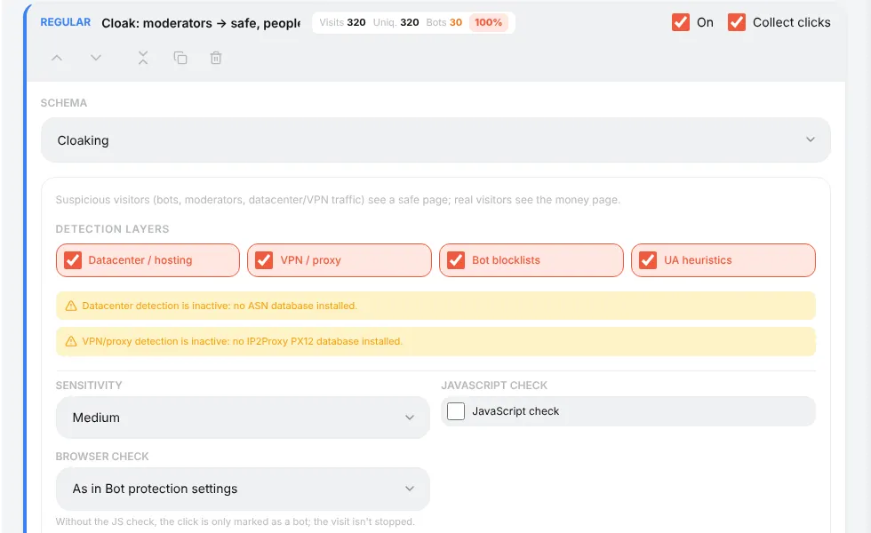
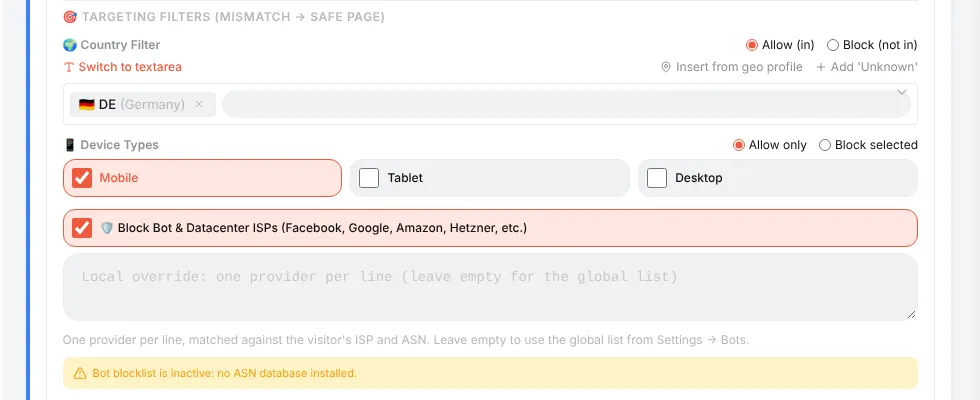
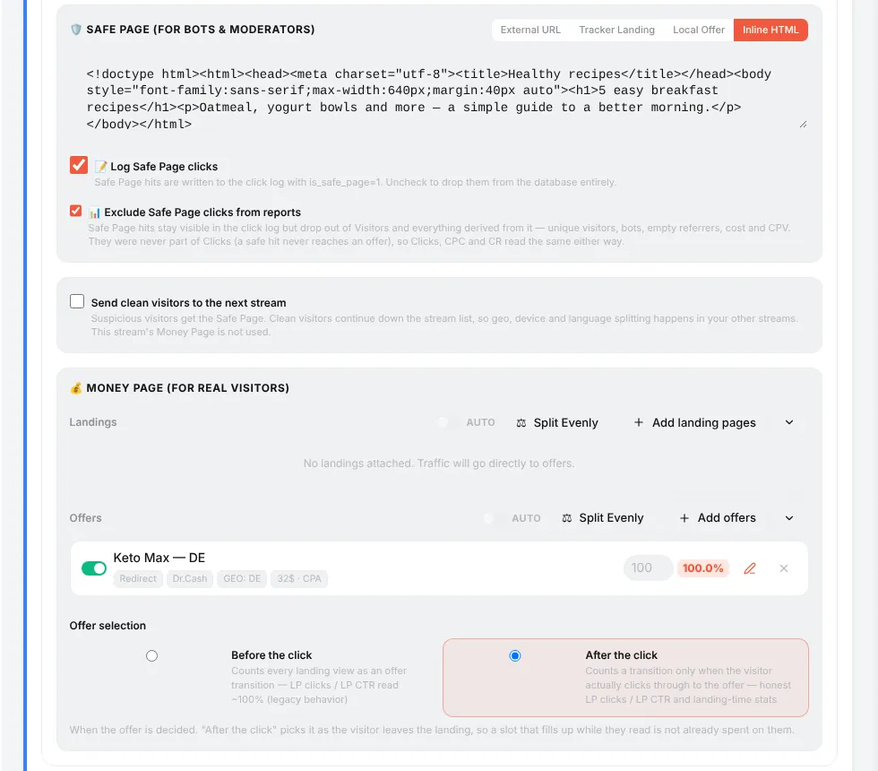
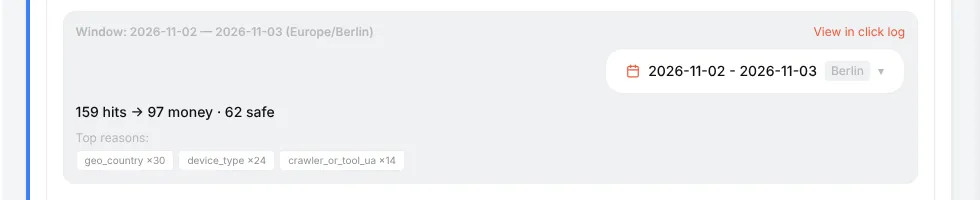
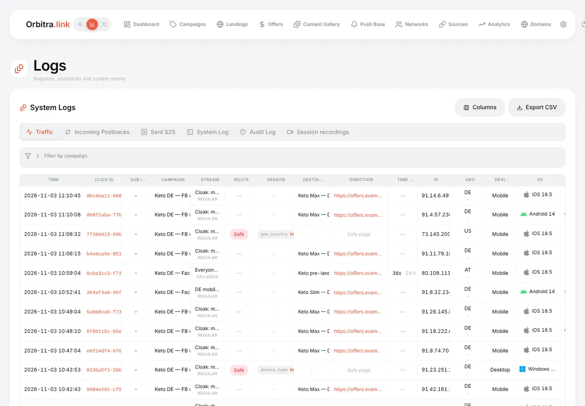

# Cloaking for beginners

## What cloaking is

Ad networks review your ads: a moderator or a bot opens the link and checks the page. **Cloaking** shows different pages to different visitors:

- **safe page** (white page) — a neutral page for bots, moderators, data-center and VPN traffic;
- **money page** — your real landing and offer for real people.

In Orbitra cloaking is a stream schema called **Cloaking**. One module makes the decision in all entry points (the campaign link, `click.php`, the Click API).

> Cloaking violates the rules of most ad platforms and can lead to account and domain bans. You are responsible for how you use it. The same tool is also used honestly — for example, to keep scrapers and bots off a landing.

## How Orbitra decides

Every visitor goes through two kinds of checks:

1. **Detection layers** — signals that the visitor is not a regular person:

| Layer | What it catches | Needs |
|---|---|---|
| **Datacenter / hosting** | Visitors from servers and clouds (Amazon, Google Cloud, Hetzner…) — typical for review bots | ASN database |
| **VPN / proxy** | VPN, proxy and Tor exits | IP2Proxy PX12 database |
| **Bot blocklists** | IPs and User-Agents from **⚙ → Settings → Bots** | — |
| **UA heuristics** | Crawlers and tools (`facebookexternalhit`, `curl`, headless browsers), an empty User-Agent, no browser language | — |

2. **Targeting filters** — your audience. A visitor who is not in it gets the safe page: wrong **country**, wrong **device type**, or an ISP from the **bot & datacenter ISP list**.

**Sensitivity** sets how many signals are needed: *Low* — only a hard signal (a blocklist hit); *Medium* (default) — a hard signal or two soft ones; *High* — any single signal.

**JavaScript check** (off by default) adds one more step: the visitor first gets a tiny loading page, and only a browser that runs JavaScript moves on to the money page. Bots that do not run JS stay on the safe page. The price is one extra hop for everyone.

## How to set it up

1. Install the geo databases first. Without them the country filter sees everyone as *Unknown* and sends **100% of traffic to the safe page**. The cloak card warns about missing databases. → [Geo databases](guide-geo-databases.md)
2. Open the campaign → **Create Stream → Regular** → schema **Cloaking**.

3. Keep all four detection layers on and sensitivity **Medium** to start.
4. **Targeting filters**: country (Allow `DE`), device types (only *Mobile* if you buy mobile traffic), leave *Block Bot & Datacenter ISPs* on.

5. **Safe page** — choose what moderators see: an *External URL*, one of your *Tracker Landings*, a *Local Offer*, or *Inline HTML*. Make it a believable, rule-abiding page on the same topic.
6. **Money page** — exactly like the *Landing + Offer* schema: add landings and/or offers.

7. Save, then test with the test link: open it from your phone in the target country — you should get the offer; open it from a desktop or with `&_geo=US` — you should get the safe page.

### The two report switches

- **Log Safe Page clicks** (on) — safe page hits are written to the click log, marked as safe. Turn it off and they are not stored at all (a counter still remembers how many there were).
- **Exclude Safe Page clicks from reports** (on) — safe hits stay in the click log but do not count in your campaign numbers, so moderators and bots do not dilute CR and cost per click.

### "Send clean visitors to the next stream"

Tick it to use the cloak only as a gate: suspicious visitors get the safe page, clean visitors continue to your normal streams (by country, device…). Then the cloak stream must be **intercepting** (or first) so that every visitor passes through it.

## A human check before the stream: Bot Challenge

Separate from cloaking, every campaign has a **Bot Challenge** on its **General** tab: before any stream is chosen, the visitor passes Cloudflare Turnstile, reCAPTCHA v2 / v3 or your own widget, and the click is written only after a successful check. It is meant for traffic where bots click every link — email above all, where corporate security gateways open every URL. For paid social traffic it costs real visitors, so leave it off there.

## Reading the results

The cloak card shows the hits for the chosen period — how many went to money and how many to safe — and the top reasons.

In **⚙ → Logs → Traffic** the *Route* and *Reason* columns appear automatically: `geo_country:US`, `device_type:Desktop`, `crawler_or_tool_ua:facebookexternalhit`…

## Common problems

| Problem | Fix |
|---|---|
| All traffic goes to the safe page | Geo database missing (reason `geo_unknown`), or the country/device list is too narrow |
| Real mobile users get the safe page with reason `ip2proxy_vpn_proxy` | Many mobile carriers look like proxies — turn off the VPN/proxy layer |
| Moderators still reach the offer | Raise sensitivity, turn on the JavaScript check, add the browser check (**⚙ → Settings → Bots**) |
| The ad dashboard shows clicks, the tracker shows zero | *Log Safe Page clicks* is off, or everything is on the safe page |

Deeper reading: [Cloaking](cloaking.md), [How the cloaker works](cloak-how-it-works.md), [Browser check](browser-check.md).
