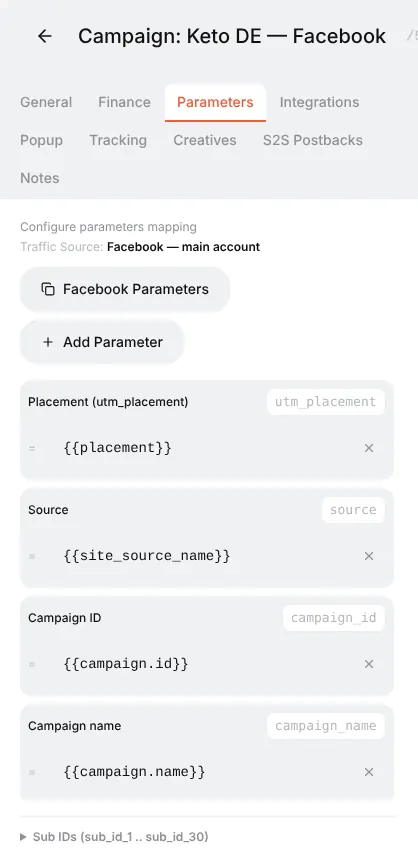
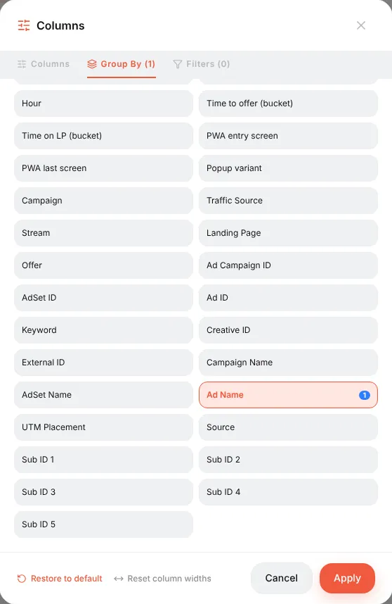
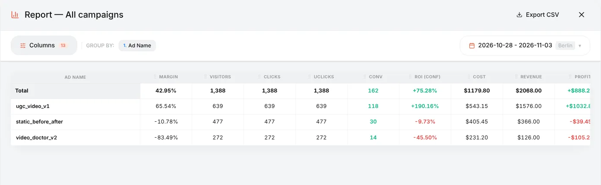
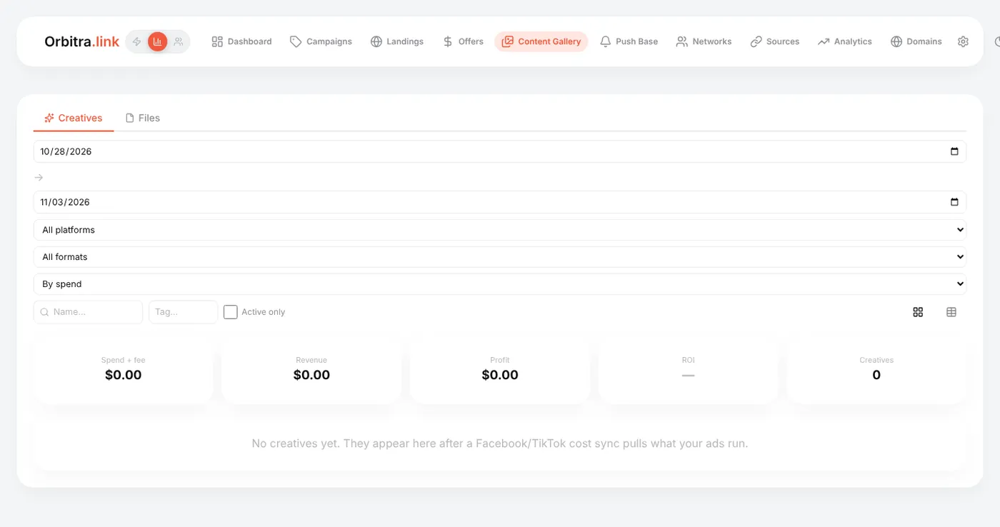

# Creatives: tracking them and testing them in one campaign

## What a creative is

A **creative** is the ad itself: the video, picture and text people see in Facebook, TikTok or a push network. It decides how many people click and who they are, so in practice it often matters more than the landing. The tracker's job is to tell you **which creative brings money**, not just clicks.

The idea is simple: every click carries the ID or name of the ad it came from, and reports can be grouped by it.

## Step 1. Pass the ad into the campaign link

This is done by the **traffic source**. The **Facebook Ads** template already adds Facebook's macros to the campaign link:

| Link parameter | Facebook macro | Becomes |
|---|---|---|
| `campaign_id`, `campaign_name` | `{{campaign.id}}`, `{{campaign.name}}` | The ad campaign |
| `adset_id`, `adset_name` | `{{adset.id}}`, `{{adset.name}}` | The ad set |
| `ad_id`, `ad_name` | `{{ad.id}}`, `{{ad.name}}` | **The ad = the creative** |
| `utm_placement` | `{{placement}}` | Feed, Stories, Reels… |

TikTok, Google and other templates do the same with their own macros. You can check and edit them on the campaign's **Parameters** tab.



Two rules:

1. Put the **whole campaign URL** with the macros into the ad. The platform replaces `{{ad.name}}` with the real name on every click.
2. **Name your ads after the creative**: `ugc_video_v1`, `static_before_after`, `video_doctor_v2`. Then reports are readable without looking up IDs.

## Step 2. Test several creatives in one campaign

You do not need a separate tracker campaign for every creative. The usual setup:

```
Facebook campaign "Keto DE"
  └─ Ad set "DE 25-55 F"  (one audience, one budget)
       ├─ Ad "ugc_video_v1"         ─┐
       ├─ Ad "static_before_after"   ├─ all three use the SAME Orbitra campaign link
       └─ Ad "video_doctor_v2"      ─┘
```

All ads point to the same Orbitra campaign link. Orbitra routes them the same way (same streams, same offers), and the only difference between the clicks is the `ad_name` they carry. That is exactly what you want for a fair test: one variable at a time.

Let it run until each creative has meaningful data — as a rule of thumb at least 20–30 conversions per creative, or a spend of 2–3 target CPAs each, before you judge.

## Step 3. Compare them in the report

**Campaigns → Report** (or the report icon on a campaign row) → **Columns** → **Group By** → remove *Country* → choose **Ad Name** → **Apply**.





How to read this example:

| Creative | Clicks | Conv | CR | ROI | Verdict |
|---|---|---|---|---|---|
| `ugc_video_v1` | 639 | 118 | 18.5% | +190% | The winner — scale it |
| `static_before_after` | 477 | 30 | 6.3% | −10% | Slightly negative — try a new version |
| `video_doctor_v2` | 272 | 14 | 5.1% | −46% | Losing money — switch off |

Look at **ROI (conf)** and **CPA** first: a creative can have a great click-through on Facebook and still bring visitors who never buy. Add **Approve %** for COD offers — some creatives bring leads that are later rejected.

You can stack groupings: *Ad Name → Country* or *Ad Name → Device* shows where each creative works. The preset **Facebook Hierarchy** builds Campaign → Ad set → Ad in one click.

> Want to test creatives against **different landings**? Use a URL Parameter filter: stream 1 takes `ad_name = ugc_video_v1` to landing A, stream 2 takes the rest to landing B. See [Stream filters](guide-filters.md).

## The Creatives library (with cost import)

When Facebook or TikTok **cost import** is connected (**⚙ → Integrations**, see [Costs](costs.md)), Orbitra goes further: it downloads the actual images and videos of your ads and shows each creative with its spend, revenue and ROI.

- **Content Gallery → Creatives** — every creative across all campaigns, with filters (period, platform, format, tags) and a card per creative: daily spend and ROI, the ads that ran it, the ad text.
- **Campaign editor → Creatives** tab — what brought traffic into this campaign over the last 7 days.
- Creatives you upload yourself as drafts are linked automatically when the same picture starts running in an ad.
- The Telegram daily digest can list the best and worst creatives and warn when a creative "burns out".



Without cost import the library stays empty — the report grouping above works anyway.

Reference: [Creatives library](creatives-library.md), [Reports](reports.md).
