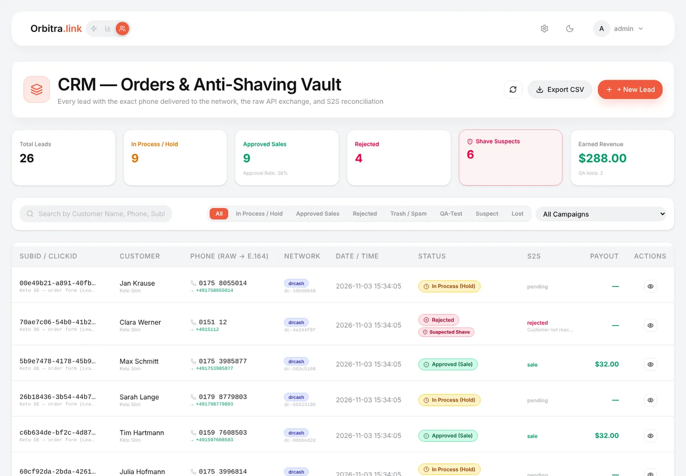
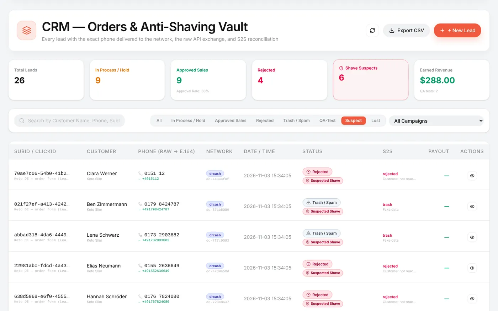
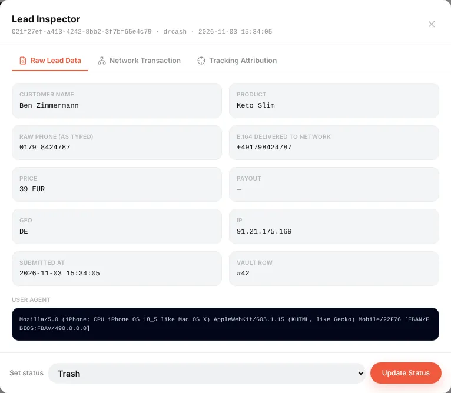
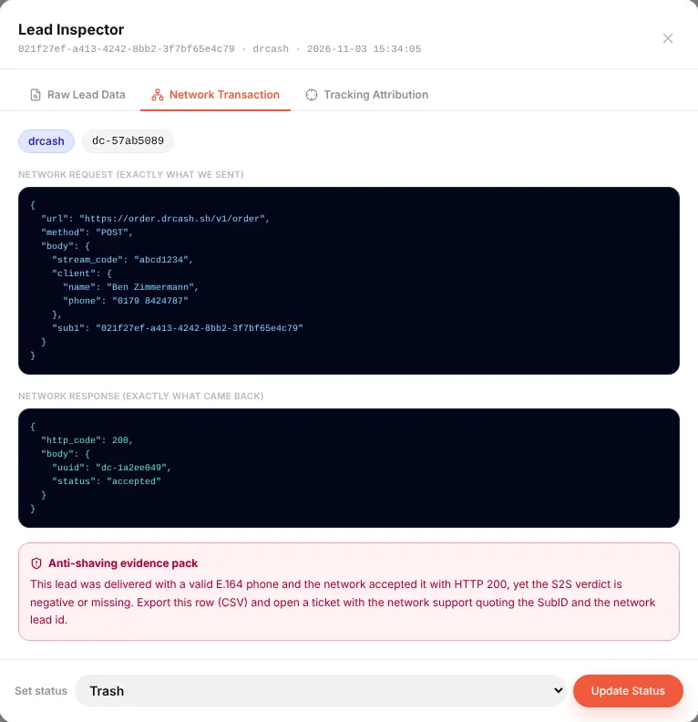

# CRM: every lead, and proof when the network "shaves" it

## What it is

The tracker counts conversions; the **CRM** keeps the **leads themselves** — who ordered, the phone exactly as typed and exactly as sent to the network, what the network answered, and what status it reported later. It is built for form offers (COD nutra, e-commerce, finance) where you send leads to the network through [LeadForge](guide-leadforge.md) or your own form.

Two everyday questions it answers:

- *"What happened to this order?"* — find it by name, phone or click ID and see the whole history.
- *"Is the network cutting my leads?"* — a lead that the network accepted with HTTP 200, with a valid phone, and later marked *rejected* or *trash* is flagged as a **shave suspect**, with an evidence pack you can send to support.

The CRM opens with the **people icon** in the top-left switcher (*LeadForge · Tracker · CRM*).

## Where the leads come from

- **LeadForge landings** — with *CRM sync* on (the default), the generated `order.php` writes every submitted lead to the CRM while sending it to the network.
- **Your own forms or landings on other hosting** — they can post leads to the public `https://your-domain/crm-ingest` endpoint. Protect it with an HMAC secret on the CRM page: once a secret is saved, every request must carry an `X-Orbitra-Signature` header (`hash_hmac('sha256', body, secret)`).
- **By hand** — **+ New Lead** (for phone orders, for example).

Each lead is tied to its **click**, so it also counts as a conversion in the tracker reports, with campaign, ad and creative attribution.

## The lead list

At the top: total leads, in process (hold), approved sales with the approval rate, rejected, **shave suspects** and earned revenue.

The tabs filter the list:

| Tab | Shows |
|---|---|
| **All**, **In Process / Hold**, **Approved Sales**, **Rejected**, **Trash / Spam** | By status |
| **QA-Test** | Test leads sent by LeadForge's Auto QA (never counted in statistics) |
| **Suspect** | Shave suspects — see below |
| **Lost** | The network accepted the lead (HTTP 200), but no postback came within 24 hours |

Each row: click ID, campaign, customer and product, phone **raw → E.164** (the international format actually delivered), network and the network's lead ID, time, status, the S2S verdict and payout. Search works by name, phone, SubID or click ID; **Export CSV** downloads the current filter.

Badges on a row:

- **Suspected Shave** — rejected or trashed although the phone was a valid E.164 number and the network had answered 200;
- **Missing Network ACK** — accepted, but no status postback for 24 hours;
- **Duplicate** — the same phone on the same network within 30 days.

## The lead inspector

The eye icon opens the **Lead Inspector** with three tabs:

- **Raw Lead Data** — name, product, the phone as typed and the E.164 phone sent, price, payout, GEO, IP, submission time, User-Agent.

- **Network Transaction** — the request exactly as it was sent to the network and the response exactly as it came back. For a suspect lead, the **anti-shaving evidence pack** explains what to send to the network's support.

- **Tracking Attribution** — the click's sub parameters: campaign, ad set, ad, placement — what brought this customer.

At the bottom, **Set status** changes the status by hand (for example after a call with the network's manager). A manual status is marked as manual; a later postback from the network replaces it with the network's verdict.

## How statuses get updated

The network reports its verdict by **postback** (see [Postbacks](guide-postbacks.md)). When a postback arrives for the lead's click, Orbitra updates the conversion in the tracker **and** the CRM lead: status, payout and reason. That is also the moment the shave check runs.

So for the CRM to be useful, set up the network's postback with all statuses — lead, approved, rejected, trash.

## Handling a shave suspect

1. Open the **Suspect** tab.
2. Check the leads: valid phone, HTTP 200 from the network, then *rejected / trash*.
3. Export them to CSV (or copy SubIDs and the network lead IDs from the inspector).
4. Open a ticket with the network's support quoting the SubIDs, network lead IDs, the phones and the times. The request and response from the inspector show that the lead was delivered correctly.

The **Lost** tab is the second thing to check with the manager: leads the network took but never reported on.

> A badge is a reason to look, not a verdict: customers really do give wrong numbers, and a call center really does reject leads. Look for patterns — a share of suspects much higher than usual, or a sudden jump.

Reference: [Landing pages → LeadForge](landing-pages.md#leadforge-20-landing-analyzer-js-validation--multi-network-bridge), [REST API](api.md) (`crm_leads`, `crm_lead`, `crm_lead_update`, `/crm-ingest`).
