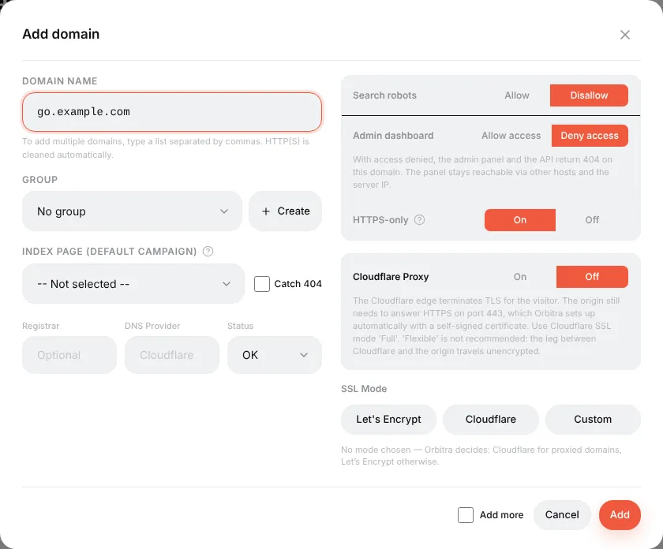
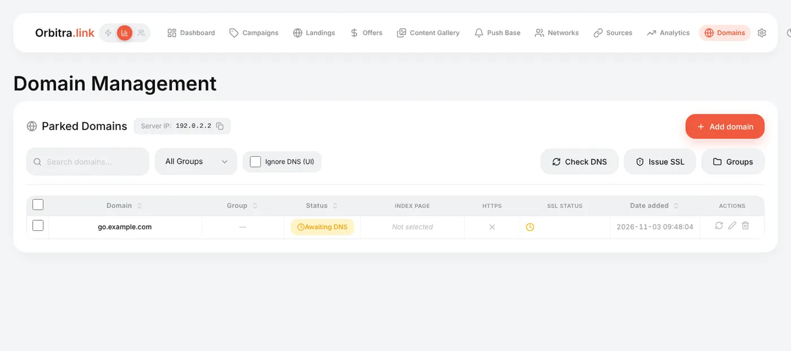

# Connecting a domain

## What it is

A domain is the address your campaign links live on: `https://go.example.com/5i5pvic4`. The tracker works without one (by the server IP), but:

- ad networks and messengers trust a domain with HTTPS much more than a bare IP;
- if a domain gets flagged, you replace the domain and keep the campaigns;
- each domain can have its own settings: hide the admin panel, open a campaign on the root, catch 404s.

You can park as many domains on one tracker as you like. Every campaign picks one of them.

## How to connect a domain

### 1. Buy a domain

Any registrar works. If you use **Cloudflare**, **Namecheap** or **Dynadot**, connect the account under **⚙ → Integrations** first — then Orbitra writes the DNS record for you and you can skip step 3.

### 2. Add it in the panel

**Domains → Add domain**. Type the domain (`go.example.com`) or several at once separated by commas — `https://` and slashes are cleaned automatically. Press **Add**.

The defaults are safe for a tracking domain, so for the first domain you can leave everything as is. What the switches mean:

| Setting | What it does | Typical value |
|---|---|---|
| **Group** | Just for sorting the list | — |
| **Index page** | The campaign shown when someone opens the domain without a path (`https://go.example.com/`) | Usually empty |
| **Catch 404** | Unknown paths also open the Index page campaign instead of a 404 | Off |
| **Search robots** | *Disallow* adds `noindex` and a `robots.txt` that closes the site | Disallow |
| **Admin dashboard** | *Deny access* makes the panel and API answer 404 on this domain. Tracking keeps working, the panel stays reachable on other domains and by IP | Deny for tracking domains |
| **HTTPS-only** | Redirects `http://` to `https://` | On |
| **Cloudflare Proxy** | Turn on only if the domain is proxied by Cloudflare (orange cloud) | Off |
| **SSL Mode** | Leave unselected: Orbitra picks Let's Encrypt, or Cloudflare for proxied domains | — |

### 3. Point the domain to the server

At your DNS provider, create an **A record**:

| Type | Name | Value |
|---|---|---|
| A | `go` (or `@` for the root domain) | the server IP shown at the top of the Domains page |

### 4. Wait for the certificate

Orbitra checks DNS by itself and, as soon as the A record points to the server, issues a free Let's Encrypt certificate (a background job runs every 5 minutes; **Issue SSL** starts it right away). The **SSL status** column tells you what it is waiting for — usually "the domain does not point at the server yet", which fixes itself once DNS propagates (minutes to a few hours).

### 5. Use it in a campaign

Open a campaign → **General** → **Domain**. The campaign URL changes to the new domain immediately. Moving many campaigns at once: select them in the campaign list and use the bulk action.

## Tips

- **Keep the panel on a separate domain.** Use one domain for the panel (`track.example.com`, admin access allowed) and other domains for campaigns (admin access denied). A moderator who opens your campaign domain never sees a login page.
- **Cloudflare:** if the domain is proxied (orange cloud), switch **Cloudflare Proxy** on. Orbitra puts a self-signed certificate on the server for Cloudflare's *Full* mode. For *Full (strict)* see [Cloudflare Full Strict SSL](CLOUDFLARE_FULL_STRICT_SSL.md).
- **The domain shows "Disabled"** — someone set its status to Disabled; such a domain answers 404 to everything, tracking included.
- **Need a PWA on the root of a domain?** Bind the domain to the PWA landing: see [PWA apps](guide-pwa.md#a-clean-domain-for-the-app).

Reference: [Domains and SSL](domains.md), [Cloudflare](cloudflare.md).
