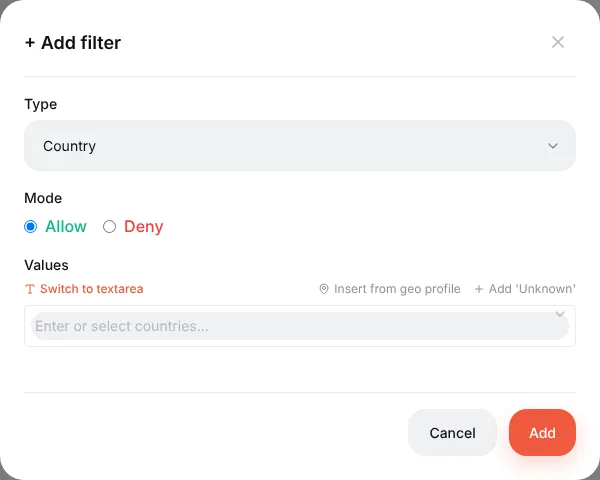
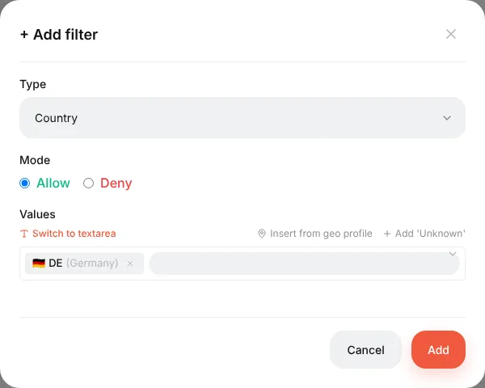
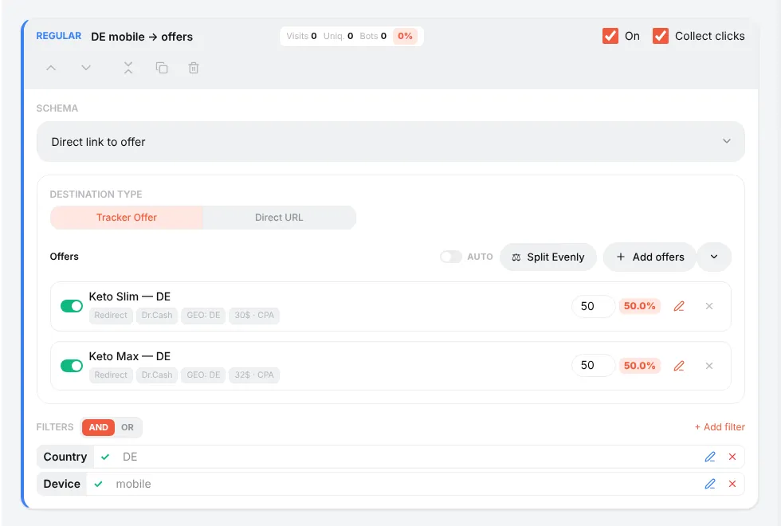
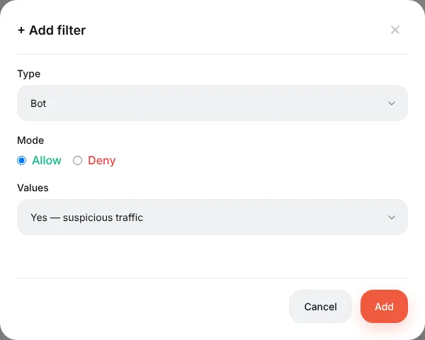

# Stream filters

## What filters do

Filters decide **which visitors a stream takes**. A stream without filters takes everyone; a stream with *Country = DE* takes only Germans. Filters are added on the stream card with **+ Add filter**.

Every filter has:

- **Type** — what is checked (country, device…);
- **Mode** — **Allow** (the stream takes visitors who match) or **Deny** (the stream takes everyone *except* those who match);
- **Values** — one or several; any of them is enough.

## Filter types

| Filter | Checks | Example |
|---|---|---|
| **Country** | The visitor's country from the geo database | Allow `DE, AT, CH` |
| **Device** | Mobile / Desktop / Tablet | Allow `Mobile` |
| **Operating System** | iOS, Android, Windows, macOS… | Allow `iOS` |
| **Browser** | Chrome, Safari… and in-app browsers (Facebook, Instagram, TikTok, Telegram, WebView) | Deny `Facebook` to catch in-app traffic separately |
| **Bot** | The bot detector (crawlers, tools, missing headers) | Allow `yes` on an intercepting stream → 404 |
| **Browser Language** | The `Accept-Language` header. `en` = any English, `en-IN` = only India | Allow `de` |
| **ISP Provider** | The visitor's provider / ASN (needs the ASN database) | Deny `Amazon, Google, Hetzner` |
| **Connection Type** | From the geo database | — |
| **IP Address** | Single IPs and ranges (`1.2.3.0/24`), IPv4 and IPv6 | Allow your office IP for a test stream |
| **Keyword** | The `keyword` parameter of the click | — |
| **URL Parameter** | Any parameter of the campaign link, by name; `*` is a wildcard, *Empty* means missing | `utm_placement = Instagram_Stories` |
| **Referrer** | Where the visitor came from | — |
| **Day of Week**, **Time** | The visitor's local time (time zone from the geo database) | Only 9:00–21:00 |

The country picker also has **Insert from geo profile** (ready sets like EU or CIS, editable under **⚙ → Geo profiles**) and **Add 'Unknown'** for visitors whose country could not be determined.

## Several filters: AND / OR

When a stream has more than one filter, the **AND / OR** switch above the list decides how they combine:

- **AND** — all filters must match (Germany **and** mobile);
- **OR** — one is enough (country = DE **or** browser language = de).

A filter that cannot decide (no geo database, no ISP data) does not vote: under AND it does not block the stream, under OR it does not open it. That is why a country filter "does nothing" until a [geo database](guide-geo-databases.md) is installed.

## Recipes

**Send each country to its own offer.** Regular streams "DE → offer DE", "AT → offer AT", "CH → offer CH", plus a fallback for everyone else.

**Bots away from the offer.** Intercepting stream, filter *Bot* (Allow, yes), schema *Action → Show 404*.

**Only mobile traffic to the offer.** Regular stream with *Device = Mobile*; desktop falls to the fallback.

**Different landing per placement.** Facebook's `{{placement}}` arrives as `utm_placement`. Stream 1: *URL Parameter* `utm_placement` = `Instagram_Stories` → a vertical landing. Stream 2: everything else.

**Hide from TikTok moderation.** Add `xxx=__PLACEMENT__` to the campaign link in TikTok. Intercepting stream with a white page and the filter *URL Parameter* `xxx` = `__PLACEMENT__` or *Empty*. In a real click TikTok replaces the macro; a moderator who opens the bare link arrives without it.

**Test stream only for you.** Intercepting stream with *IP Address = your IP* → whatever you are testing. Nobody else ever hits it.

## Checking

Use the test link with `&_dbg=1`: the trace shows every filter's vote — *match*, *no-match*, or *abstained* with the reason. See [Streams](guide-streams.md#checking-the-routing).

Reference: [Campaigns and streams → Filters](campaigns.md#filters).
