# Your first campaign, step by step

This guide takes you from a freshly installed tracker to a working campaign link and a test conversion. It uses one realistic example all the way through:

- you promote a **keto diet offer in Germany** from the affiliate network **Dr.Cash**;
- the traffic comes from **Facebook**;
- German mobile visitors go straight to the offer, bots get a 404, everyone else sees a short pre-landing.

Each step takes a few minutes. Install the tracker first: [Installation and updates](deployment.md).

## Step 1. Create the administrator

Open `http://<your-server-ip>/admin.php`. On the first visit Orbitra starts a three-step wizard: create the admin user (login of at least 3 characters, password of at least 8), then pick your time zone and interface language.

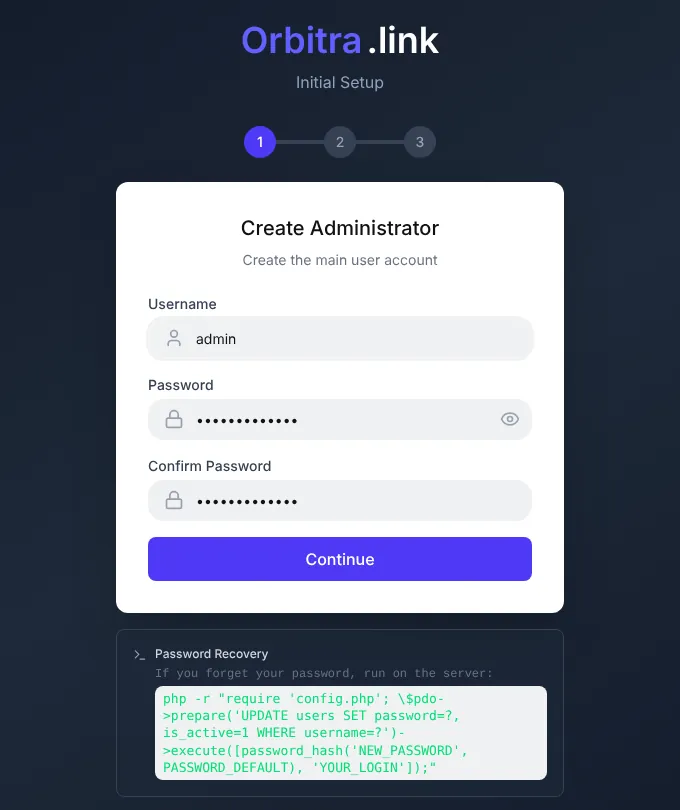

> The time zone matters: "today" and "yesterday" in every report are counted in it. You can change it later under **⚙ → Users → Profile**.

## Step 2. Install a geo database

On the dashboard you will see a yellow banner "No geo database installed". Press **Install Sypex Geo (free)**. Without a geo database the tracker cannot tell which country a visitor is from, so country filters and country cloaking will not work.

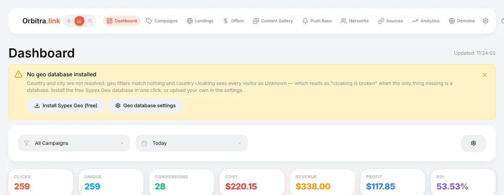

Sypex is enough to start. For better cloaking add the free MaxMind and IP2Location databases later — see [Geo databases](guide-geo-databases.md).

## Step 3. Change the postback key

Open **⚙ → Postback URL**. If you see the warning "Your postback key is the public default", replace the key: type any random string of letters and digits into **Postback Key** (or generate one on the server with `php cli/generate_postback_key.php`) and press **Save settings**.

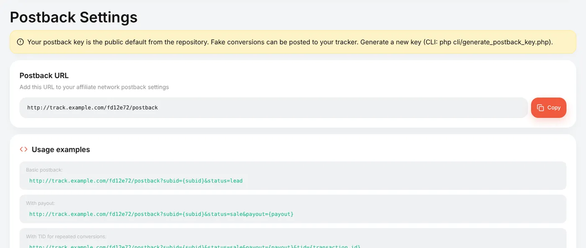

The key is part of the address networks send conversions to. With the public default anyone could post fake conversions to your tracker. Do this **before** you add affiliate networks: a network saves the postback URL with the key that was current when you created it, so after a later change you would have to fix the URL in every network and in every network dashboard.

## Step 4. Add a domain

Campaign links look much better (and survive ad reviews longer) on your own domain than on a bare IP.

1. **Domains → Add domain**, type the domain, e.g. `go.example.com`, press **Add**.
2. At your registrar or DNS provider, create an **A record** for that domain pointing to the server IP shown at the top of the Domains page.
3. Wait: Orbitra checks DNS and issues a free Let's Encrypt certificate by itself.

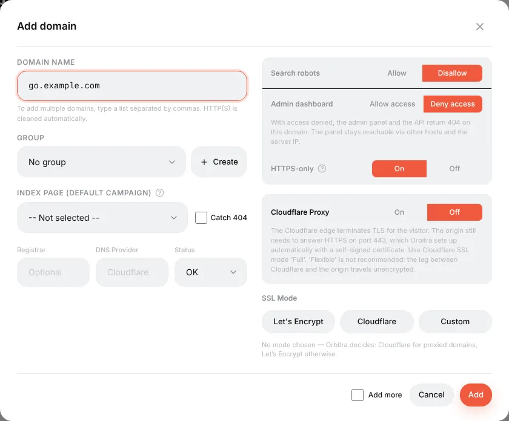

Details, Cloudflare and the meaning of every switch: [Connecting a domain](guide-domains.md).

## Step 5. Add the affiliate network

**Networks → Create**, choose your network in **Template** (about 440 networks are listed; pick **Generic** if yours is missing) and give it a name.

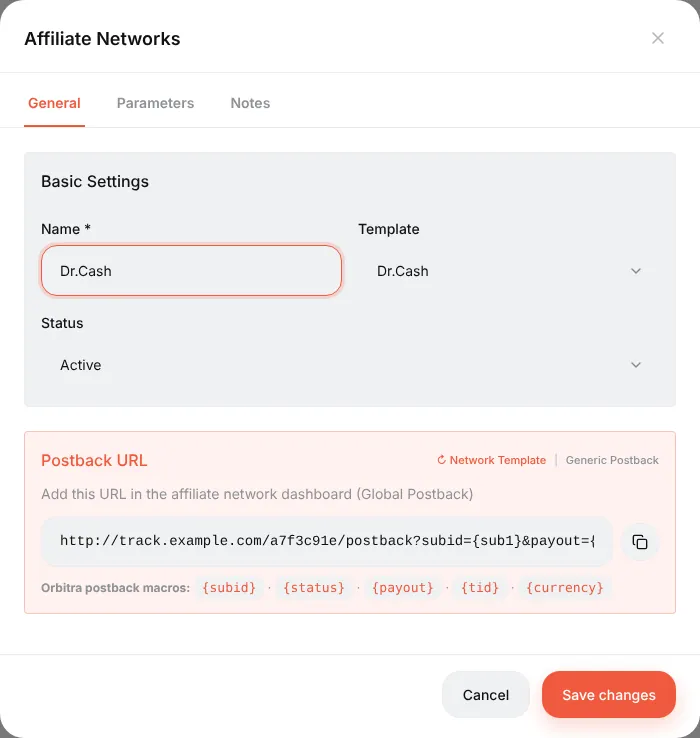

The template fills in two important things:

- **Postback URL** — the address you will give to the network (step 10);
- **Parameters** tab — what Orbitra adds to every offer link of this network. For Dr.Cash it is `&sub1={subid}`: the click ID travels to the network in `sub1`, and the network sends it back in the postback.

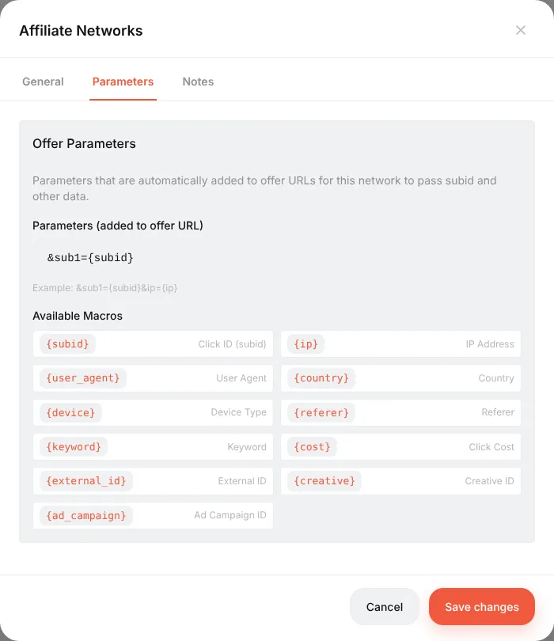

## Step 6. Add the offer

**Offers → Create**:

- **Name** — anything you will recognise, e.g. `Keto Slim — DE`;
- **Affiliate Network** — the one from step 5;
- **Redirect Type** — leave **Redirect** and **HTTP Redirect (302)**;
- **URL** — the tracking link from the network's dashboard (without any `sub1=` part: the network parameters are added automatically).

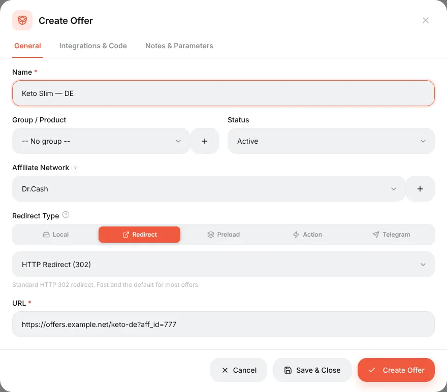

On the **Notes & Parameters** tab set the country and the payout (e.g. CPA, 30). The payout is only used as a default; the real amount arrives in the postback.

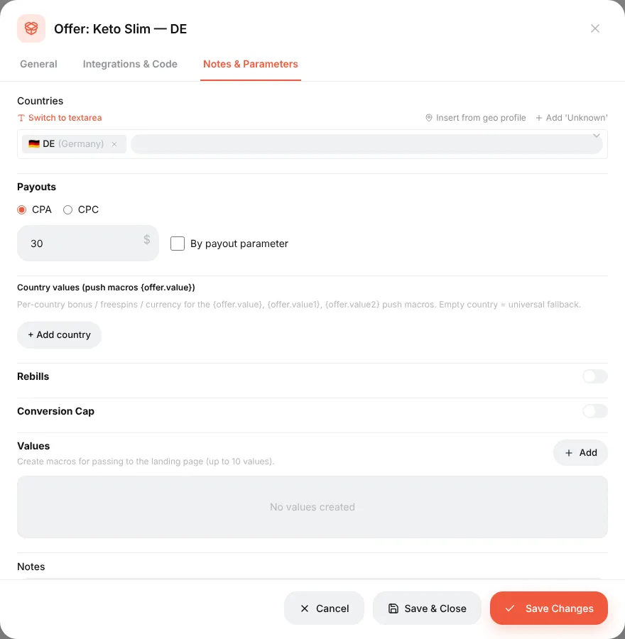

Create a second offer the same way if you want to split traffic between two offers. More: [Offers and affiliate networks](guide-offers-networks.md).

## Step 7. Add the traffic source

**Sources → Create**, choose **Facebook Ads** in **Source Template**, name it after your ad account.

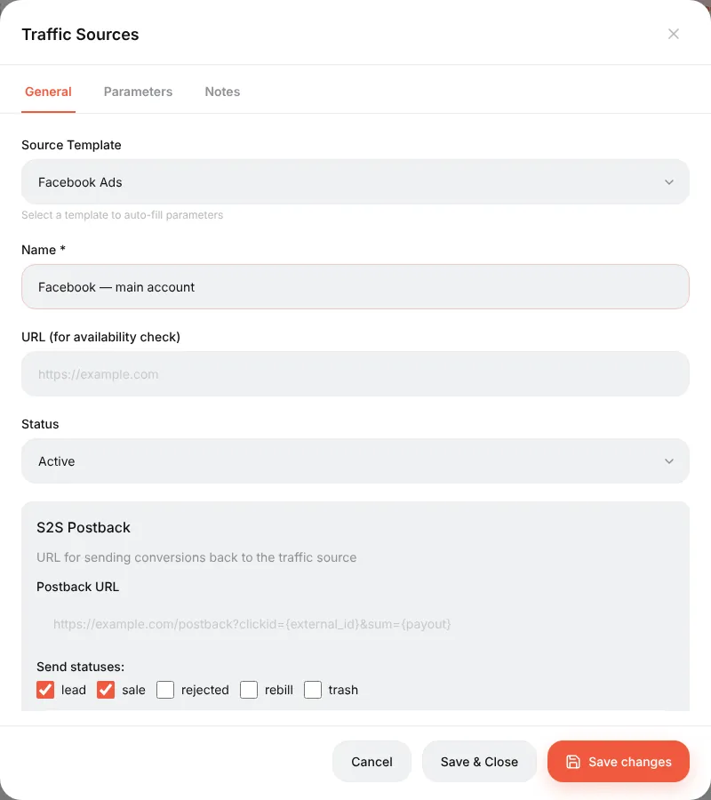

The **Parameters** tab now holds Facebook macros like `{{ad.id}}` and `{{ad.name}}`. They will be added to the campaign link automatically, and Facebook replaces them with real IDs on every click. That is how reports can later show results per campaign, ad set and ad.

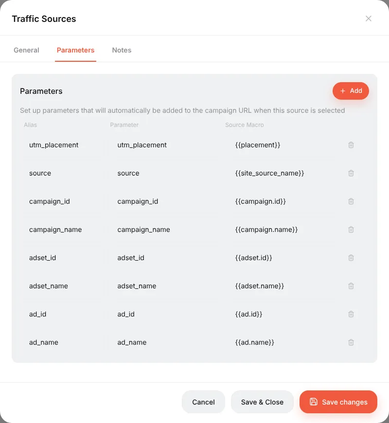

## Step 8. Create the campaign

**Campaigns → Create**. The editor has settings on the left and streams on the right.

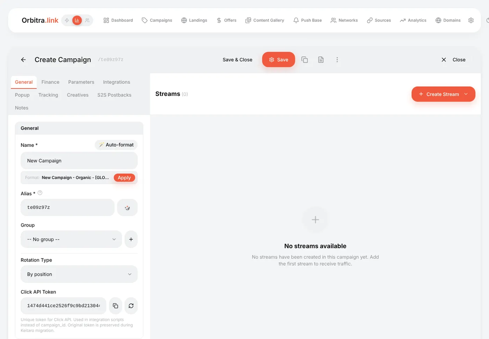

On the **General** tab:

- **Name** — `Keto DE — Facebook`;
- **Domain** — `go.example.com`;
- **Traffic Source** — the Facebook source from step 7.

Now add the main stream: **Create Stream → Regular**. Leave the schema **Direct link to offer**, press **Add offers** and tick the offer(s).

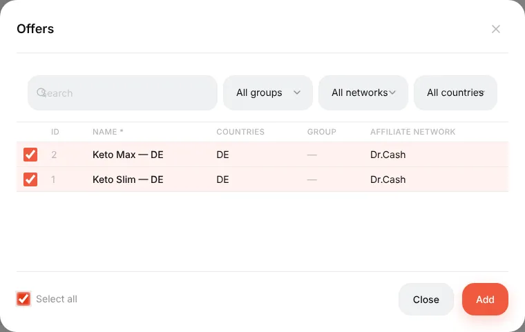

Then **+ Add filter → Country → Germany** and **+ Add filter → Device → Mobile**, so this stream only takes German mobile visitors.

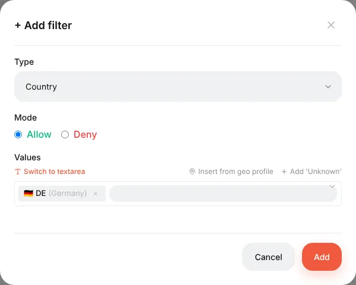

Press **Save**. The stream card now shows the offers with their split (50% / 50%) and the filters.

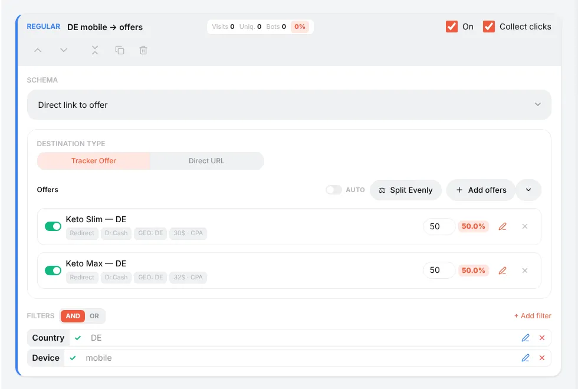

> **What about everyone else?** A visitor who matches no stream gets nothing. Add a **Fallback** stream (no filters) that sends them to a landing or another offer, and, if you like, an **Intercepting** stream with the **Bot** filter and the action **Show 404**. How streams are ordered and chosen is explained in [Streams](guide-streams.md).

## Step 9. Check the link before spending money

Scroll the **General** tab down. You will find:

- **Campaign URL** — the link for your ad. With a source selected it already contains the source's macros (`?utm_placement={{placement}}&ad_id={{ad.id}}…`);
- **Test link** — the same link with a signature. It routes like a real click, but writes nothing to statistics.

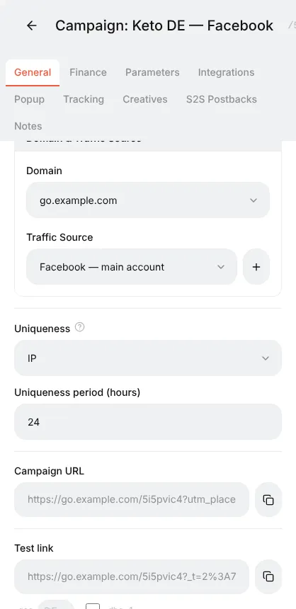

Add `&_dbg=1` to the test link and open it: instead of a redirect you get a trace — every stream, every filter's verdict, the chosen stream and the final URL with the click ID inside. Add `&_geo=DE` to pretend you are in Germany without a VPN.

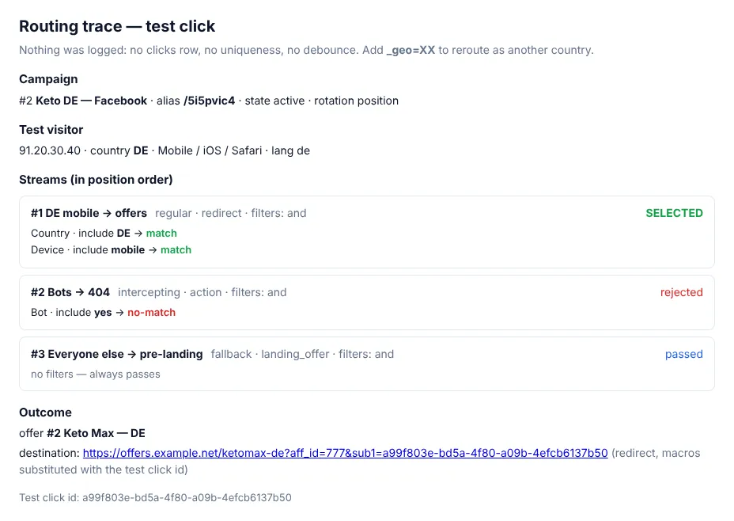

## Step 10. Give the postback URL to the network

Copy the **Postback URL** from **Networks** (the one the template built for your network) and paste it into your affiliate network dashboard as the **global postback**. Not sure where that is or what to write to your manager? See [Postbacks](guide-postbacks.md#what-to-send-your-affiliate-manager).

To check the chain without real sales: **⚙ → Postback URL → Test Postback** — paste a click ID from the click log, choose a status and press **Test**.

## Step 11. Launch and watch

Put the **Campaign URL** into your Facebook ad (the whole link, with the macros). As visitors arrive:

- **⚙ → Logs → Traffic** shows every click: time, country, device, stream, where it went;
- **⚙ → Conversions** shows every postback that arrived;
- the **Dashboard** and the **Campaigns** list show clicks, conversions, cost, revenue, profit and ROI.

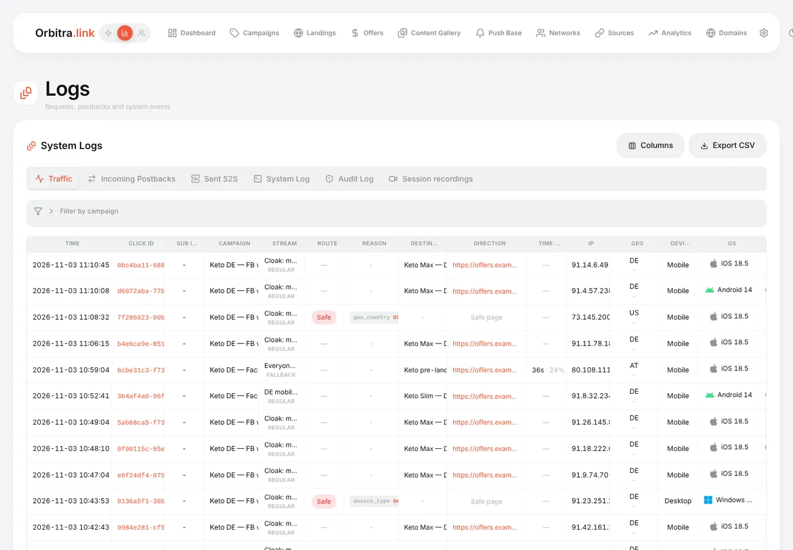

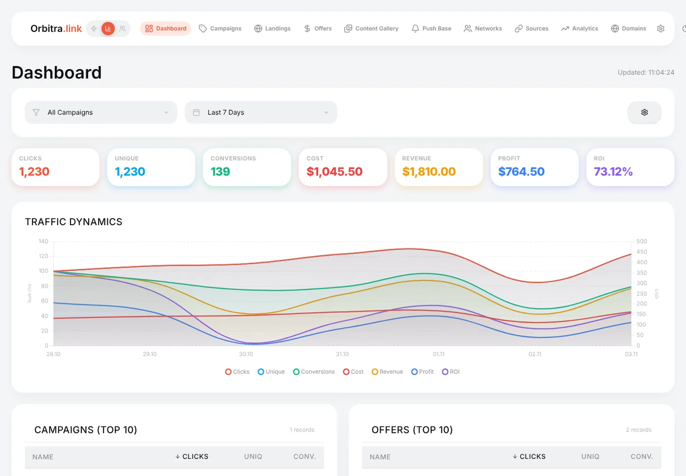

Click a click ID anywhere to open the click card — every parameter the visitor brought, the stream, the exact redirect URL.

## What next

- Set the campaign **cost** on the **Finance** tab (or connect cost import from Facebook in **⚙ → Integrations**) — without cost there is no profit or ROI. → [Costs](costs.md)
- Learn what the numbers mean: [Metrics cheat sheet](guide-metrics.md).
- Find out which ad works best: [Testing creatives in one campaign](guide-creatives.md).
- Hide the offer from moderators: [Cloaking for beginners](guide-cloaking.md).
