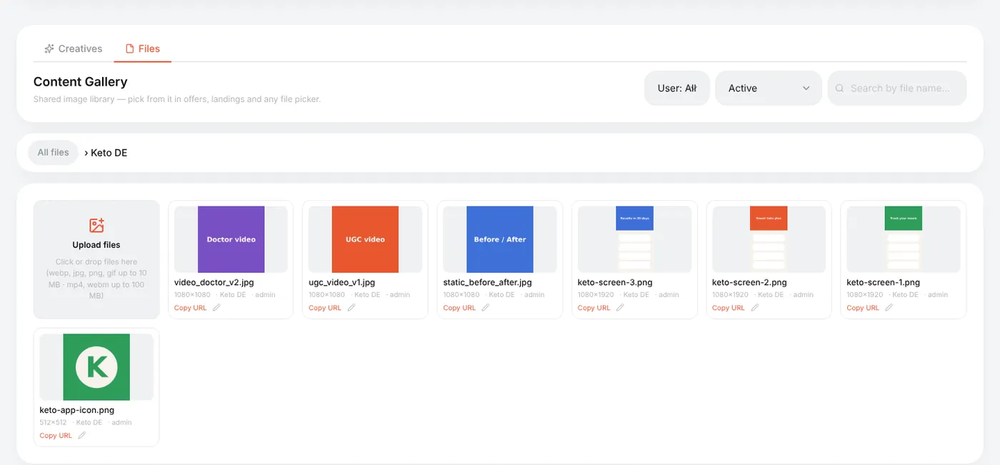
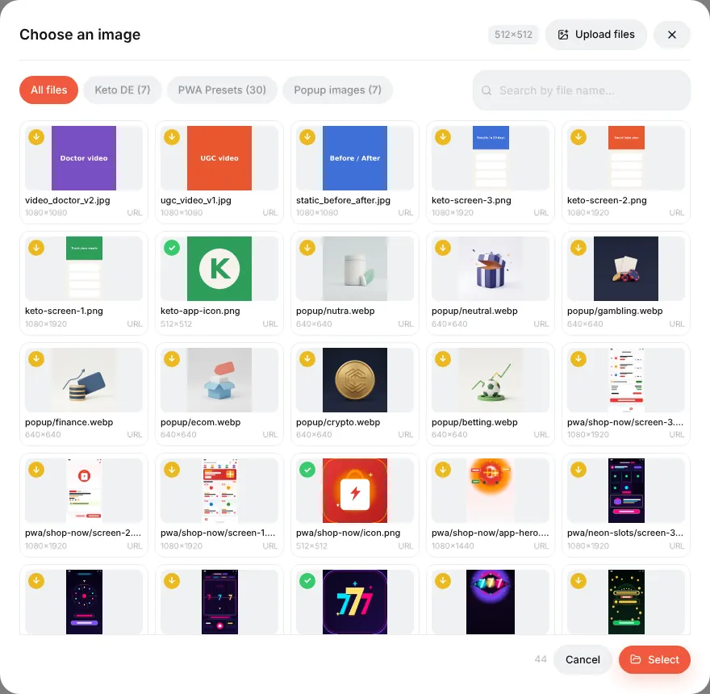

# Content Gallery

## What it is

The **Content Gallery** is the tracker's own media library — one place for all images and videos you use in the panel:

- app icons and screenshots for [PWAs](guide-pwa.md);
- images for landings, offers, popups and push notifications;
- your ad creatives (and, with Facebook/TikTok cost import connected, the creatives pulled from your ad accounts — see [Creatives](guide-creatives.md)).

Files are stored on your own server. Every image picker in the panel (the PWA icon, screenshots, popup images…) opens this library, so you upload once and reuse everywhere.

It has two tabs: **Files** (the library) and **Creatives** (performance of ad creatives).

## Uploading

**Content Gallery → Files**:

1. Optionally create a folder: **New folder** — e.g. one per offer or per GEO.
2. Open the folder and drop files on **Upload files** (or click it).

| What | Limit |
|---|---|
| Images | webp, jpg, png, gif — up to 10 MB |
| Video | mp4, webm — up to 100 MB |
| SVG | not allowed (it can carry scripts) |

The tracker checks the real file type, not the extension — a renamed file is rejected.

Each tile shows the size in pixels; **Copy URL** copies a direct link (handy for push icons or an `` in a landing); the pencil renames or moves the file.

Ready-made folders — **PWA Presets** and **Popup images** — ship with the tracker and are used by the PWA presets and popup templates.

## Picking files in editors

Wherever the panel needs an image, a **Choose from gallery** button opens the picker: the same folders, search and an upload tab.

When the slot has a required size (a PWA icon must be 512×512), tiles are labelled *exact match*, *croppable* or *too small*. Picking a bigger image opens a cropper; the result is saved as a new file, and the original stays untouched.

## Deleting

Deleting is soft: the file disappears from the picker, but pages that already use it keep showing it. Switch the filter to **Inactive (deleted)** to see such files. Deleting a folder moves its files to the root.

Reference: [Content Gallery](content-gallery.md), [Creatives library](creatives-library.md).
