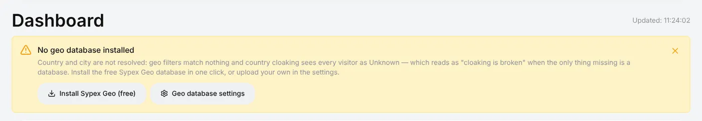
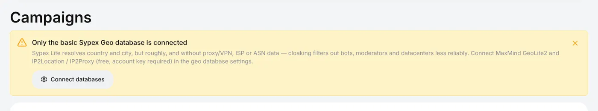
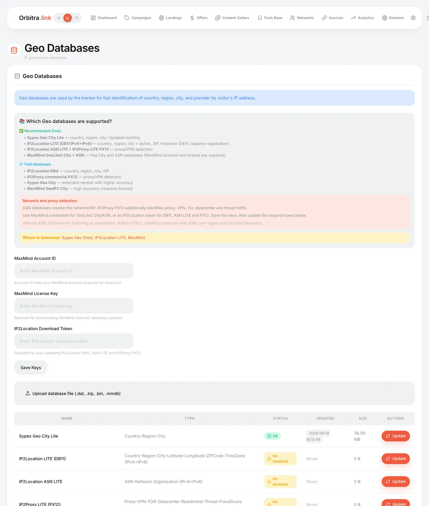

# Geo databases

## What they are and why you need them

When a visitor arrives, the tracker only sees an IP address. A **geo database** turns the IP into facts: the country, region and city, the provider (ISP) and network (ASN), whether the IP belongs to a data center, a VPN or a proxy.

Without one:

- reports show no countries;
- **country filters** in streams cannot decide and simply do not vote;
- **cloaking** sees every visitor as *Unknown* — with a country filter on, that sends **all traffic to the safe page**;
- data-center, ISP and VPN detection in cloaking is switched off.

So install a database before your first campaign. It takes a minute.

## Which databases exist

| Database | Gives | Cost | What you need |
|---|---|---|---|
| **Sypex Geo City Lite** | Country, region, city | Free | Nothing — one click |
| **MaxMind GeoLite2 City + ASN** | City, provider and ASN | Free | A free MaxMind account: Account ID + License key |
| **IP2Location LITE DB11** | Country, city, coordinates, ZIP, **time zone** | Free | A free IP2Location account: download token |
| **IP2Location ASN LITE** | Provider / network | Free | The same token |
| **IP2Proxy LITE PX12** | **VPN, proxy, Tor, data center, residential, fraud score** | Free | The same token |
| Paid versions (IP2Location DB4, IP2Proxy PX12 commercial, MaxMind GeoIP2…) | Better accuracy | Paid | Upload the file manually |

**Recommended set:** Sypex (country) + MaxMind GeoLite2 ASN (providers) + IP2Proxy PX12 (VPN/proxy). With it, every cloaking layer works.

## The banner on the dashboard

| Banner | Meaning |
|---|---|
| **No geo database installed** | Nothing is installed — install Sypex now |
| **Only the basic Sypex Geo database is connected** | Countries work, but cloaking has no provider, data-center or VPN data. Add MaxMind and IP2Location |

## How to install

### Sypex (one click)

Press **Install Sypex Geo (free)** on the banner, or **⚙ → Geo Databases → Update** in the Sypex row. The installer also does it on a fresh server.

### MaxMind GeoLite2

1. Register at [maxmind.com](https://www.maxmind.com/en/geolite2/signup) (free).
2. In your MaxMind account: **Manage License Keys → Generate new license key**. Note the **Account ID** and the key.
3. **⚙ → Geo Databases**: paste **MaxMind Account ID** and **MaxMind License Key**, press **Save Keys**.
4. Press **Update** in the GeoLite2 City and GeoLite2 ASN rows.

### IP2Location / IP2Proxy

1. Register at [lite.ip2location.com](https://lite.ip2location.com/) (free).
2. Copy the **download token** from your account.
3. Paste it into **IP2Location Download Token**, **Save Keys**, then **Update** in the DB11, ASN LITE and PX12 rows.

Each row shows **Status**, the date of the last update and the size. A database that failed to download shows the error.

### Your own file

**Upload database file** accepts `.dat`, `.bin`, `.mmdb` or a `.zip` with one of them — for paid databases or a server without internet.

## Updates

Databases are refreshed monthly by a background job (`cli/geo_update.php`, installed automatically). MaxMind and IP2Location update only when their keys are saved. **Update** in a row refreshes it right away.

## Checking

- Open a campaign test link with `&_dbg=1` — the trace shows the country it detected for you.
- `&_geo=DE` overrides the country for testing even without a database.
- Clicks in **⚙ → Logs → Traffic** show the country; the click card shows ISP and ASN when those databases are present.

## Geo profiles

**⚙ → Geo profiles** are named country lists — *EU*, *CIS*, *Tier 1*, or your own. Insert them into country filters with one click instead of typing 27 countries.

Reference: [Administration → Geo databases](administration.md#geo-databases), [Cloaking](cloaking.md).
