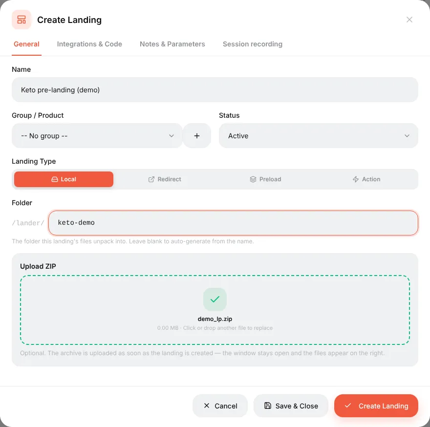
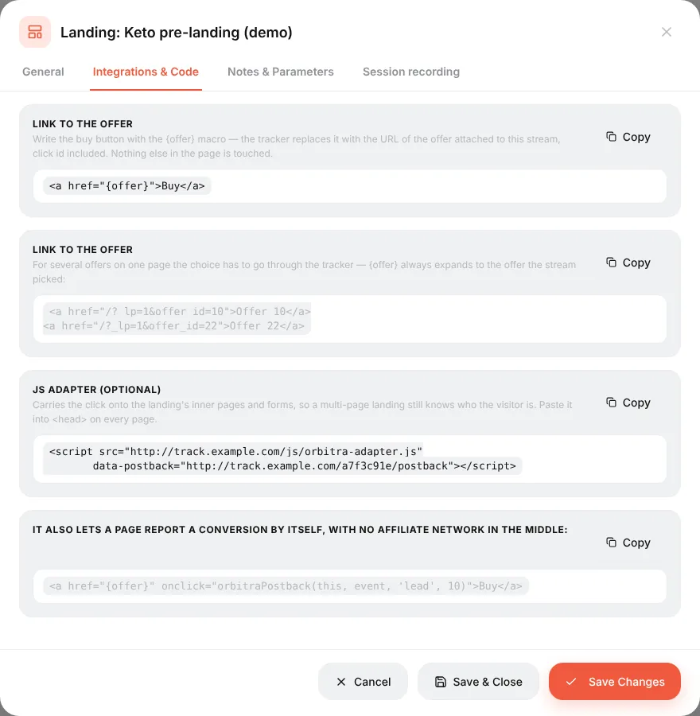
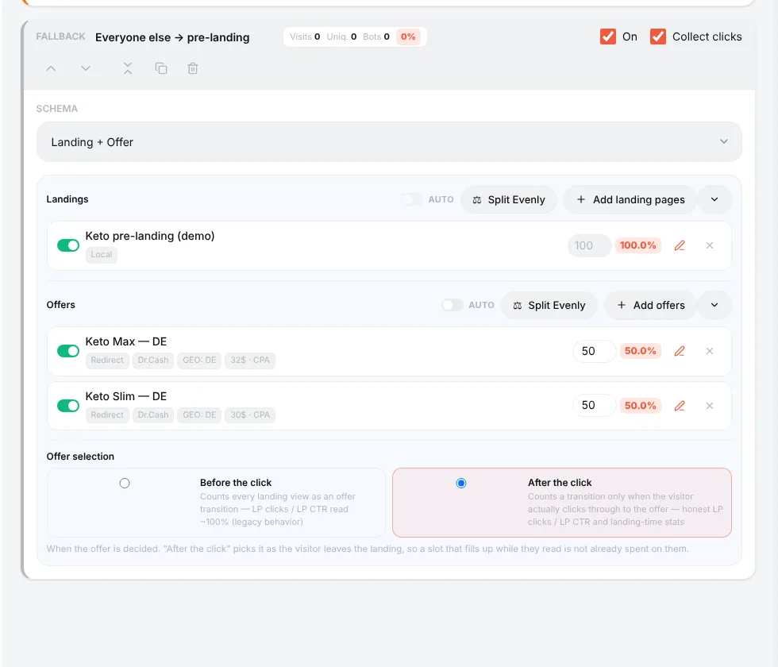
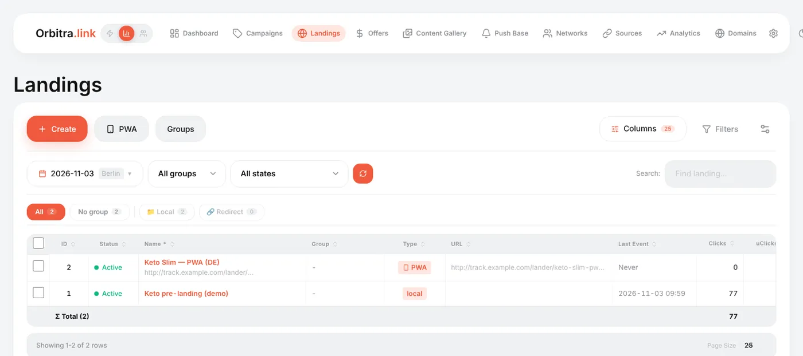

# Landing pages

## What a landing is

A **landing** (pre-landing, prelander) is your own page that the visitor sees **before** the offer: a story, a quiz, a review, a "special price" page. It warms the visitor up, and a warmer visitor converts better. The button on it leads to the offer through the tracker, so Orbitra knows who clicked.

Do you need one? For many offers a direct link works fine. A landing is worth testing when the offer page is cold, when the ad cannot say everything, or when you want to pre-qualify visitors.

## Landing types

| Type | Where the page lives | When to use |
|---|---|---|
| **Local** | You upload a ZIP; Orbitra serves it from your domain | The usual choice — fastest, and the button link is filled in automatically |
| **Redirect** | On your own hosting or another domain | You already host the page elsewhere |
| **Preload** | Another URL, fetched by Orbitra and shown under your domain | Quick reuse of an existing page |
| **Action** | Nothing is shown; the tracker does something | Special cases |
| **PWA** | An installable "app" built in the panel | See [PWA apps](guide-pwa.md) |

## How to add a local landing

1. Prepare the page: a folder with `index.html` (and its images, CSS, JS) zipped into one archive. Use relative paths (`img/photo.jpg`).
2. Make the button lead to the offer with the `{offer}` macro:

```html
<a href="{offer}">Get the offer</a>
```

Orbitra replaces `{offer}` with a tracked link to the offer chosen in the stream. You do not paste the offer URL into the page.

3. **Landings → Create** → type **Local** → name, folder (optional) → drop the ZIP → **Create Landing**.



The files appear in the built-in file manager, where you can edit them without re-uploading.

**Several offers on one page** (for example, three products): link each button to a specific offer — `<a href="{offer}&offer_id=10">`. To pass a choice made on the page (a product, a quiz answer) to the offer, add `sub_id_5=…` to the link; the offer URL can use it as `{sub_id_5}`. Details: [Landing pages (reference)](landing-pages.md#linking-to-the-offer).

## A landing on another site (Redirect)

The landing is on your hosting, so the page cannot use `{offer}`. Install the tracking script from the landing's **Integrations & Code** tab into the page's `<head>`, and link the button to `/?_lp=1` as shown there. The script lets the tracker recognise the visitor coming back from your site.



## Putting the landing into a campaign

In a stream choose the schema **Landing + Offer**, press **Add landing pages** and **Add offers**. Several landings are split by weight — the easiest way to A/B test landings.



Keep **Offer selection: After the click**: the offer is chosen when the visitor really presses the button, so the landing statistics are honest.

## Landing statistics

The **Landings** list and the campaign report have landing-specific columns:

| Column | Meaning |
|---|---|
| **LP Views** | How many times the landing was shown |
| **LP Clicks** | How many visitors pressed the button and went on to the offer |
| **LP CTR** | LP Clicks ÷ LP Views — how well the landing pushes to the offer |
| **Time on LP**, **LP bounce**, **LP scroll** | How long people stay (only visible time), the share who left in under 5 seconds, how far they scroll. Measured automatically on local landings |
| **CR**, **EPV** | Conversions per click and earnings per visit — the final verdict |



Want to see what visitors actually do? Turn on **Session recording** in the landing editor — Clarity-style replays and click heatmaps, stored on your own server. → [Session recordings](session-recordings.md)

Reference: [Landing pages](landing-pages.md), [Tracking Client (PHP)](tracking-client-php.md).
