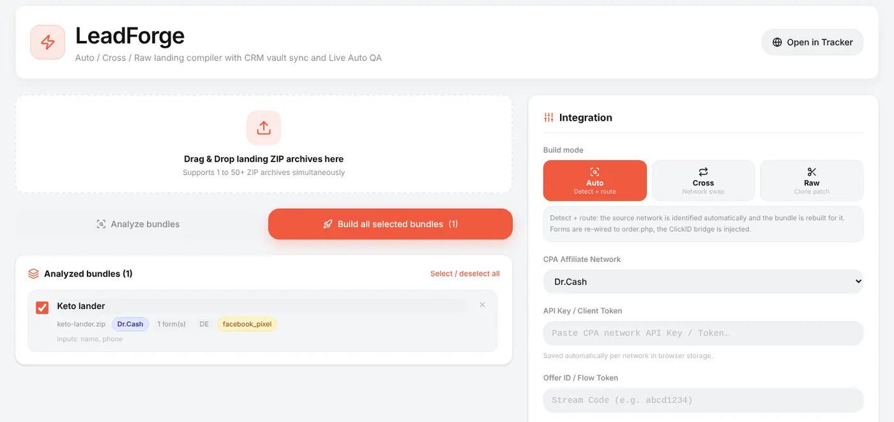
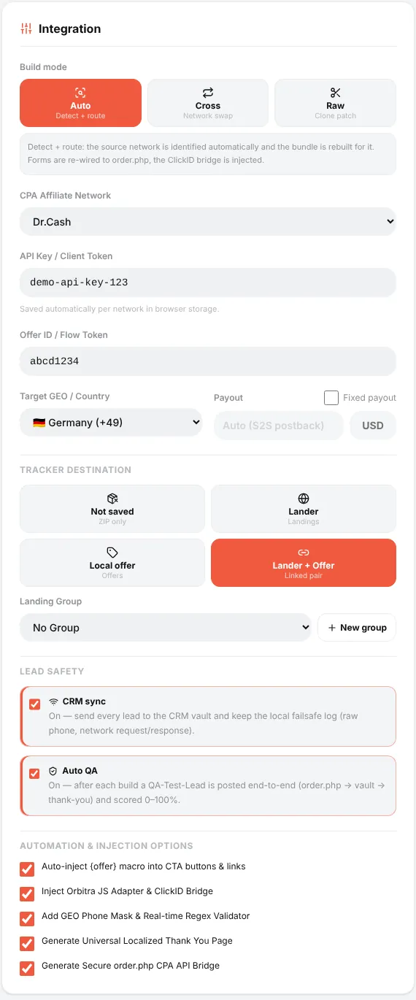
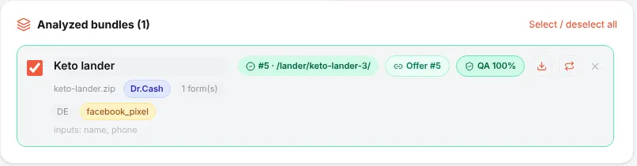
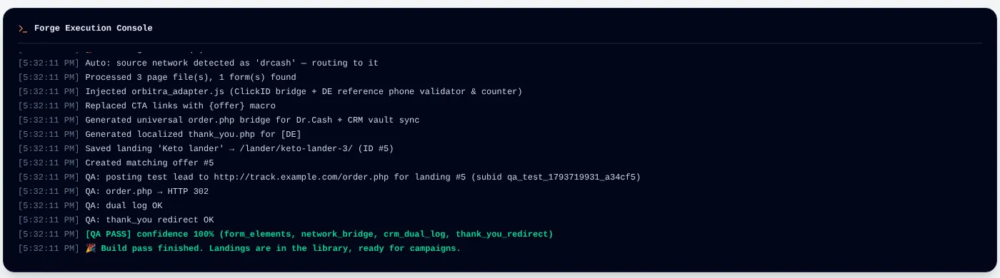
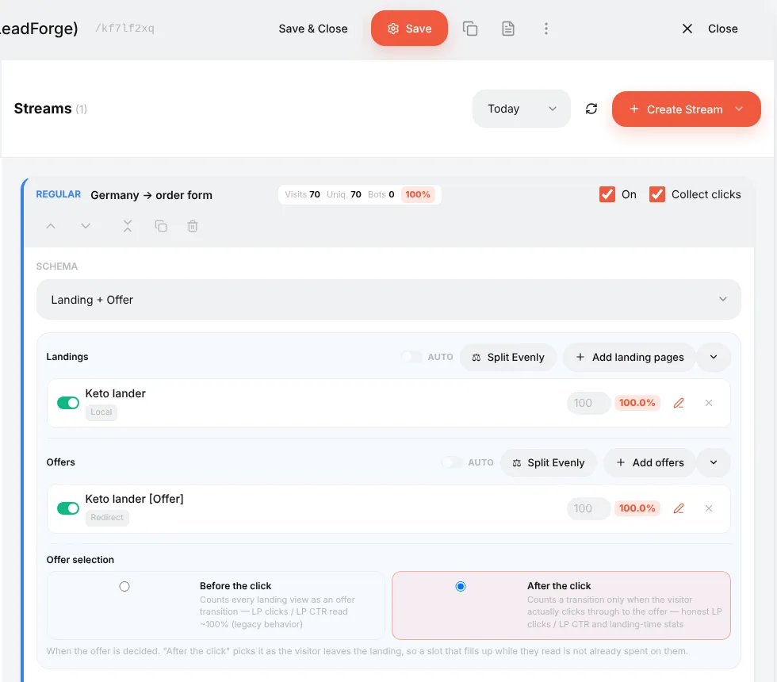

# LeadForge: put a landing with an order form on your own tracker

## What it is

Many offers — nutra and e-commerce with cash on delivery (COD) above all — are sold through a **form**: name, phone, "Order". Normally the form lives on the affiliate network's landing, and you only send traffic to their link.

**LeadForge** lets you host that landing yourself and send the leads to the network **through its API**:

1. You take a landing ZIP (from the network's promo materials, a spy tool, or your own).
2. LeadForge analyses it, cuts out the old network's order handler and foreign pixels, and builds a new **`order.php`** that sends every lead straight to your network's API, with your click ID.
3. It adds a phone mask and validation for the country, a localised thank-you page and the click-ID bridge.
4. The result is saved as a landing (and, if you want, a matching offer) in the tracker, ready for a campaign.
5. Every lead is also stored in the [CRM](guide-crm.md) with the exact phone sent to the network and the network's answer — your proof if leads go missing.

Why bother: you control the page (speed, cloaking, A/B tests, your own domain), you see every lead the moment it is submitted, and you can prove "shaved" leads to the network.

LeadForge opens with the **⚡ lightning icon** in the top-left switcher (*LeadForge · Tracker · CRM*).

> LeadForge needs **PHP landings** enabled (the generated `order.php` is PHP). If they are off, LeadForge shows a banner with an **Enable in 1 click** button; the same switch is in **⚙ → Settings → General**.

## Step 1. Drop the ZIPs and analyse

Drag one or many landing ZIPs onto the drop zone (up to 50+ at once) and press **Analyze bundles**.

For every archive LeadForge shows what it found: the source network (detected from code signatures — here *Dr.Cash*), the number of forms and their fields, the GEO, and foreign scripts that will be removed (`facebook_pixel`, TikTok, Google Analytics, Yandex Metrika, devtools blockers, back-button redirects). The console at the bottom logs every step.

## Step 2. Choose how to build

**Build mode**

| Mode | What it does | When |
|---|---|---|
| **Auto** | Detects the source network and rebuilds the landing for it: forms re-wired to the new `order.php`, the click-ID bridge injected | The landing comes from the same network you work with |
| **Cross** | Network swap: the old network's handlers (`order.php`, `send.php`, `api.php`…) and their hard-coded keys are cut out, and the landing is re-seated on the network you choose | A landing of one network, an offer of another |
| **Raw** | Clone patch: only cleans foreign counters and scripts and injects the click-ID bridge and `{offer}` macros. No `order.php` | A landing whose button should lead to a normal offer link, not a form |

**Network settings**

- **CPA Affiliate Network** — the network that receives the leads. Built-in adapters: Dr.Cash, LemonAD, Webvork, Leadbit, Everad, KMA.biz, TerraLeads, Lucky.online, Ezaff, AdCombo, plus **Custom API / Webhook** for any network with a POST API. Your own networks from the tracker are listed too and use the custom adapter.
- **API Key / Client Token** — from the network's API settings. Remembered per network in your browser.
- **Offer ID / Flow Token** — what the network calls the offer or stream (Dr.Cash: stream code; Leadbit: flow hash…). The placeholder tells you which.
- **Target GEO** — the country: it sets the phone mask, validation rules, the thank-you page language and the number format sent to the network.
- **Payout** — leave *Auto (S2S postback)* to take the real amount from the network's postback, or tick *Fixed payout*.

**Tracker destination** — what to save:

| Option | Result |
|---|---|
| **Not saved** | Only a ZIP to download |
| **Lander** | A landing in **Landings**, ready for a *Landing + Offer* stream |
| **Local offer** | An offer in **Offers** that serves the page itself |
| **Lander + Offer** | Both, linked — the most convenient for a campaign |

**Lead safety**

- **CRM sync** (on) — every lead also goes to the CRM vault with the raw phone and the full network request/response, plus a local fail-safe log. Keep it on.
- **Auto QA** (on) — after the build a test lead runs the whole chain (`order.php` → CRM vault → thank-you page) and the bundle gets a score from 0 to 100%. QA leads are marked *QA-Test* and never count in statistics.

**Automation & injection options** — all on by default: put `{offer}` into CTA links, inject the JS adapter and click-ID bridge, add the GEO phone mask with live validation, generate the localised thank-you page, generate `order.php`.

## Step 3. Build

Press **Build all selected bundles**. The bundle card shows where it was saved and the QA score:

The console tells you exactly what happened — which scripts were removed, which files were generated, the QA steps:

The icons on the card download the prepared ZIP or rebuild the bundle; **Re-run Live QA** repeats the test. **Open in Tracker** jumps to the saved landing.

If QA fails, the console names the failing step (for example `order_php_http_0` — the tracker could not call its own `order.php`, usually a domain or SSL problem on the server).

## Step 4. Use it in a campaign

Create a campaign (see [First campaign](guide-first-campaign.md)) with a stream **Landing + Offer**: add the LeadForge landing and the matching offer.

The visitor's path: ad → campaign link → your landing with the order form → `order.php` sends the lead to the network API with the click ID → thank-you page. At the same moment a **lead** conversion appears in the tracker and the lead appears in the [CRM](guide-crm.md).

## Step 5. Get the statuses back

The network decides later whether the lead is approved, rejected or trash. To see that in Orbitra, the network must send **postbacks** as with any other offer — see [Postbacks](guide-postbacks.md). The postback updates both the tracker conversion and the CRM lead.

## Checking a bundle by hand

Open the **campaign link** and submit the form with a test name and phone. Typing `/order.php` into the browser is *not* a test: it is a request without a form and without a click, and the tracker answers "Campaign not found".

Reference: [Landing pages → LeadForge](landing-pages.md#leadforge-20-landing-analyzer-js-validation--multi-network-bridge), [LeadForge subid validation](leadforge-subid-validation.md).
