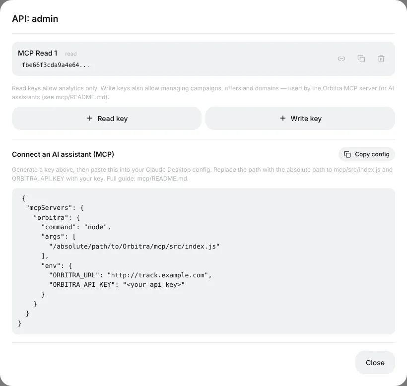
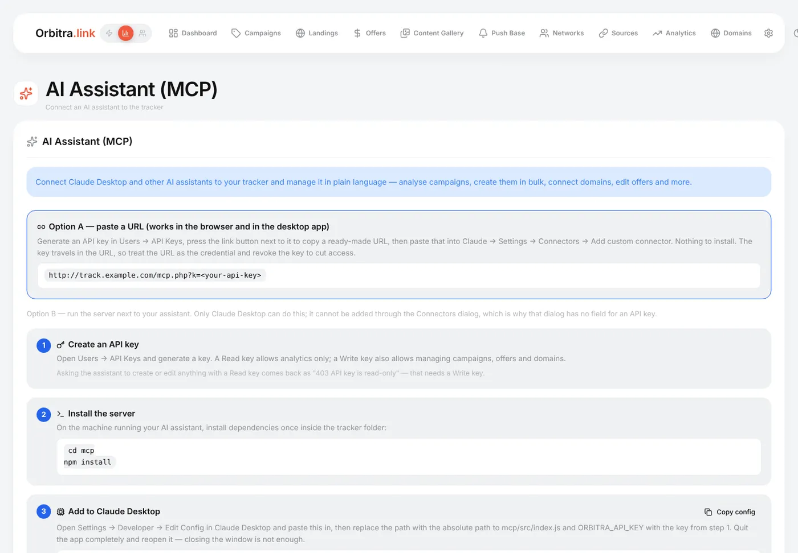

# AI assistant (MCP): manage the tracker in plain language

## What it is

**MCP** (Model Context Protocol) is a standard way to give an AI assistant — Claude and other MCP clients — tools to work with your software. Orbitra ships an MCP server, so after a one-time connection you can simply write to the assistant:

> "How did my campaigns do over the last 7 days? Which one lost money?"
>
> "Show yesterday's conversions for the Keto DE campaign by country."
>
> "Create 5 campaigns for offer #4 — one per GEO: DE, AT, CH, FR, IT — on the domain go.example.com."
>
> "Add the domain promo.example.com and put campaign 12 on its root."
>
> "Which creatives had ROI below zero this week?"

The assistant calls the tracker's API for you: it reads statistics, builds reports, creates and edits campaigns, offers, domains, traffic sources and landings (41 tools in total). It sees only what your API key allows.

## Read key or write key?

Keys are made in **⚙ → Users** → the number in the **API keys** column of a user → **Read key** or **Write key**.



| Key | Can |
|---|---|
| **Read** | Only look: metrics, lists, reports, conversions. Physically cannot change anything — safe to start with |
| **Write** | Everything Read can, plus create, edit and delete campaigns, offers, domains, sources, landings |

Start with a Read key. If you ask a Read-key assistant to change something, it answers *403 API key is read-only* — then create a Write key.

## Connecting — option A: a link (the easiest)

Works in the Claude apps (web, desktop, mobile), nothing to install.

1. Create a key (see above) and press the **link** icon next to it — a ready URL like `https://track.example.com/mcp.php?k=YOUR_KEY` is copied.
2. In Claude: **Settings → Connectors → Add custom connector**, paste the URL, give it a name (*Orbitra*), **Add**.
3. In a new chat, ask "Ping my Orbitra tracker" — the assistant should answer with your tracker's version.

> 🔑 The key is inside the link, so treat the link like a password: do not post it anywhere. To cut access, delete the key — the link stops working immediately.

The page **⚙ → AI / MCP** shows the same instructions with your tracker's address already filled in.



## Connecting — option B: local server for Claude Desktop

For people who prefer to run the server on their own computer. You need Node.js and a copy of the Orbitra repository.

1. In the repository: `cd mcp && npm install`.
2. In Claude Desktop: **Settings → Developer → Edit Config** and add:

```json
{
  "mcpServers": {
    "orbitra": {
      "command": "/usr/local/bin/node",
      "args": ["/absolute/path/to/Orbitra/mcp/src/index.js"],
      "env": {
        "ORBITRA_URL": "https://track.example.com",
        "ORBITRA_API_KEY": "your-api-key"
      }
    }
  }
}
```

3. Quit Claude Desktop completely (⌘Q on Mac) and start it again.

The **Copy config** button in the API keys window gives you this block with your address. If the server does not appear: use the absolute path to `node` (`which node` shows it), check `npm install` ran, and check the key with `ORBITRA_URL=… ORBITRA_API_KEY=… npm run smoke -- --ping`.

## Good prompts

- Be specific about the period and the entity: "campaign 12, last 7 days, by country".
- For changes, ask for a plan first: "Show me what you would create, then wait for my OK".
- Bulk work is where it shines: "Clone campaign 12 for AT and CH, same streams, offer #7 instead of #4".

## Safety

- The key only goes to your own tracker address.
- Delete a key in **⚙ → Users** and every assistant using it loses access at once.
- Give the assistant a Read key unless you really need it to change things.

Reference: [MCP](mcp.md), [REST API](api.md).
