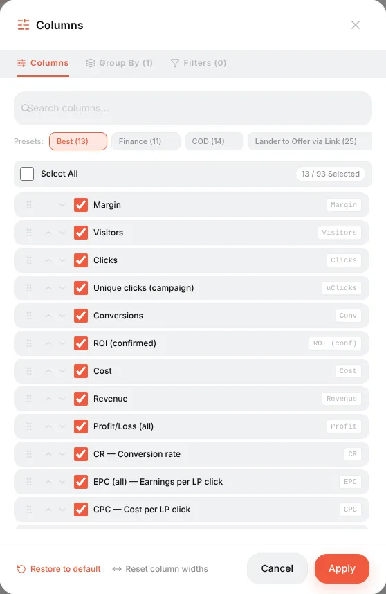

# Metrics cheat sheet

Every column you can add to the dashboard, the campaign / offer / landing lists and the report builder, with the formula Orbitra uses. Pick columns in **Columns** (or **⚙** on the dashboard); hovering a column header in a table shows a short hint too.

Abbreviations and affiliate slang (CPA, RevShare, FTD, COD…) are explained in the [Glossary](glossary.md).

**Ready-made column sets** (presets at the top of the Columns window):

| Preset | For |
|---|---|
| **Best** | A general overview: visitors, clicks, conversions, cost, revenue, profit, ROI, CR, EPC, CPC, CPA |
| **Finance** | Money: revenue by status, profit, ROI confirmed vs all |
| **COD** | Cash-on-delivery offers: leads, sales, approve %, rejected, trash, CPL, CPS |
| **Lander to Offer** | Landing performance: LP views, LP clicks, LP CTR, time on page, bounce, scroll, PWA installs |
| **Traffic** | Traffic quality: uniques, bots, possible bots, proxies, empty referrers |

## Traffic

| Metric | What it counts |
|---|---|
| **Clicks** | Every visit to the campaign link, whatever stream served it — the same as Keitaro. Offer transitions are counted separately (*LP clicks*, *Real offer clicks*) |
| **Visitors** | All hits on the campaign URL — equals Clicks; the denominator of CPV and EPV |
| **Unique clicks (campaign)** / uClicks | Visitors counted once per campaign (by IP, IP + User-Agent or cookie — the campaign's uniqueness setting) within the uniqueness period |
| **Unique clicks (flow)** | Counted once per stream — a visitor who hits two streams counts in each |
| **Unique clicks (global)** | Counted once across all campaigns of the tracker |
| **Unique clicks %** | Unique clicks ÷ Clicks |
| **Bots** | Hits whose User-Agent looks like a crawler or a tool (the same signatures cloaking uses). Included in Visitors |
| **Bot %** | Bots ÷ Clicks |
| **Possible bots** | Visits where the landing timer ran but not a single mouse move or touch happened — a hint, not a verdict |
| **Proxies** | Hits from proxy / VPN / Tor IPs. Needs the IP2Proxy database |
| **Empty referrers** | Hits without a referrer: typed in, in-app browsers, or a source that strips it |

## Conversions

| Metric | What it counts |
|---|---|
| **Conversions** | Every conversion that arrived by postback, any status |
| **Leads** | Conversions in *lead* (hold, pending) status |
| **Sales** | Approved conversions (*sale*) |
| **Rejected** | Rejected by the advertiser |
| **Trash** | Invalid leads (fake phone, duplicate…) |
| **Registrations**, **Deposits** | Conversions of the *registration* / *deposit* types (gambling, betting, finance) |
| **Approve %** | Sales ÷ (leads + sales + rejected + trash) — the share of leads the advertiser paid for |
| **CR** | Conversions ÷ Clicks × 100% |
| **CR (sales / deposits / hold / registrations)** | The same, counting only that status |
| **CR (regs to deps)** | Deposits ÷ Registrations |
| **uCR** | Registrations ÷ Unique clicks |

Which statuses count as a "conversion", "sale" or "profit" is set in **⚙ → Settings → Conversion Types**.

## Money

| Metric | Formula |
|---|---|
| **Cost** | What the traffic cost: from the campaign's cost model (CPC, CPM…) or from cost import (Facebook, TikTok, Google, push networks) |
| **Spend (cabinet)** | Cost without the agency fee |
| **Agency fee** | The fee added on top of the platform spend, if an agency is configured |
| **Revenue** | The sum of payouts of all conversions |
| **Revenue (confirmed / hold / rejected / trash / registration / deposit)** | Revenue of conversions in that status |
| **Profit/Loss (all)** | Revenue − Cost |
| **Profit/Loss (confirmed)** | Confirmed revenue − Cost |
| **ROI (all)** | Profit ÷ Cost × 100%. +50% means every $1 spent came back as $1.50 |
| **ROI (confirmed)** | The same, only with approved money — the honest number for offers with holds |
| **Margin** | Profit ÷ Revenue × 100% — what share of the revenue you keep |

## Unit economics

| Metric | Formula | Answers |
|---|---|---|
| **EPC** — earnings per click | Revenue ÷ Clicks | How much one click earns. Compare with CPC: EPC > CPC means profit |
| **uEPC** | Revenue ÷ Unique clicks | The same per unique visitor |
| **EPC (hold / registration / confirmed)** | That revenue ÷ Clicks | — |
| **EPV** — earnings per visit | Revenue ÷ Visitors | Equals EPC now that every visit is a click |
| **CPC** — cost per click | Cost ÷ Clicks | — |
| **uCPC** | Cost ÷ Unique clicks | — |
| **CPV** — cost per visit | Cost ÷ Visitors | Equals CPC |
| **eCPC** | Cost ÷ Clicks | The same as CPC, kept for Keitaro habits |
| **CPA** — cost per action | Cost ÷ Conversions | What one conversion costs you |
| **CPL / CPS / CPR / CPD** | Cost ÷ Leads / Sales / Registrations / Deposits | — |
| **EC** — earnings per conversion | Revenue ÷ Conversions | The average payout |
| **EC (confirmed)** | Confirmed revenue ÷ Sales | — |
| **eCPM** | Profit ÷ Clicks × 1000 | Profit per thousand clicks |

## Ad platform numbers

Filled only when cost import from an ad platform is connected:

| Metric | Formula |
|---|---|
| **Impressions** | Ad impressions reported by the platform |
| **Clicks (platform)** | Link clicks reported by the platform |
| **CPM (platform)** | Cost ÷ Impressions × 1000 |
| **CTR (platform)** | Platform clicks ÷ Impressions |
| **Click loss** | 1 − Visitors ÷ Platform clicks — clicks the platform charged for that never reached the tracker (slow page, in-app browser, bots) |

## Landings

| Metric | Formula |
|---|---|
| **LP Views** | Landing impressions |
| **LP Clicks** | Visitors who pressed the button and actually left to the offer |
| **LP CTR** | LP Clicks ÷ LP Views × 100% |
| **Real LP clicks**, **Real LP CTR**, **Real offer clicks** | The same honest funnel under the names older column layouts used; *Real offer clicks* = direct offer clicks + landing transitions |
| **Time since LP click** (LP time) | Average time from opening the landing to pressing the button |
| **Time on LP** | Average time on the landing for **every** visitor, including those who never clicked. Only visible time counts |
| **LP bounce rate** | Share of measured visits shorter than 5 seconds |
| **LP scroll depth** | Average deepest scroll, 0–100% |
| **LP measured visits** | How many visits reported a time — the sample behind the three metrics above |

## PWA, push and popups

| Metric | Formula |
|---|---|
| **PWA install intents** | Taps on the PWA's Install button |
| **PWA installs** / **Real PWA installs** | Install events; *real* excludes bots |
| **PWA opens** | Re-opens of the installed app from the home screen |
| **PWA install rate** | Real installs ÷ Clicks |
| **PWA screen views** | Views of the PWA funnel screens |
| **Push subscribers** | Clicks whose visitor allowed notifications |
| **Popup shown / clicks / closed / conversions**, **Popup CTR** | The conversion popup funnel; CTR = popup clicks ÷ popup shown. See [Conversion popups](conversion-popups.md) |

## How to read them together

- **Is the campaign profitable?** ROI (confirmed). Positive — yes.
- **Is the problem the traffic or the offer?** CR low and CPC normal → the offer or the landing; CR fine but CPC high → the traffic is too expensive.
- **Is the landing helping?** Compare LP CTR and CR of *Landing + Offer* streams against a *Direct* stream.
- **Is the network cutting leads?** Approve % falling while Leads stay the same.
- **Are you paying for bots?** Bot %, Possible bots, Click loss.

Custom formulas: **⚙ → Settings → Custom Metrics**. Reference: [Reports, logs and metrics](reports.md).
