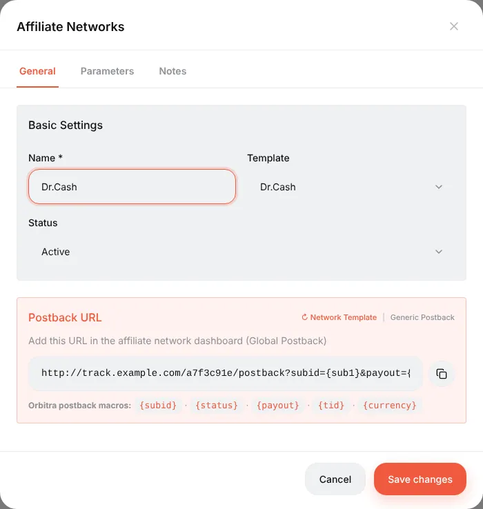
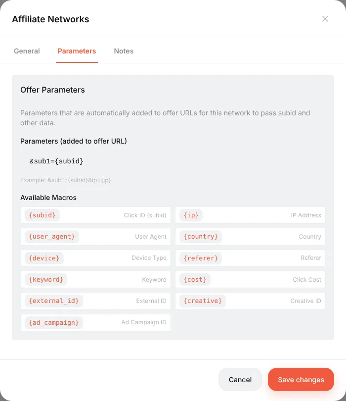
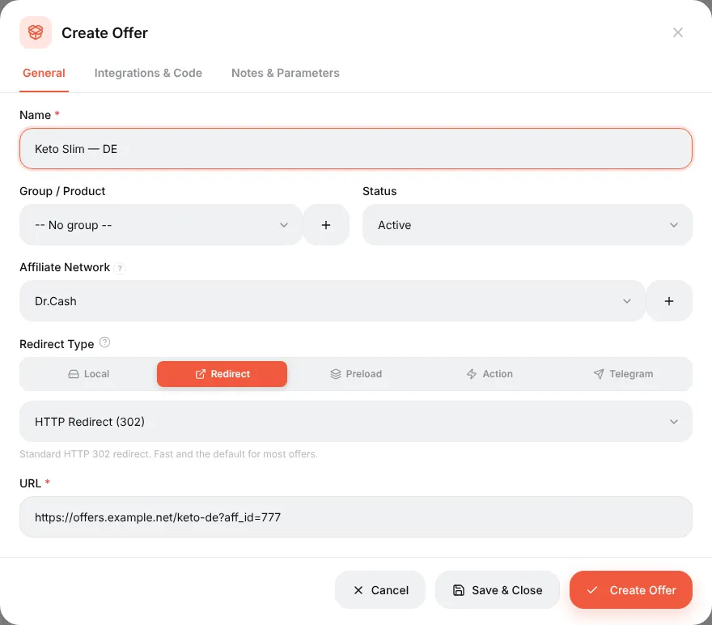
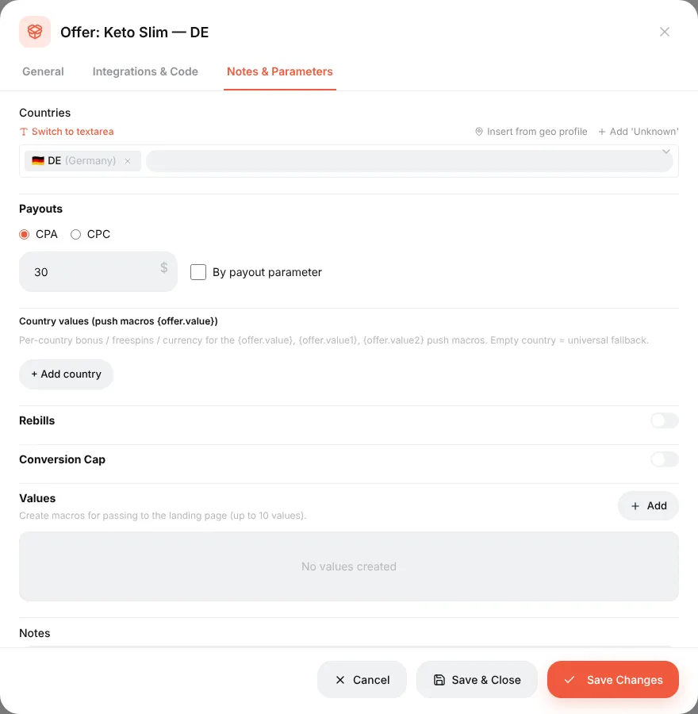
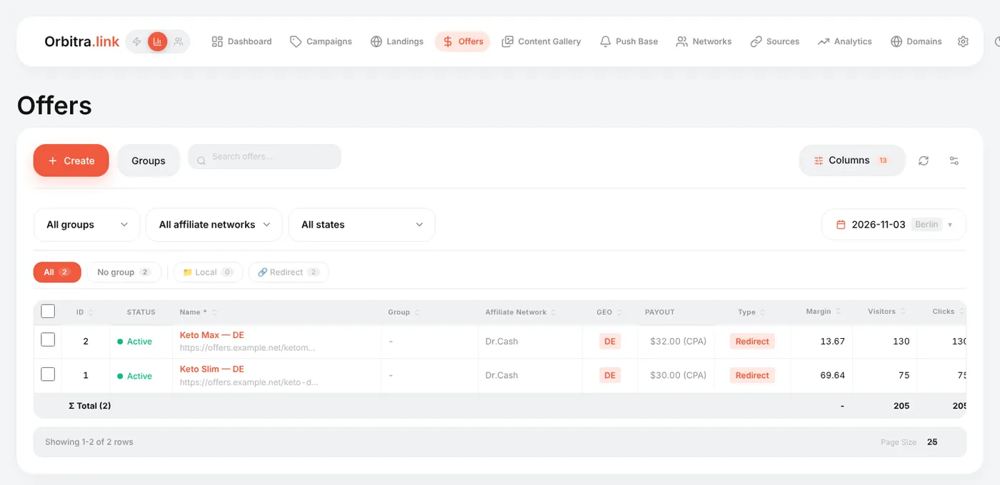

# Offers and affiliate networks

## What they are

- An **affiliate network** (Dr.Cash, Leadbit, Everad…) is the partner who has offers and pays you for results. In Orbitra a network record stores two things: which parameters to add to its offer links, and the postback URL it should call.
- An **offer** is one specific product page of that network: "Keto Slim, Germany, $30 per approved sale". You get its link in the network's dashboard.

You create the network once and then add as many of its offers as you need. Editing the network's parameters affects all of its offers at once.

## How to add an affiliate network

**Networks → Create**.

1. **Template** — find your network in the list (about 440 are there). A template knows the network's own macro names, so it is always better than writing parameters by hand. No template? Choose **Generic**.
2. **Name** — any.
3. Look at the **Postback URL** block: this is the address to put into the network's dashboard. Copy it now or later from the network list.

4. Open the **Parameters** tab. The line under *Parameters (added to offer URL)* is appended to every offer link of this network at click time. `&sub1={subid}` means "put the Orbitra click ID into the network's `sub1` field".

You can add more, e.g. `&sub2={country}&sub3={ad_id}` — the macro list under the field shows what is available. Values the visitor's click does not have become empty.

> ⚠️ The one thing that must be there is the click ID (`{subid}`) in the field the network will return in the postback. Without it a conversion cannot be matched to a click and reports show zero conversions.

## How to add an offer

**Offers → Create**.

| Field | What to put |
|---|---|
| **Name** | Product + country is a good habit: `Keto Slim — DE` |
| **Group / Product** | Optional, for filtering lists |
| **Affiliate Network** | The network — its parameters will be added automatically |
| **Redirect Type** | **Redirect** for a normal offer link. **Local** — you upload the offer page as a ZIP and host it yourself. **Preload** — the page is fetched and shown under your domain. **Action** — the "offer" is an action (show text, 404, send to another campaign). **Telegram** — a Telegram channel or bot as the destination |
| **HTTP Redirect (302)** | The redirect method. Keep 302 unless the network asks otherwise |
| **URL** | The offer link from the network dashboard. Do not add `sub1=` yourself — the network parameters do it. If you do write `sub1={subid}` in the URL, it is not duplicated |

On **Notes & Parameters**:

- **Countries** — where the offer works. Used for filtering and as a hint in streams;
- **Payouts** — CPA (per conversion) or CPC (per click) and the amount. The real payout normally arrives in the postback; this value is the fallback;
- **Conversion Cap** — a daily limit; when reached, traffic can go to an alternative offer;
- **Values** — up to 10 custom values passed to the landing page as macros, handy for prices or product names that differ per offer.

## Using offers in campaigns

An offer does nothing until a stream points to it. In a campaign stream press **Add offers** and tick one or several. With several offers the traffic is split by weight (50/50 by default); **Split Evenly** resets the weights, and **AUTO** lets the tracker move traffic to the offer that earns more. See [Streams](guide-streams.md).

The **Offers** list shows each offer's own clicks, conversions, revenue and ROI across all campaigns.

## Common mistakes

| Symptom | Cause |
|---|---|
| The network shows leads, Orbitra shows none | The click ID is not in the field the network returns (check **Parameters** of the network and the postback URL in the network dashboard) |
| Leads arrive but on the wrong offer | Two offers share the same URL and network — fine; but check the stream points to the right one |
| The offer page opens with `{subid}` written literally | The URL was put into a place that is not processed by the tracker (e.g. straight into the ad). Ads must always point to the **campaign** link |

Reference: [Traffic sources and affiliate networks](sources-and-networks.md), [Affiliate network offer parameters](affiliate-network-parameters.md).
