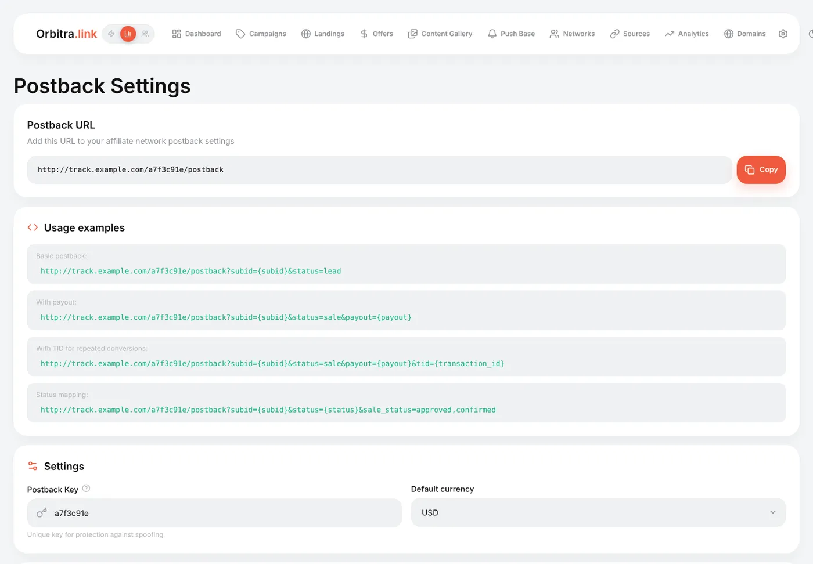
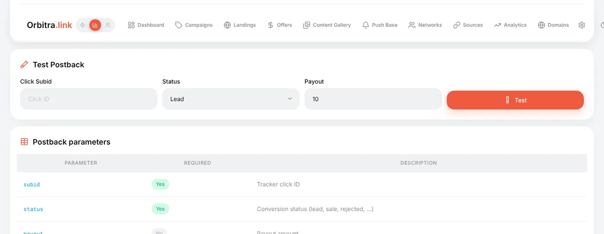
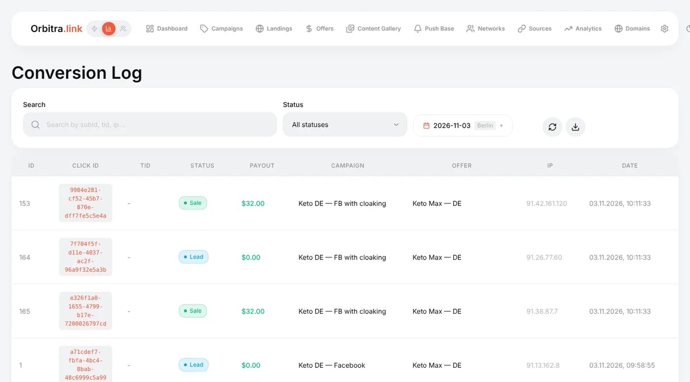
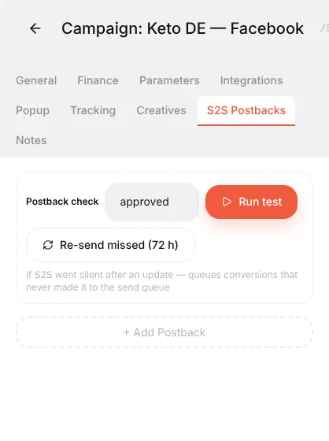

# Postbacks: what they are and what to tell your affiliate manager

## What a postback is

When a visitor buys on the advertiser's site, the sale is recorded **in the affiliate network**, not in your tracker. A postback is the network telling your tracker about it: a short server-to-server request like

```
https://track.example.com/a7f3c91e/postback?subid=0bc4ba11-688d-4de0-98b4-8b0d6e81cef&status=sale&payout=30
```

It says: "the click `0bc4ba11…` converted, status *sale*, you earn 30". Orbitra finds that click and from then on knows which campaign, stream, offer, country, ad and creative produced the money.

Without postbacks the tracker counts clicks but never sees a single conversion, so revenue, profit, ROI and CR stay at zero.

## How the click ID makes the round trip

```
1. Visitor clicks your ad → Orbitra creates click 0bc4ba11…
2. Orbitra redirects to the offer:  https://network/offer?aff=777&sub1=0bc4ba11…
                                                              ▲ added by the network's "offer parameters"
3. The network remembers sub1 for this visitor
4. Visitor buys → the network calls your postback URL and puts sub1 back:
       https://track.example.com/a7f3c91e/postback?subid=0bc4ba11…&status=sale&payout=30
5. Orbitra marks click 0bc4ba11… as a conversion
```

Two settings make it work:

- the **offer parameters** of the network in Orbitra (`&sub1={subid}`) — the click ID goes **to** the network;
- the **postback URL** in the network's dashboard — the click ID comes **back**. The network replaces its own macro (`{sub1}`, `{clickid}`, `[SUB1]` — every network spells it differently) with the stored value.

If you created the network from a template, both halves already use the right names.

## Where to find your postback URL

- **Networks** → the network row (or the network editor) → **Postback URL**. This is the best one: it uses the network's own macro names.
- **⚙ → Postback URL** — the generic address and examples for networks that are not in the template list.



The parameters Orbitra understands:

| Parameter | Required | Meaning |
|---|---|---|
| `subid` | yes | The Orbitra click ID — whatever the network received in `sub1` (or the field you chose) |
| `status` | no | `lead`, `sale`, `rejected`, `trash`, `registration`, `deposit`, or the network's own word (`approved`, `pending`, `declined`…) |
| `payout` | no | How much you earn for this conversion |
| `currency` | no | If the network pays in another currency — it is converted to the tracker currency |
| `tid` | no | Transaction ID, needed when one click can bring several conversions (e.g. repeat deposits) |

The network's own words for statuses are translated automatically (`approved`, `confirmed` → sale; `declined`, `cancelled` → rejected). You can map any other word right in the URL: `&sale_status=approved,paid&lead_status=pending`. Words Orbitra did not recognise show up in **⚙ → Settings → Conversion Types → Unmapped statuses**, where you can assign them.

## Several deposits on one click (RevShare)

One player from one click can top up several times — normal for RevShare and repeat deposits. For the tracker to see every deposit, not just the last one, the network must send **`tid`** in the postback — its own transaction (deposit) ID.

Example: a player deposits three times, $20, $30 and $50, and all three postbacks arrive with the same `subid`.

| How the postback is set up | What Orbitra shows |
|---|---|
| **with `tid`** (`…&tid={transaction_id}`), each deposit has its own ID | 3 conversions, click revenue **$100** |
| the same $50 postback arrives again (same `tid`) | the conversion is updated, the total stays **$100** — no double counting |
| **without `tid`** | 1 conversion, every new postback overwrites the amount — **$50** remains |

How to turn it on: **Affiliate networks** → network editor → under Postback URL tick **"Count every deposit separately"**. The link gets `&tid={tid}` — replace `{tid}` with your network's transaction ID macro (often `{transaction_id}`, `{event_id}`, `{payment_id}`; ask your manager). Some templates (1win, MB Partners) already spell this out in their notes.

Keep in mind:

- The `tid` value must be **different for every deposit**. If the network sends the same ID each time (a player ID, say), all deposits merge into one.
- If the network cannot send a transaction ID at all, a re-delivered postback cannot be told apart from a second deposit of the same amount — Orbitra then keeps the latest amount.
- The player's total shows in the revenue columns of reports (e.g. **Revenue (deposit)**) by campaign, offer, Sub ID and so on.

## What to send your affiliate manager

Most networks set up the postback for you if you ask. Send something like this (replace the URL with yours):

> Hi! Please set up a **global postback** for my account (all offers):
>
> `https://track.example.com/a7f3c91e/postback?subid={sub1}&status={status}&payout={payout}`
>
> - My click ID is passed in **sub1** of the offer link — please return it in `subid`.
> - Please send postbacks for **all statuses**: new lead (hold/pending), approved, rejected and trash, with the payout for approved.
> - Method GET is fine.
>
> Could you also tell me your macro names for the click ID, status and payout, if they differ from `{sub1}`, `{status}`, `{payout}`? Thanks!

What to check in their answer:

1. **Which field carries your click ID.** If they say "use `aff_sub`", change the network's offer parameters in Orbitra to `&aff_sub={subid}` and the postback to `subid={aff_sub}`.
2. **Their macro syntax.** `{sub1}`, `[SUB1]`, `%sub1%`, `{{sub1}}` — copy exactly what they use.
3. **Status words.** If they send `status=1/2/3` or Russian words, map them with `&sale_status=…&lead_status=…&rejected_status=…` or in **Conversion Types**.
4. **Per-offer vs global.** A global postback covers every offer; a per-offer postback must be added to each offer separately.

## How to test it

1. Make one real click through the campaign link (or use a click from **⚙ → Logs → Traffic**) and copy its click ID.
2. **⚙ → Postback URL → Test Postback**: paste the click ID, choose a status, press **Test**.



3. Open **⚙ → Conversions** — the conversion is there, and the campaign's counters change.

Many networks also have a "test postback" button that fires a request with a fake sub1. Orbitra answers it with "click not found" — that is expected; it proves the URL is reachable.



**⚙ → Logs → Incoming Postbacks** lists every request that arrived, including rejected ones, with the reason. It is the first place to look when "the network says it sent, the tracker shows nothing".

## Sending conversions back to the traffic source (S2S)

Some traffic sources (push and pop networks, TikTok, some native networks) optimise better when they receive your conversions. That is an **outgoing** postback, configured on the campaign's **S2S Postbacks** tab. If the traffic source template has a postback URL, a new campaign gets it automatically. The **Run test** button there checks the whole chain. Facebook and TikTok use their Conversions API instead — see [Facebook / Meta](facebook.md).



## Troubleshooting

| Symptom | Where to look |
|---|---|
| Nothing in **Incoming Postbacks** | The network never called you: wrong URL in their dashboard, or the postback is set per-offer for another offer |
| "Click not found" | The click ID is not being passed: check the network's offer parameters and the macro in the postback |
| "Wrong key" | The URL contains an old postback key. A network created **before** you changed the key keeps the old key in its saved Postback URL — fix the key in that URL (network editor) and update it in the network dashboard |
| Conversion recorded with status `custom` | The network's status word is not mapped — fix it in **Conversion Types** |
| Payout is 0 | The network does not substitute `{payout}`, or sends it under another name — add a parameter alias on the Postback page |

Reference: [Postbacks and conversions](postbacks.md).
