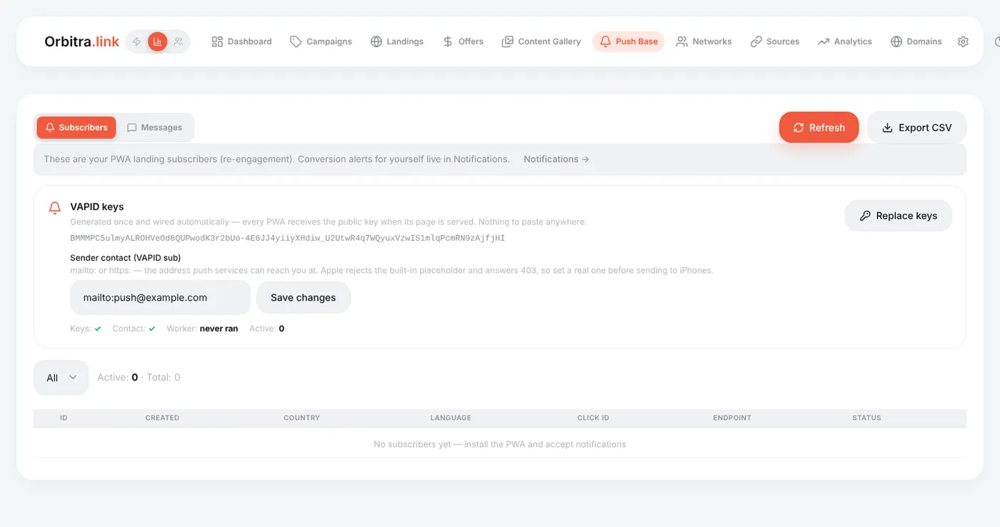
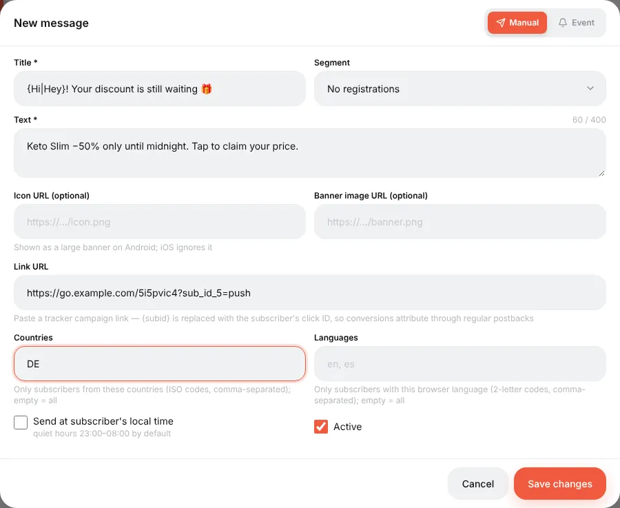
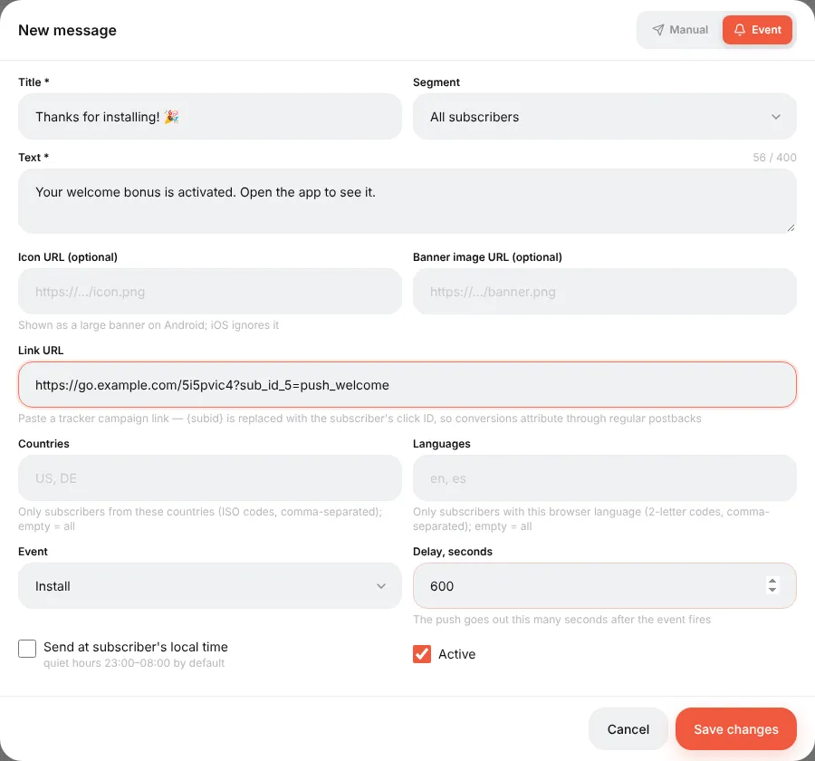
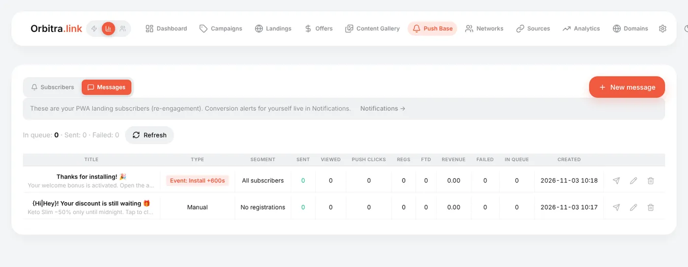

# Push notifications to PWA users

## What it is

When someone installs your [PWA](guide-pwa.md), the app can ask: "Allow notifications?". Everyone who says yes becomes a **subscriber** in your **Push Base**. You can then send them notifications — a reminder, a new bonus, a discount — for free, and every tap on a notification brings the visitor back to the offer, attributed to their original click.

Orbitra does it all on your own server: the subscriber base, the encryption keys, the sending. Google and Apple only deliver the messages to the phones.

## Setting it up

### 1. Keys and contact

Open **Push Base**.

1. **Sender contact** — `mailto:you@yourdomain.com` (or an `https://` address). Apple rejects notifications with a placeholder contact, so use a real one. Press **Save changes**.
2. **Generate keys**. That is all — the keys (VAPID) are given to every PWA automatically; nothing to paste anywhere.



The strip under the keys shows the state: **Keys ✓**, **Contact ✓**, **Worker** (when the sending job last ran) and the number of active subscribers.

> Generate the keys once. **Replace keys** invalidates every subscription; devices re-subscribe the next time they open the app, but until then they receive nothing.

### 2. Ask for notifications in the PWA

In the PWA builder, step **Screens**, tick **Push notifications** and save. After install, the app offers notifications once.

### 3. Make sure the sending job runs

Notifications are sent by a background job every minute (`cli/push_cron.php`). The installer sets it up. If **Worker** says "never ran" on a real server, check the cron:

```bash
crontab -u www-data -l | grep orbitra-push
```

## Subscribers

The **Subscribers** tab lists the base: country, language, click ID, status (active / dead). Subscriptions die by themselves when a phone uninstalls the app — no cleanup needed.

The **Send** button on a subscriber row sends a test push to that one device instantly, bypassing the queue — the fastest way to test the whole chain on your own phone.

## Messages

**Messages → New message**. Two kinds:

- **Manual** — you press **Send now** and it goes out.
- **Event** — sent automatically after an event: **Install**, **Lead** or **Sale**, with a delay you choose (e.g. 600 seconds after install).



| Field | Tips |
|---|---|
| **Title**, **Text** | Short. `{Hi\|Hey\|Hello}` picks a random variant for every recipient; `{subid}` and other click macros are filled in at send time |
| **Icon**, **Image** | URLs, conveniently copied from the [Content Gallery](guide-gallery.md). The big image shows on Android only |
| **Link** | Where a tap leads. Put a campaign link (optionally with `sub_id_5=push` to see pushes in reports) |
| **Segment** | All subscribers / no registration yet / registered without deposit / with deposit — built from the conversions of each subscriber's click |
| **Countries**, **Languages** | Narrow the audience: `DE`, `de` |



The message list shows for each message: **Sent**, **Viewed**, **Push clicks**, and what the clicks brought — **Regs**, **FTD**, **Revenue**.



## Good practice

- Start with an **Install** event message ("Thanks for installing! Your bonus is waiting") — it has the best click rate.
- Send manual messages at a sensible local time; do not spam — every unsubscribe is a lost channel.
- "Sent" means the push service accepted the message; only the phone decides whether it is shown. Test on your own device first.

Reference: [PWA and Web Push](pwa-push.md#3-web-push-the-base-keys-sending).
