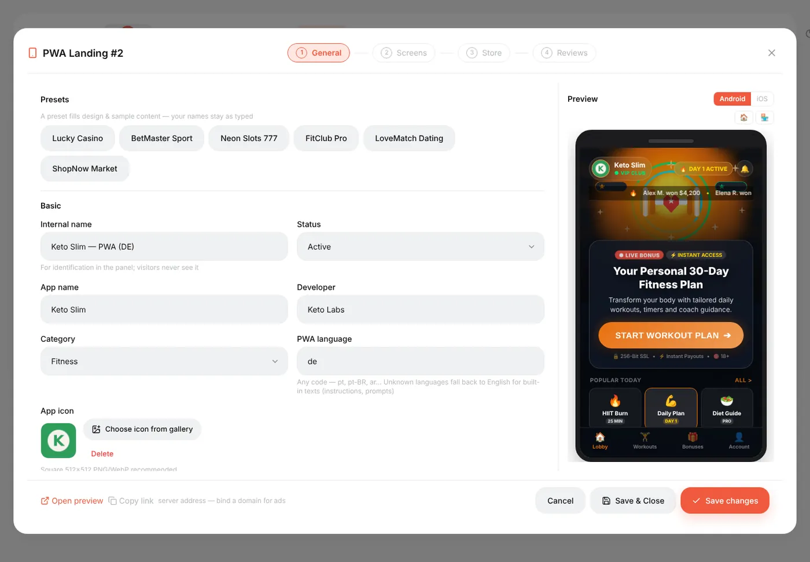
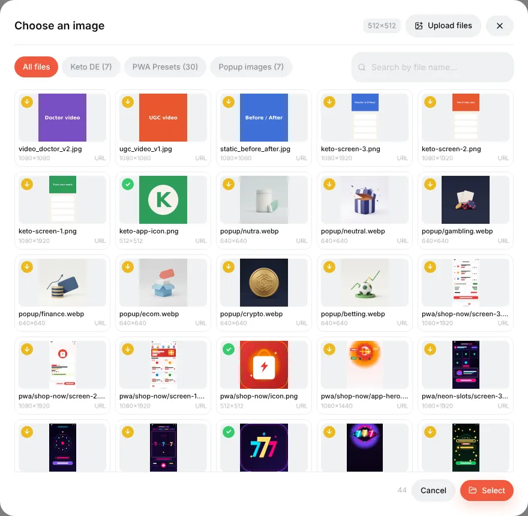
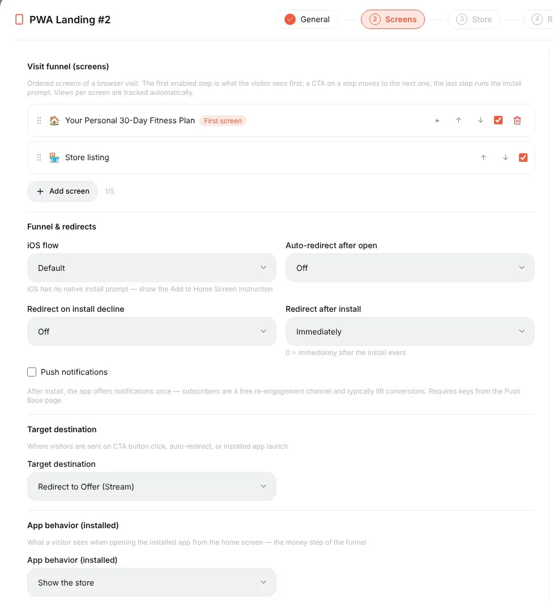
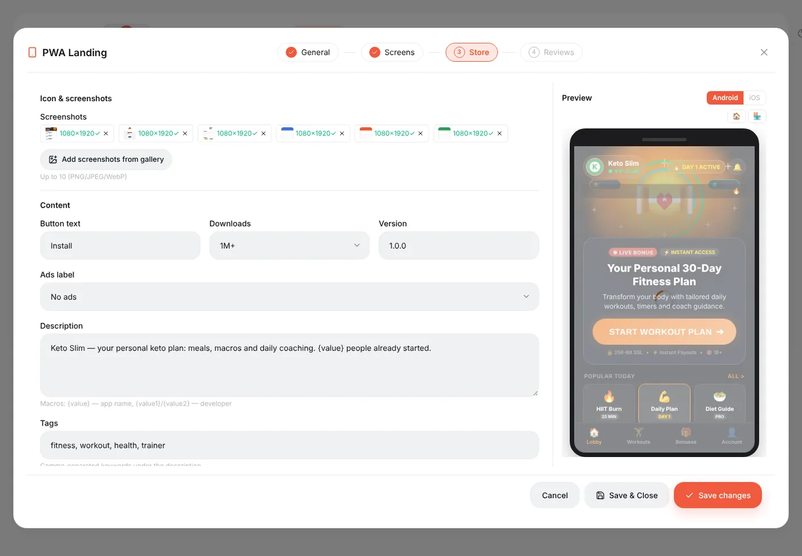
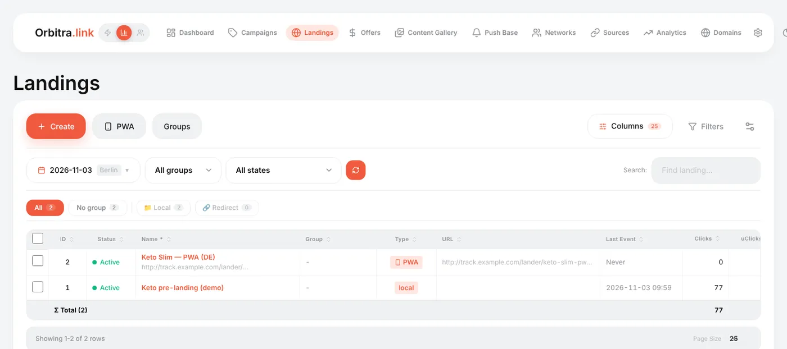

# PWA apps

## What a PWA is

A **PWA** (Progressive Web App) is a website that the visitor can **install** on the phone's home screen. It gets an icon, opens full-screen without the browser bar and looks like an app. Orbitra builds one for you in a few minutes:

1. The visitor clicks your ad and lands on a page that looks like an app store listing (Google Play on Android, App Store on iPhone): icon, rating, reviews, screenshots, an **Install** button.
2. They tap **Install** → the browser shows its install sheet → the app icon appears on the home screen.
3. When they open the app, it shows your **screen** (the money step) and sends them to the offer.
4. Optionally, the app asks for **push notifications** — and you get a subscriber you can message for free later. → [Push notifications](guide-push.md)

Why bother? An installed app keeps a direct line to the visitor: they come back by tapping the icon, without another paid click, and pushes bring them back again. PWAs are popular for gambling, betting, dating and subscription offers.

In Orbitra a PWA is a special kind of **landing**, so it goes into campaigns, streams, cloaking and reports like any other landing.

## How to build one

**Landings → PWA**. The builder has four steps and a live phone preview on the right.

### Step 1. General

- **Presets** fill the design and sample content in one click (casino, betting, fitness, dating, shop…). Your names stay as typed.
- **Internal name** (only you see it), **App name**, **Developer**, **Category**, **PWA language**.
- **App icon** — **Choose icon from gallery**. The picker marks images that fit 512×512; a bigger one can be cropped right there. → [Content Gallery](guide-gallery.md)
- **Domain** — optional; see [A clean domain for the app](#a-clean-domain-for-the-app).
- **Appearance** — store style (Auto picks Google Play or App Store by the visitor's phone), theme, colours, badges and effects.

The **Install readiness** block is a checklist: icon, description, screenshots of the right size and push keys. With all green, Chrome shows the big "store-like" install sheet instead of a plain prompt.

### Step 2. Screens

- **Visit funnel (screens)** — what the visitor sees, in order. The first screen is the landing part; the store listing runs the install. Add screens for a quiz or a bonus wheel before the store.
- **Funnel & redirects** — what happens after install or if the visitor declines; iOS has no native install prompt, so it can show an "Add to Home Screen" instruction.
- **Push notifications** — tick to ask installed users for notifications (needs keys on the Push Base page).
- **Target destination** — where the CTA leads: the offer from the stream, a campaign, or a URL.
- **App behavior (installed)** — what opens when the user taps the icon on the home screen.

### Step 3. Store

The texts of the store listing: button text, downloads, version, **description** (`{value}` puts a growing number in it), tags, rating, and **screenshots** from the gallery.

### Step 4. Reviews

User reviews shown on the listing. Edit them or keep the preset ones.

Press **Save changes**. **Open preview** at the bottom shows the real page.

## Putting the PWA into a campaign

A PWA is used like a landing: in a stream choose **Landing + Offer**, press **Add landing pages**, pick the PWA, then **Add offers**. The visitor goes ad → campaign link → PWA store page → install → app → offer, and every step is attributed to the original click.

### A clean domain for the app

You can also bind a domain to the PWA (step 1 → **Domain**, or in the domain settings). Then `https://app-domain.com/` opens the store page directly — a short, clean link that installs nicely. Visits without a campaign are recorded as organic clicks; pick an offer next to the domain so the button has somewhere to go. One domain serves one PWA.

## Statistics

The **Landings** list and campaign reports have PWA columns:

| Column | Meaning |
|---|---|
| **PWA Intent** | Taps on **Install** (before the browser's prompt) |
| **Real PWA Inst** | Completed installs by real visitors (bots excluded) |
| **PWA Opens** | Re-opens of the installed app from the home screen |
| **PWA CR** | Real installs ÷ clicks |
| **Push subs** | Visitors who allowed notifications |

Per-screen numbers (how many saw each funnel screen) are on the PWA's funnel card. → [PWA Funnel](pwa-funnel.md)

## Good to know

- Installation needs **HTTPS** — use a domain with a certificate, not the bare IP.
- In-app browsers (Facebook, Instagram, TikTok) cannot install apps. The PWA shows an "open in your browser" card there, and the *Auto-open in browser* option tries to leave the in-app browser automatically.
- iPhone users install through **Share → Add to Home Screen**; the PWA explains this on iOS.

Reference: [PWA and Web Push](pwa-push.md), [PWA Funnel](pwa-funnel.md), [External PWA and Telegram channels](external-pwa-telegram.md).
