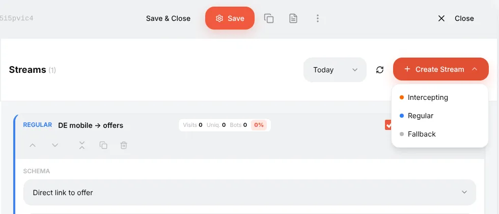
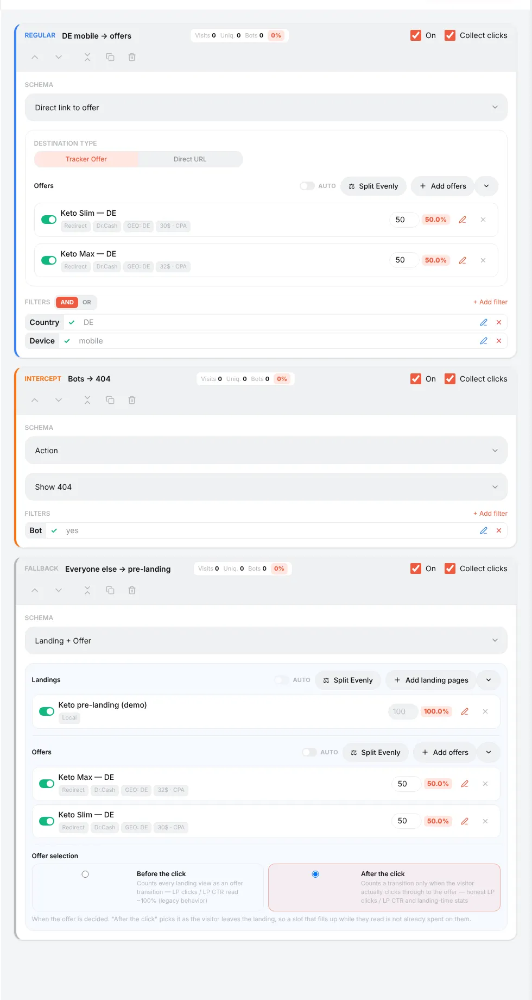
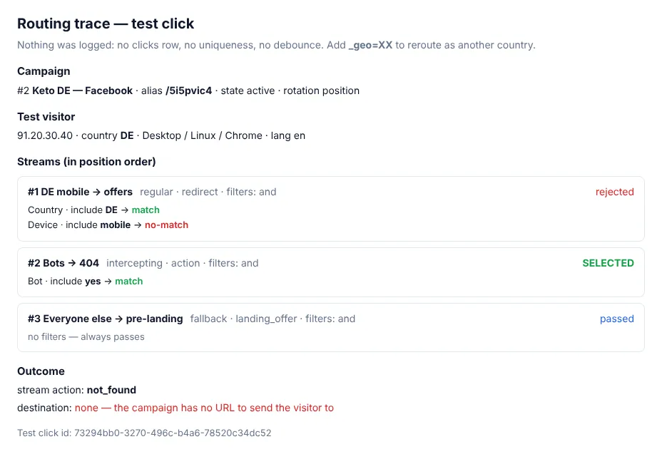

# Streams: how traffic is distributed inside a campaign

## What a stream is

A campaign has one link, but visitors are different: different countries, phones and computers, real people and bots. **Streams** are the rules that decide what each visitor gets. Every stream has:

- **filters** — who it is for (country, device, browser, URL parameter…);
- a **schema** — what to do with them (send to an offer, show a landing first, show a 404, cloak).

When a visitor opens the campaign link, Orbitra goes through the streams and picks **one**.

## The three stream types

**Create Stream** offers three types:

| Type | Checked | Use it for |
|---|---|---|
| **Intercepting** | First, before everything else | Exceptions that must win: bots, moderators, a specific test IP, a "kill switch" |
| **Regular** | Second | The main traffic: "DE + mobile → offer A", "AT → offer B" |
| **Fallback** | Last, only if nothing else matched | "Everyone else": a backup offer, a pre-landing, a safe page |

A campaign with only regular streams and no fallback leaves unmatched visitors with nothing — always add a fallback.

Here is the example campaign with all three:

- **Bots → 404** (intercepting, filter *Bot = yes*, action *Show 404*) — crawlers never reach the offer;
- **DE mobile → offers** (regular, filters *Country = DE* and *Device = mobile*) — the money traffic, split between two offers;
- **Everyone else → pre-landing** (fallback, no filters) — a landing page with the same offers.

The stream cards are listed in the order you created them; the **type** decides the priority, not the position on the screen.

## How a regular stream is chosen

When several regular streams match the same visitor, the campaign's **Rotation Type** (on the **General** tab) decides:

- **By position** — the first matching stream from the top wins. Move streams with the arrows on the card. Use it when streams are "from specific to general": first "DE + iPhone", then "DE", then "EU".
- **By weight** — matching streams share the traffic in proportion to their weights. Use it to split-test whole funnels: stream A (landing 1 + offer) 50%, stream B (landing 2 + offer) 50%.

## Splitting inside a stream: offers and landings

Inside one stream you can attach several offers (and, for *Landing + Offer*, several landings). Each gets a weight; the percentage next to it shows its share.

- **Split Evenly** sets equal weights.
- The switch next to an item turns it off without deleting it.
- **AUTO** turns on automatic optimisation: the tracker recalculates weights by a metric you choose (confirmed sales, CR, EPC, EPV or ROI) over a window of days, with a minimum number of sales before an item joins and limits on the share. While AUTO is on, manual weights are locked. Use it once each item has enough traffic; on a fresh campaign keep manual weights.

## Schemas — what a stream does

| Schema | What the visitor gets |
|---|---|
| **Direct link to offer** | A redirect straight to the offer (or to a direct URL) |
| **Landing + Offer** | Your landing page first; the button on it leads to the offer |
| **Action** | Do nothing, show a 404, show text or HTML, or send to another campaign |
| **Cloaking** | Bots and moderators get a safe page, real people the money page — see [Cloaking](guide-cloaking.md) |

**Offer selection** in *Landing + Offer*: keep **After the click** (the default). The offer is then chosen when the visitor actually presses the button, so LP clicks and LP CTR are honest.

## Other switches on a stream card

- **On** — disable a stream without deleting it.
- **Collect clicks** — when off, the visitor is still routed but no click is written. Useful for fallback/white-page streams so junk traffic does not pollute CR; but a click that is not written cannot get a conversion.
- The chips **Visits / Uniq / Bots / %** show today's (or the selected period's) traffic of the stream and its share of the campaign — a quick way to see how much went to the safe page and how much to the offer.

## Checking the routing

The **Test link** on the **General** tab with `&_dbg=1` shows the decision for your own browser: every stream, every filter's vote, the selected stream and the final URL. Nothing is written to statistics.

- `&_geo=AT` — pretend to be in another country;
- open it on your phone to test the mobile streams;
- **⚙ → Traffic simulation** lets you test any IP, User-Agent, country, device and language from the panel.

Reference: [Campaigns and streams](campaigns.md).
