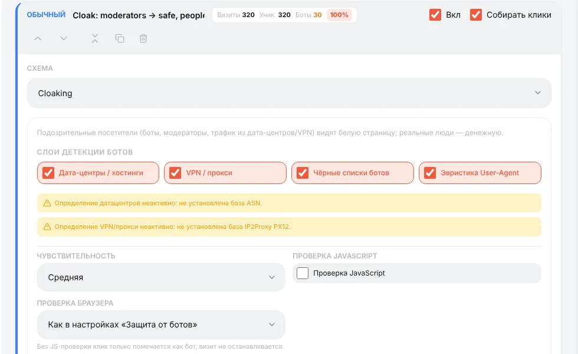
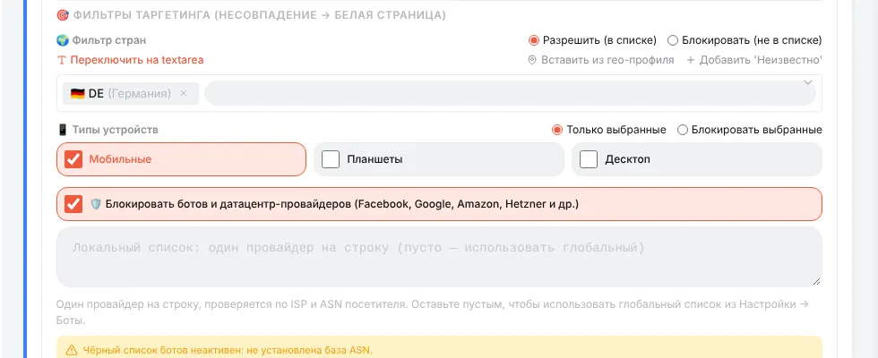
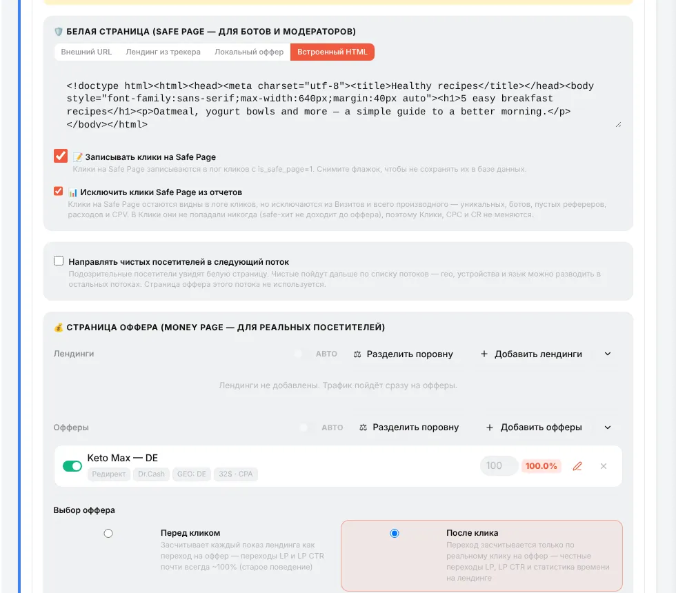
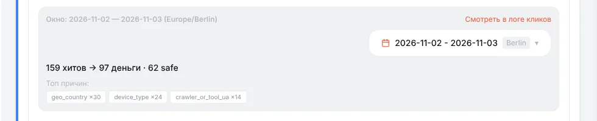
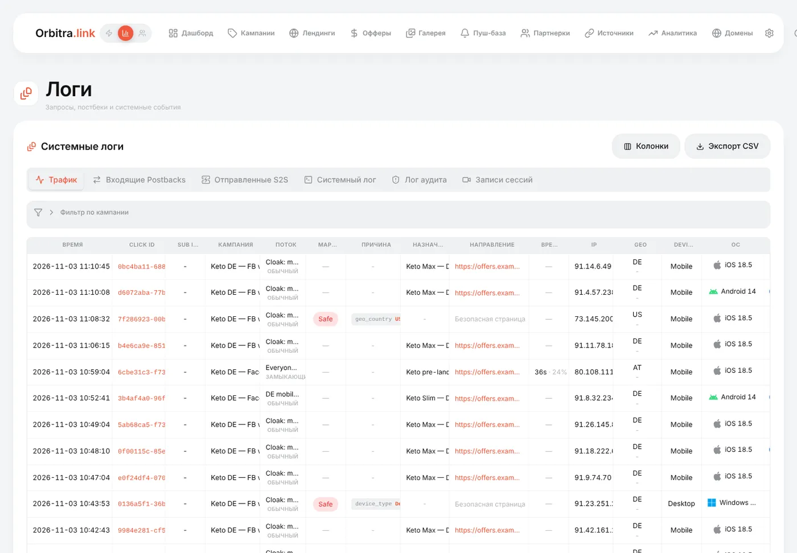

# Клоакинг для новичков

## Что такое клоакинг

Рекламные сети проверяют объявления: модератор или бот открывает ссылку и смотрит страницу. **Клоакинг** показывает разным посетителям разные страницы:

- **safe page** (white page, «белая») — нейтральная страница для ботов, модераторов, трафика из дата-центров и VPN;
- **money page** («чёрная», денежная) — ваш настоящий лендинг и оффер для живых людей.

В Orbitra клоакинг — это схема потока **Cloaking**. Решение принимает один модуль на всех точках входа (ссылка кампании, `click.php`, Click API).

> Клоакинг нарушает правила большинства рекламных платформ и может привести к бану аккаунтов и доменов. Ответственность за использование — на вас. Тот же инструмент используют и честно — например, чтобы не пускать на лендинг скраперов и ботов.

## Как Orbitra принимает решение

Каждый посетитель проходит два вида проверок:

1. **Слои детекта** — признаки того, что это не обычный человек:

| Слой | Что ловит | Нужно |
|---|---|---|
| **Дата-центры / хостинги** | Визиты с серверов и облаков (Amazon, Google Cloud, Hetzner…) — типично для ботов модерации | ASN-база |
| **VPN / прокси** | VPN, прокси и выходы Tor | База IP2Proxy PX12 |
| **Чёрные списки ботов** | IP и User-Agent из **⚙ → Настройки → Боты** | — |
| **Эвристика User-Agent** | Краулеры и утилиты (`facebookexternalhit`, `curl`, headless-браузеры), пустой User-Agent, отсутствие языка браузера | — |

2. **Фильтры таргетинга** — ваша аудитория. Кто в неё не попал, получает safe page: не та **страна**, не тот **тип устройства** или провайдер из **списка ISP ботов и дата-центров**.

**Чувствительность** задаёт, сколько признаков нужно: *Низкая* — только «жёсткий» признак (попадание в чёрный список); *Средняя* (по умолчанию) — жёсткий признак или два «мягких»; *Высокая* — любой один признак.

**Проверка JavaScript** (по умолчанию выключена) добавляет ещё шаг: сначала посетитель получает крошечную страницу загрузки, и только браузер, выполнивший JavaScript, переходит на денежную страницу. Боты без JS остаются на safe page. Цена — один лишний переход для всех.

## Как настроить

1. Сначала поставьте гео-базы. Без них фильтр по стране видит всех как *Unknown* и отправляет **100% трафика на safe page**. Карточка клоаки предупреждает о недостающих базах. → [Гео-базы](guide-geo-databases.md)
2. Откройте кампанию → **Создать поток → Обычный** → схема **Cloaking**.

3. Для начала оставьте все четыре слоя включёнными и чувствительность **Средняя**.
4. **Фильтры таргетинга**: страна (Разрешить `DE`), типы устройств (только *Телефон*, если закупаете мобильный трафик), галочку блокировки ISP ботов и дата-центров оставьте.

5. **Safe Page** — что увидят модераторы: *Внешний URL*, один из *Лендингов из трекера*, *Локальный оффер* или *Встроенный HTML*. Сделайте правдоподобную страницу на ту же тему, не нарушающую правил.
6. **Money page** — ровно как схема *Лендинг + Оффер*: добавьте лендинги и/или офферы.

7. Сохраните и проверьте тестовой ссылкой: с телефона в нужной стране должен открыться оффер; с компьютера или с `&_geo=US` — safe page.

### Два переключателя для отчётов

- **Записывать клики на Safe Page** (вкл.) — хиты safe page пишутся в лог кликов с пометкой safe. Если выключить, они не сохраняются вовсе (но счётчик помнит, сколько их было).
- **Исключить клики Safe Page из отчетов** (вкл.) — хиты safe остаются в логе кликов, но не считаются в цифрах кампании, так что модераторы и боты не размывают CR и цену клика.

### «Направлять чистых посетителей в следующий поток»

Отметьте, чтобы использовать клоаку только как фильтр на входе: подозрительные получают safe page, чистые идут дальше в ваши обычные потоки (по странам, устройствам…). Тогда поток с клоакой должен быть **перехватывающим** (или первым), чтобы через него проходил каждый посетитель.

## Проверка «человек ли» перед потоком: Bot Challenge

Отдельно от клоакинга у каждой кампании на вкладке **Общие** есть **Bot Challenge**: до выбора потока посетитель проходит Cloudflare Turnstile, reCAPTCHA v2 / v3 или ваш собственный виджет, и клик записывается только после успешной проверки. Это для трафика, где боты открывают каждую ссылку, — прежде всего email, где корпоративные шлюзы безопасности переходят по всем URL. Для платного трафика из соцсетей это стоит живых посетителей, там лучше не включать.

## Как читать результат

Карточка клоаки показывает хиты за выбранный период — сколько ушло на money и сколько на safe — и главные причины.

В **⚙ → Логи → Трафик** автоматически появляются колонки маршрута и причины: `geo_country:US`, `device_type:Desktop`, `crawler_or_tool_ua:facebookexternalhit`…

## Частые проблемы

| Проблема | Решение |
|---|---|
| Весь трафик уходит на safe page | Нет гео-базы (причина `geo_unknown`) или слишком узкий список стран/устройств |
| Живые мобильные пользователи получают safe page с причиной `ip2proxy_vpn_proxy` | Многие мобильные операторы похожи на прокси — выключите слой VPN / прокси |
| Модераторы всё равно доходят до оффера | Поднимите чувствительность, включите проверку JavaScript, добавьте проверку браузера (**⚙ → Настройки → Боты**) |
| В рекламном кабинете клики есть, в трекере ноль | Выключено «Записывать клики на Safe Page» или всё уходит на safe page |

Подробнее: [Клоакинг](cloaking.md), [How the cloaker works](../cloak-how-it-works.md) (EN), [Проверка браузера](browser-check.md).
