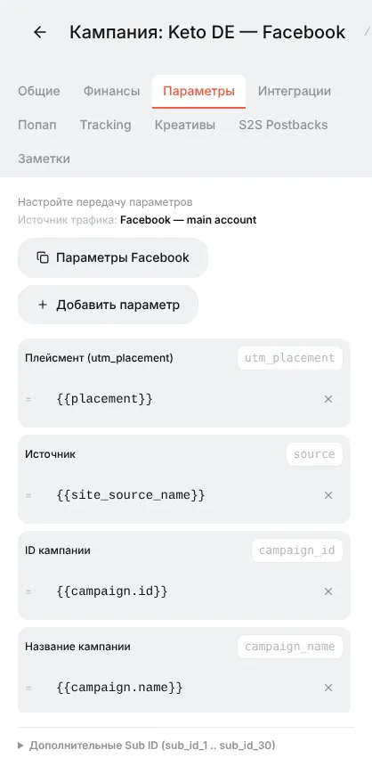
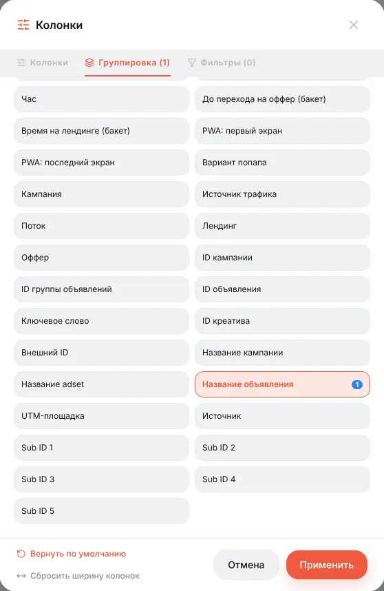
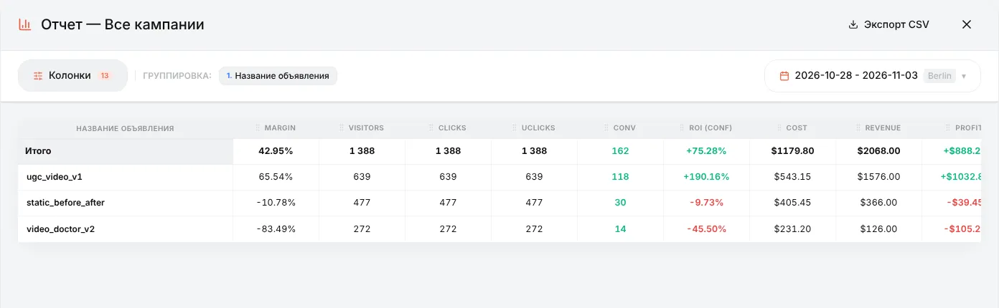
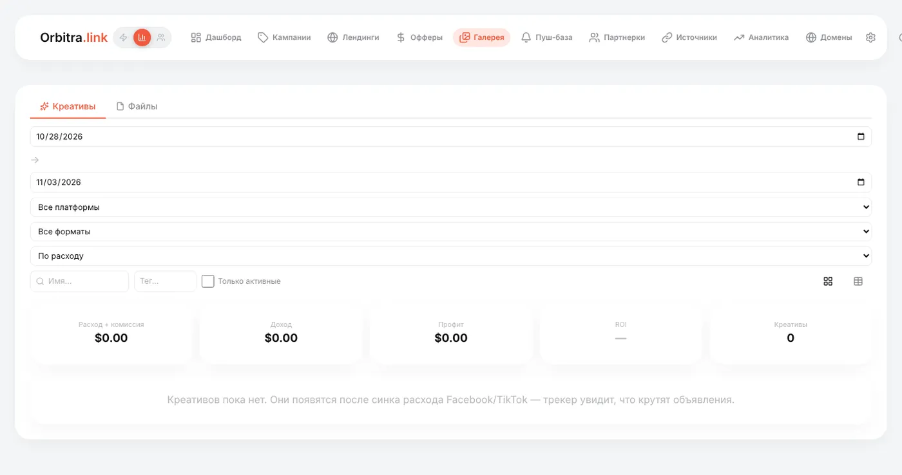

# Креативы: как их отслеживать и тестировать в одной кампании

## Что такое креатив

**Креатив** (крео) — само объявление: видео, картинка и текст, которые люди видят в Facebook, TikTok или пуш-сети. Он решает, сколько людей кликнет и кто они, поэтому на практике часто важнее лендинга. Задача трекера — показать, **какой креатив приносит деньги**, а не просто клики.

Идея простая: каждый клик несёт ID или название объявления, с которого он пришёл, и отчёты можно сгруппировать по нему.

## Шаг 1. Передайте объявление в ссылку кампании

Это делает **источник трафика**. Шаблон **Facebook Ads** уже добавляет макросы Facebook в ссылку кампании:

| Параметр ссылки | Макрос Facebook | Что это |
|---|---|---|
| `campaign_id`, `campaign_name` | `{{campaign.id}}`, `{{campaign.name}}` | Рекламная кампания |
| `adset_id`, `adset_name` | `{{adset.id}}`, `{{adset.name}}` | Адсет (группа объявлений) |
| `ad_id`, `ad_name` | `{{ad.id}}`, `{{ad.name}}` | **Объявление = креатив** |
| `utm_placement` | `{{placement}}` | Лента, Stories, Reels… |

Шаблоны TikTok, Google и других делают то же со своими макросами. Проверить и поправить их можно на вкладке **Параметры** кампании.



Два правила:

1. Ставьте в объявление **весь URL кампании** с макросами. Платформа на каждом клике заменит `{{ad.name}}` на реальное название.
2. **Называйте объявления по креативу**: `ugc_video_v1`, `static_before_after`, `video_doctor_v2`. Тогда отчёты читаются без поиска ID.

## Шаг 2. Тестируйте несколько креативов в одной кампании

Отдельная кампания в трекере под каждый креатив не нужна. Обычная схема:

```
Кампания Facebook "Keto DE"
  └─ Адсет "DE 25-55 F"  (одна аудитория, один бюджет)
       ├─ Объявление "ugc_video_v1"         ─┐
       ├─ Объявление "static_before_after"   ├─ у всех трёх ОДНА И ТА ЖЕ ссылка кампании Orbitra
       └─ Объявление "video_doctor_v2"      ─┘
```

Все объявления ведут на одну ссылку кампании Orbitra. Трекер маршрутизирует их одинаково (те же потоки, те же офферы), и единственное отличие кликов — `ad_name`, который они несут. Это и нужно для честного теста: меняется одна переменная.

Дайте тесту набрать данных — для ориентира хотя бы 20–30 конверсий на креатив или расход в 2–3 целевых CPA на каждый, прежде чем делать выводы.

## Шаг 3. Сравните в отчёте

**Кампании → Отчет** → **Колонки** → **Группировка** → уберите *Страна* → выберите **Название объявления** → **Применить**.





Как читать этот пример:

| Креатив | Клики | Конв. | CR | ROI | Вывод |
|---|---|---|---|---|---|
| `ugc_video_v1` | 639 | 118 | 18,5% | +190% | Победитель — масштабировать |
| `static_before_after` | 477 | 30 | 6,3% | −10% | Слегка в минус — попробовать новую версию |
| `video_doctor_v2` | 272 | 14 | 5,1% | −46% | Сливает — выключить |

Сначала смотрите **ROI (conf)** и **CPA**: у креатива может быть отличный CTR в Facebook, но он приводит людей, которые не покупают. Для COD-офферов добавьте **Approve %** — некоторые креативы приводят лиды, которые потом отклоняют.

Группировки можно вкладывать: *Название объявления → Страна* или *Название объявления → Устройство* покажет, где каждый креатив работает. Пресет **Facebook Hierarchy** строит Кампания → Адсет → Объявление одним кликом.

> Хотите тестировать креативы с **разными лендингами**? Используйте фильтр «Параметр URL»: поток 1 берёт `ad_name = ugc_video_v1` на лендинг A, поток 2 — остальное на лендинг B. См. [Фильтры потоков](guide-filters.md).

## Библиотека креативов (с импортом расходов)

Если подключён **импорт расходов** из Facebook или TikTok (**⚙ → Интеграции**, см. [Расходы](costs.md)), Orbitra идёт дальше: скачивает сами картинки и видео ваших объявлений и показывает каждый креатив с его расходом, доходом и ROI.

- **Галерея → Креативы** — все креативы по всем кампаниям, с фильтрами (период, платформа, формат, теги) и карточкой креатива: расход и ROI по дням, объявления, в которых он крутился, текст объявления.
- Вкладка **Креативы** в редакторе кампании — что приводило трафик в эту кампанию за последние 7 дней.
- Креативы, которые вы загрузили сами как черновики, связываются автоматически, когда та же картинка начинает крутиться в объявлении.
- Ежедневный дайджест в Telegram может присылать лучшие и худшие креативы и предупреждать о «выгорании» креатива.



Без импорта расходов библиотека пустая — но группировка отчёта выше работает в любом случае.

Справка: [Библиотека креативов](creatives-library.md), [Отчёты](reports.md).
