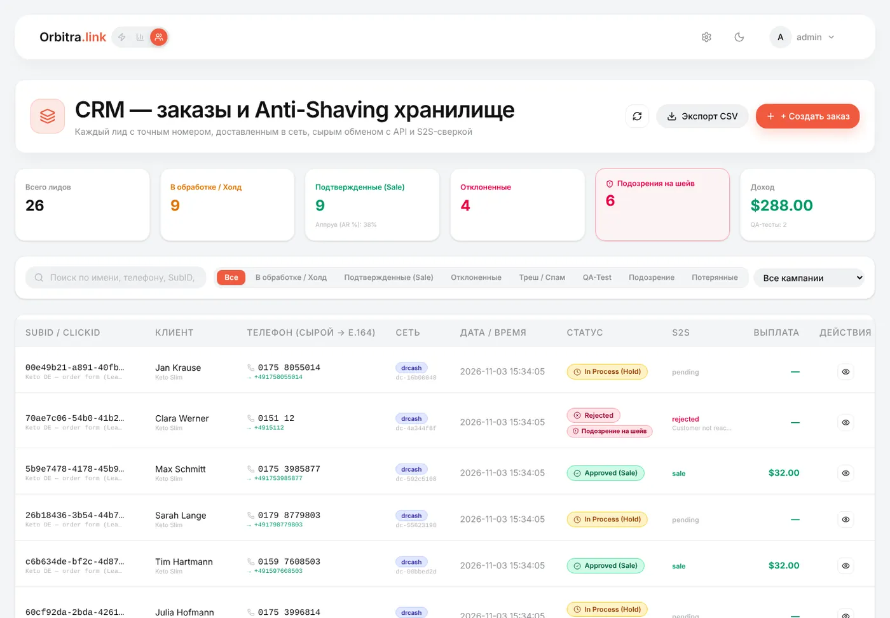
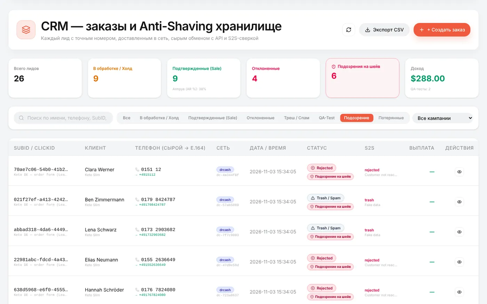
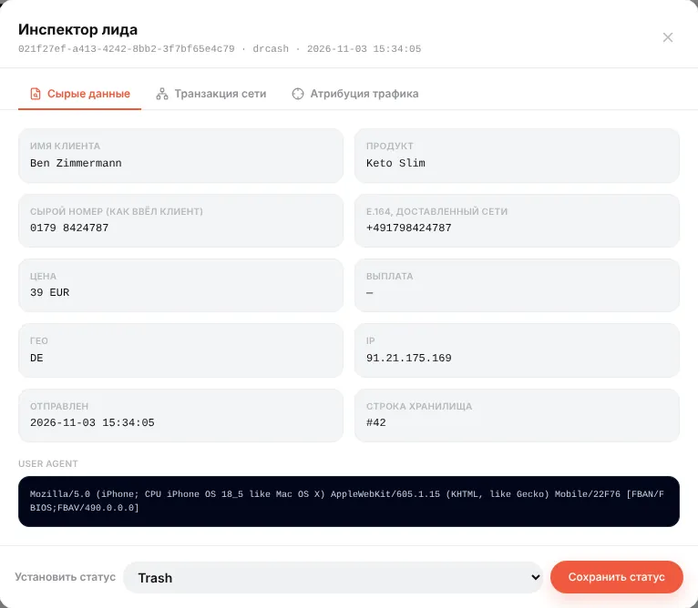
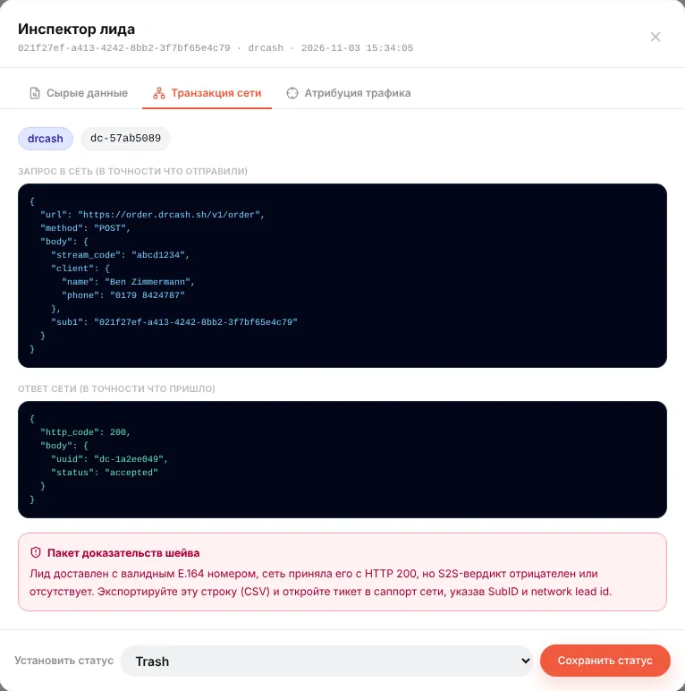

# CRM: каждый лид — и доказательства, когда партнёрка его «шейвит»

## Что это

Трекер считает конверсии, а **CRM** хранит **сами лиды**: кто заказал, телефон ровно как ввели и ровно как отправили в сеть, что сеть ответила и какой статус прислала потом. Она сделана для офферов с формой (COD-нутра, товарка, финансы), где лиды уходят в партнёрку через [LeadForge](guide-leadforge.md) или вашу собственную форму.

Отвечает на два ежедневных вопроса:

- *«Что с этим заказом?»* — найдите его по имени, телефону или click ID и посмотрите всю историю.
- *«Режет ли партнёрка мои лиды?»* — лид, который сеть приняла с HTTP 200, с валидным телефоном, а потом отметила *rejected* или *trash*, помечается как **подозрение на шейв** с пакетом доказательств для саппорта.

CRM открывается **иконкой людей** в переключателе слева вверху (*LeadForge · Трекер · CRM*).

## Откуда берутся лиды

- **Лендинги LeadForge** — при включённой *Синхронизации с CRM* (по умолчанию) сгенерированный `order.php` записывает каждый отправленный лид в CRM одновременно с отправкой в сеть.
- **Ваши формы или лендинги на другом хостинге** — могут отправлять лиды на публичный адрес `https://ваш-домен/crm-ingest`. Защитите его HMAC-секретом на странице CRM: после сохранения секрета каждый запрос должен нести заголовок `X-Orbitra-Signature` (`hash_hmac('sha256', тело, секрет)`).
- **Вручную** — кнопка создания лида (например, для заказов по телефону).

Каждый лид привязан к своему **клику**, поэтому он же считается конверсией в отчётах трекера — с кампанией, объявлением и креативом.

## Список лидов

Вверху: всего лидов, в обработке (холд), подтверждённые продажи с процентом апрува, отклонённые, **подозрения на шейв** и заработанный доход.

Вкладки фильтруют список:

| Вкладка | Показывает |
|---|---|
| **Все**, **В обработке / Холд**, **Подтверждённые**, **Отклонённые**, **Треш / Спам** | По статусу |
| **QA-Test** | Тестовые лиды от Auto QA в LeadForge (никогда не попадают в статистику) |
| **Подозрительные** | Подозрения на шейв — см. ниже |
| **Потерянные** | Сеть приняла лид (HTTP 200), но постбек не пришёл за 24 часа |

В каждой строке: click ID, кампания, клиент и продукт, телефон **как ввели → E.164** (международный формат, который реально ушёл в сеть), сеть и ID лида в сети, время, статус, вердикт S2S и выплата. Поиск — по имени, телефону, SubID или click ID; экспорт CSV выгружает текущий фильтр.

Бейджи в строке:

- **Подозрение на шейв** — отклонён или в треше, хотя телефон был валидным E.164, а сеть ответила 200;
- **Нет подтверждения от сети** — принят, но постбека со статусом нет 24 часа;
- **Дубль** — тот же телефон в той же сети за 30 дней.

## Инспектор лида

Иконка глаза открывает **инспектор лида** с тремя вкладками:

- **Сырые данные** — имя, продукт, телефон как ввели и отправленный E.164, цена, выплата, ГЕО, IP, время отправки, User-Agent.

- **Транзакция сети** — запрос ровно в том виде, в каком ушёл в сеть, и ответ ровно в том виде, в каком пришёл. Для подозрительного лида — **пакет доказательств против шейва** с объяснением, что отправить в саппорт сети.

- **Атрибуция трафика** — саб-параметры клика: кампания, адсет, объявление, плейсмент — что привело этого клиента.

Внизу **Установить статус** меняет статус вручную (например, после созвона с менеджером партнёрки). Ручной статус помечается как ручной; следующий постбек от сети заменит его вердиктом сети.

## Как обновляются статусы

Свой вердикт партнёрка присылает **постбеком** (см. [Постбеки](guide-postbacks.md)). Когда приходит постбек по клику лида, Orbitra обновляет и конверсию в трекере, **и** лид в CRM: статус, выплату и причину. В этот же момент запускается проверка на шейв.

Поэтому, чтобы CRM была полезной, настройте постбек партнёрки на все статусы — лид, апрув, отклон, треш.

## Что делать с подозрением на шейв

1. Откройте вкладку **Подозрительные**.
2. Проверьте лиды: валидный телефон, HTTP 200 от сети, затем *rejected / trash*.
3. Выгрузите их в CSV (или скопируйте SubID и ID лидов в сети из инспектора).
4. Откройте тикет в саппорте партнёрки с SubID, ID лидов в сети, телефонами и временем. Запрос и ответ из инспектора показывают, что лид был доставлен корректно.

Вкладка **Потерянные** — второе, что стоит обсудить с менеджером: лиды, которые сеть приняла, но так и не прислала по ним статус.

> Бейдж — повод посмотреть, а не приговор: клиенты действительно оставляют неверные номера, а колл-центр действительно отклоняет лиды. Ищите закономерности — доля подозрительных намного выше обычной или резкий скачок.

Справка: [Landing pages → LeadForge](../landing-pages.md#leadforge-20-landing-analyzer-js-validation--multi-network-bridge) (EN), [REST API](api.md) (`crm_leads`, `crm_lead`, `crm_lead_update`, `/crm-ingest`).
