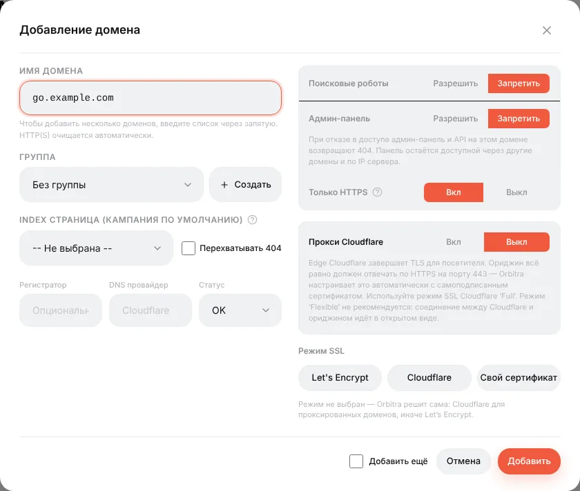
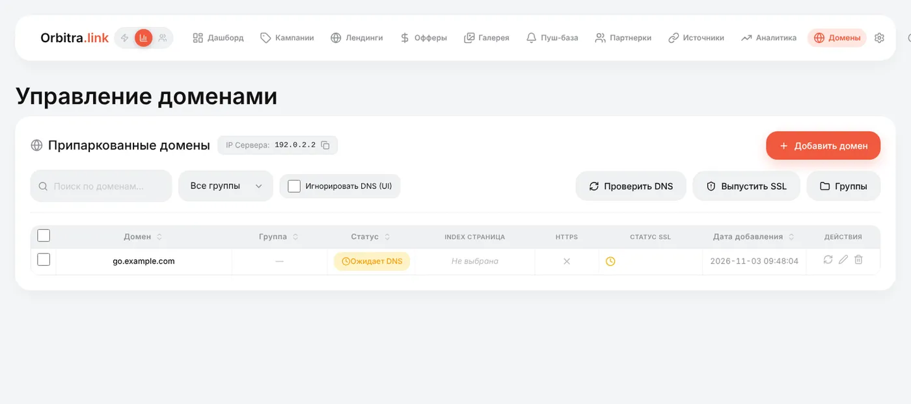

# Подключение домена

## Что это

Домен — адрес, на котором живут ссылки кампаний: `https://go.example.com/5i5pvic4`. Трекер работает и без домена (по IP сервера), но:

- рекламные сети и мессенджеры гораздо больше доверяют домену с HTTPS, чем голому IP;
- если домен «зафлагали», вы меняете домен, а кампании остаются;
- у каждого домена свои настройки: скрыть админку, открыть кампанию на корне, перехватывать 404.

На одном трекере можно припарковать сколько угодно доменов. Каждая кампания выбирает один из них.

## Как подключить домен

### 1. Купите домен

Подойдёт любой регистратор. Если пользуетесь **Cloudflare**, **Namecheap** или **Dynadot**, сначала подключите аккаунт в **⚙ → Интеграции** — тогда Orbitra сама пропишет DNS-запись, и шаг 3 можно пропустить.

### 2. Добавьте его в панели

**Домены → Добавить домен**. Впишите домен (`go.example.com`) или сразу несколько через запятую — `https://` и слэши убираются автоматически. Нажмите **Добавить**.

Значения по умолчанию безопасны для трекингового домена, так что первый домен можно оставить как есть. Что означают переключатели:

| Настройка | Что делает | Обычно |
|---|---|---|
| **Группа** | Только для сортировки списка | — |
| **Index страница** | Кампания, которая открывается, если зайти на домен без пути (`https://go.example.com/`) | Пусто |
| **Перехватывать 404** | Несуществующие пути тоже открывают кампанию с Index страницы вместо 404 | Выкл. |
| **Поисковые роботы** | *Запретить* — добавляет `noindex` и `robots.txt`, закрывающий сайт | Запретить |
| **Админ-панель** | *Запретить* — панель и API на этом домене отвечают 404. Трекинг работает, панель доступна на других доменах и по IP | Запретить для доменов кампаний |
| **Только HTTPS** | Редирект с `http://` на `https://` | Вкл. |
| **Прокси Cloudflare** | Включайте, только если домен проксируется Cloudflare (оранжевое облако) | Выкл. |
| **Режим SSL** | Оставьте не выбранным: Orbitra сама выберет Let's Encrypt, а для проксируемых доменов — Cloudflare | — |

### 3. Направьте домен на сервер

У DNS-провайдера создайте **A-запись**:

| Тип | Имя | Значение |
|---|---|---|
| A | `go` (или `@` для корневого домена) | IP сервера, показанный вверху страницы «Домены» |

### 4. Дождитесь сертификата

Orbitra сама проверяет DNS и, как только A-запись указывает на сервер, выпускает бесплатный сертификат Let's Encrypt (фоновая задача раз в 5 минут; кнопка **Выпустить SSL** запускает её сразу). Колонка статуса SSL подсказывает, чего ждём — обычно «домен ещё не указывает на сервер», что проходит само после обновления DNS (от минут до нескольких часов).

### 5. Используйте в кампании

Откройте кампанию → **Общие** → **Домен**. URL кампании сразу меняется на новый домен. Чтобы перенести много кампаний разом — выделите их в списке кампаний и примените массовое действие.

## Советы

- **Держите панель на отдельном домене.** Один домен под панель (`track.example.com`, доступ к админке разрешён), другие — под кампании (доступ к админке запрещён). Модератор, открывший домен кампании, никогда не увидит страницу входа.
- **Cloudflare:** если домен проксируется (оранжевое облако), включите **Прокси Cloudflare**. Orbitra поставит на сервер самоподписанный сертификат для режима *Full*. Для *Full (strict)* см. [Cloudflare Full Strict SSL](../CLOUDFLARE_FULL_STRICT_SSL.md).
- **У домена статус Disabled** — кто-то выставил ему статус «отключён»; такой домен отвечает 404 на всё, включая трекинг.
- **Нужен PWA на корне домена?** Привяжите домен к PWA-лендингу: см. [PWA-приложения](guide-pwa.md#чистый-домен-для-приложения).

Справка: [Домены и SSL](domains.md), [Cloudflare](cloudflare.md).
