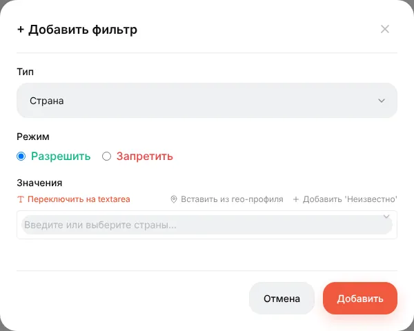
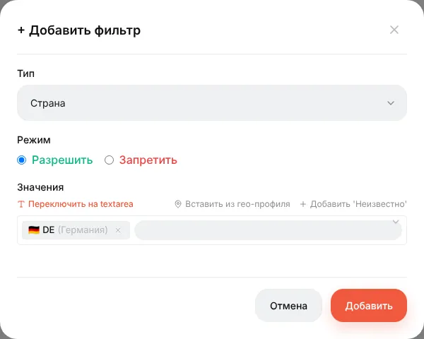
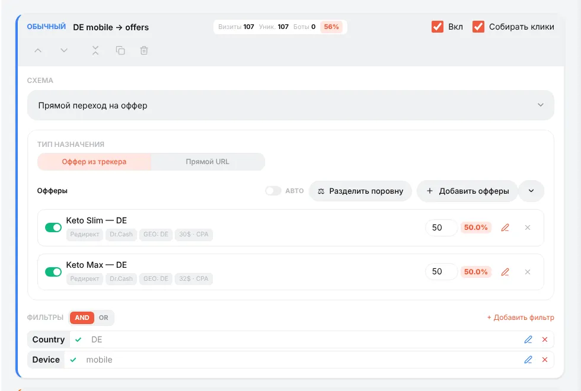
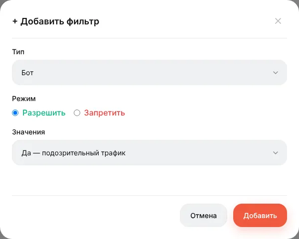

# Фильтры потоков

## Что делают фильтры

Фильтры решают, **каких посетителей берёт поток**. Поток без фильтров берёт всех; поток со *Страна = DE* — только немцев. Фильтры добавляются на карточке потока кнопкой **+ Добавить фильтр**.

У каждого фильтра есть:

- **Тип** — что проверяется (страна, устройство…);
- **Режим** — **Разрешить** (поток берёт подходящих) или **Запретить** (поток берёт всех, *кроме* подходящих);
- **Значения** — одно или несколько; достаточно совпадения с любым.

## Типы фильтров

| Фильтр | Что проверяет | Пример |
|---|---|---|
| **Страна** | Страну посетителя по гео-базе | Разрешить `DE, AT, CH` |
| **Устройство** | Телефон / Компьютер / Планшет | Разрешить `Телефон` |
| **Операционная система** | iOS, Android, Windows, macOS… | Разрешить `iOS` |
| **Браузер** | Chrome, Safari… и встроенные браузеры (Facebook, Instagram, TikTok, Telegram, WebView) | Запретить `Facebook`, чтобы отдельно ловить in-app трафик |
| **Бот** | Детектор ботов (краулеры, утилиты, отсутствующие заголовки) | Разрешить `да` в перехватывающем потоке → 404 |
| **Язык браузера** | Заголовок `Accept-Language`. `en` = любой английский, `en-IN` = только Индия | Разрешить `de` |
| **Провайдер (ISP)** | Провайдер / ASN посетителя (нужна ASN-база) | Запретить `Amazon, Google, Hetzner` |
| **Тип соединения** | Из гео-базы | — |
| **IP-адрес** | Отдельные IP и диапазоны (`1.2.3.0/24`), IPv4 и IPv6 | Разрешить IP офиса для тестового потока |
| **Ключевое слово** | Параметр `keyword` клика | — |
| **Параметр URL** | Любой параметр ссылки кампании по имени; `*` — любые символы, *Пусто* — параметра нет | `utm_placement = Instagram_Stories` |
| **Реферер** | Откуда пришёл посетитель | — |
| **День недели**, **Время** | Местное время посетителя (часовой пояс из гео-базы) | Только 9:00–21:00 |

В выборе стран есть **Вставить из гео-профиля** (готовые наборы вроде EU или СНГ, редактируются в **⚙ → Гео-профили**) и **Добавить 'Неизвестно'** — для посетителей, страну которых определить не удалось.

## Несколько фильтров: AND / OR

Когда у потока больше одного фильтра, переключатель **AND / OR** над списком решает, как они сочетаются:

- **AND** — должны совпасть все (Германия **и** телефон);
- **OR** — достаточно одного (страна = DE **или** язык браузера = de).

Фильтр, который не может решить (нет гео-базы, нет данных о провайдере), не голосует: при AND он не блокирует поток, при OR — не открывает его. Поэтому фильтр по стране «ничего не делает», пока не установлена [гео-база](guide-geo-databases.md).

## Рецепты

**Каждую страну — на свой оффер.** Обычные потоки «DE → оффер DE», «AT → оффер AT», «CH → оффер CH» плюс замыкающий для всех остальных.

**Ботов — подальше от оффера.** Перехватывающий поток, фильтр *Бот* (Разрешить, да), схема *Действие → Показать 404*.

**На оффер — только мобильный трафик.** Обычный поток с *Устройство = Телефон*; компьютеры уходят в замыкающий.

**Разный лендинг под разный плейсмент.** `{{placement}}` из Facebook приходит в `utm_placement`. Поток 1: *Параметр URL* `utm_placement` = `Instagram_Stories` → вертикальный лендинг. Поток 2: всё остальное.

**Спрятаться от модерации TikTok.** Добавьте `xxx=__PLACEMENT__` в ссылку кампании в TikTok. Перехватывающий поток с white page и фильтром *Параметр URL* `xxx` = `__PLACEMENT__` или *Пусто*. В настоящем клике TikTok подставит значение макроса; модератор, открывший голую ссылку, придёт без него.

**Тестовый поток только для себя.** Перехватывающий поток с *IP-адрес = ваш IP* → то, что тестируете. Больше никто в него не попадёт.

## Проверка

Используйте тестовую ссылку с `&_dbg=1`: трассировка покажет голос каждого фильтра — *match*, *no-match* или *воздержался* с причиной. См. [Потоки](guide-streams.md#проверка-маршрутизации).

Справка: [Кампании и потоки → Фильтры](campaigns.md).
