# Первая кампания по шагам

Этот гайд проводит от только что установленного трекера до рабочей ссылки кампании и тестовой конверсии. Весь путь — на одном реалистичном примере:

- вы льёте на **кето-оффер в Германии** из партнёрки **Dr.Cash**;
- трафик — из **Facebook**;
- немецкие пользователи с телефонов идут сразу на оффер, боты получают 404, все остальные видят короткий прелендинг.

Каждый шаг занимает несколько минут. Сначала установите трекер: [Установка и обновление](deployment.md).

## Шаг 1. Создайте администратора

Откройте `http://<ip-вашего-сервера>/admin.php`. При первом заходе Orbitra запускает мастер из трёх шагов: создать администратора (логин от 3 символов, пароль от 8), затем выбрать часовой пояс и язык интерфейса.

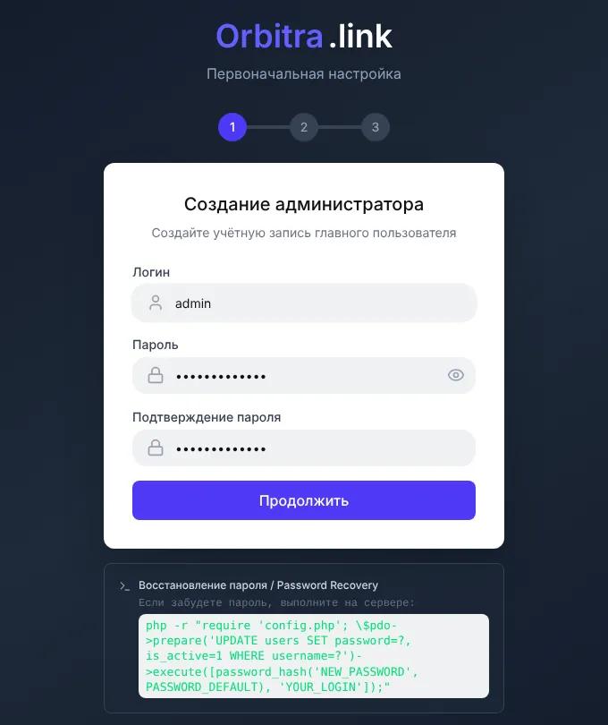

> Часовой пояс важен: «сегодня» и «вчера» во всех отчётах считаются по нему. Поменять можно позже в **⚙ → Пользователи и профиль → Профиль**.

## Шаг 2. Поставьте гео-базу

На дашборде появится жёлтый баннер о том, что гео-база не установлена. Нажмите **Установить Sypex Geo (бесплатно)**. Без гео-базы трекер не знает, из какой страны посетитель, поэтому фильтры по странам и клоакинг по стране работать не будут.

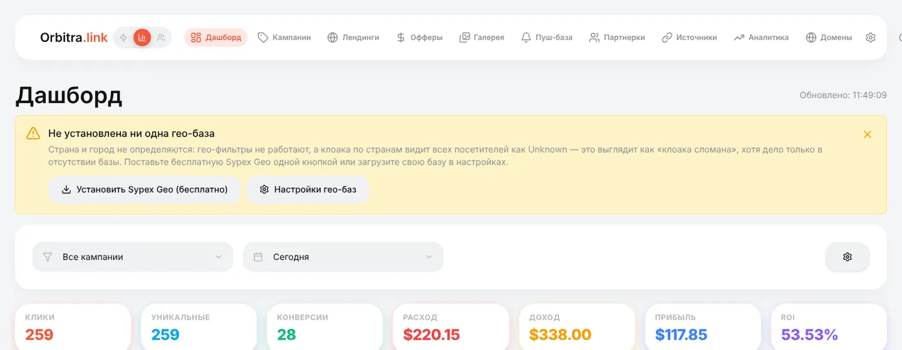

Для старта Sypex достаточно. Для хорошего клоакинга позже добавьте бесплатные базы MaxMind и IP2Location — см. [Гео-базы](guide-geo-databases.md).

## Шаг 3. Смените постбек-ключ

Откройте **⚙ → Postback URL**. Если видите предупреждение, что ключ постбека — публичный ключ по умолчанию, замените его: впишите в **Postback Key** любую случайную строку из букв и цифр (или сгенерируйте на сервере командой `php cli/generate_postback_key.php`) и нажмите **Сохранить настройки**.

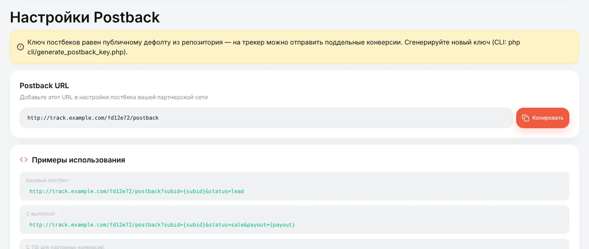

Ключ — часть адреса, на который партнёрки шлют конверсии. С публичным ключом кто угодно может прислать вам фейковые конверсии. Сделайте это **до того**, как добавите партнёрки: партнёрка сохраняет постбек-URL с тем ключом, который был в момент её создания, и после смены ключа пришлось бы исправлять URL в каждой партнёрке и в каждом кабинете партнёрки.

## Шаг 4. Добавьте домен

Ссылки кампаний на своём домене выглядят лучше (и дольше живут на модерации), чем на голом IP.

1. **Домены → Добавить домен**, впишите домен, например `go.example.com`, нажмите **Добавить**.
2. У регистратора или DNS-провайдера создайте **A-запись** этого домена на IP сервера, который показан вверху страницы «Домены».
3. Подождите: Orbitra сама проверит DNS и выпустит бесплатный сертификат Let's Encrypt.

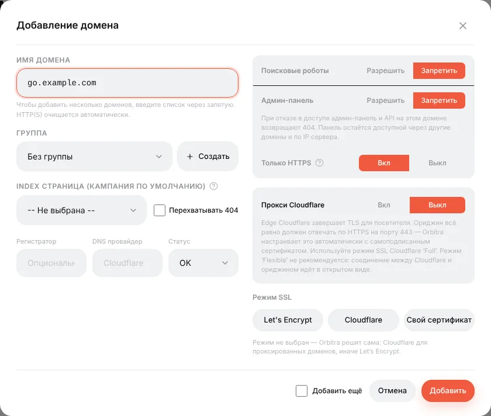

Подробности, Cloudflare и смысл каждого переключателя: [Подключение домена](guide-domains.md).

## Шаг 5. Добавьте партнёрку

**Партнерки → Создать**, выберите свою партнёрку в поле **Шаблон** (в списке около 440 сетей; если вашей нет — выберите **Generic**) и дайте ей название.

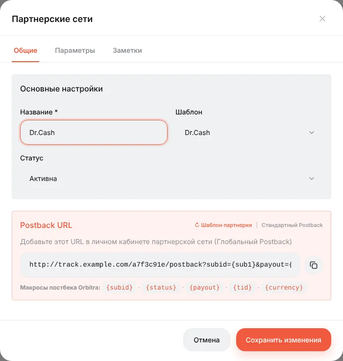

Шаблон заполняет две важные вещи:

- **Postback URL** — адрес, который вы отдадите партнёрке (шаг 10);
- вкладку **Параметры** — что Orbitra добавляет к каждой ссылке оффера этой партнёрки. Для Dr.Cash это `&sub1={subid}`: ID клика уходит в партнёрку в `sub1`, а партнёрка возвращает его в постбеке.

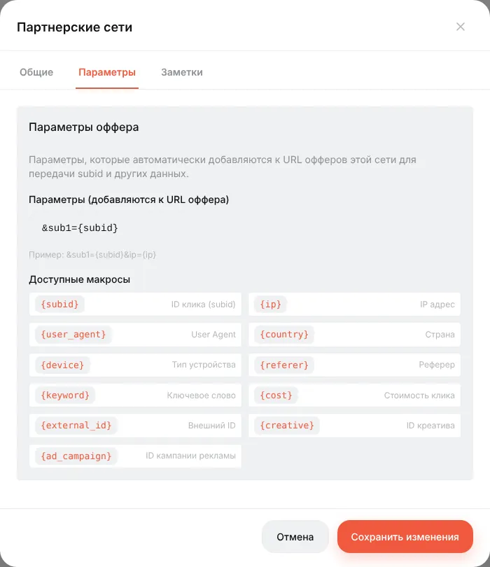

## Шаг 6. Добавьте оффер

**Офферы → Создать**:

- **Название** — любое понятное, например `Keto Slim — DE`;
- **Партнёрская сеть** — та, что создали на шаге 5;
- **Тип редиректа** — оставьте **Редирект** и **HTTP-редирект (302)**;
- **URL** — трекинговая ссылка из кабинета партнёрки (без `sub1=`: параметры партнёрки добавятся автоматически).

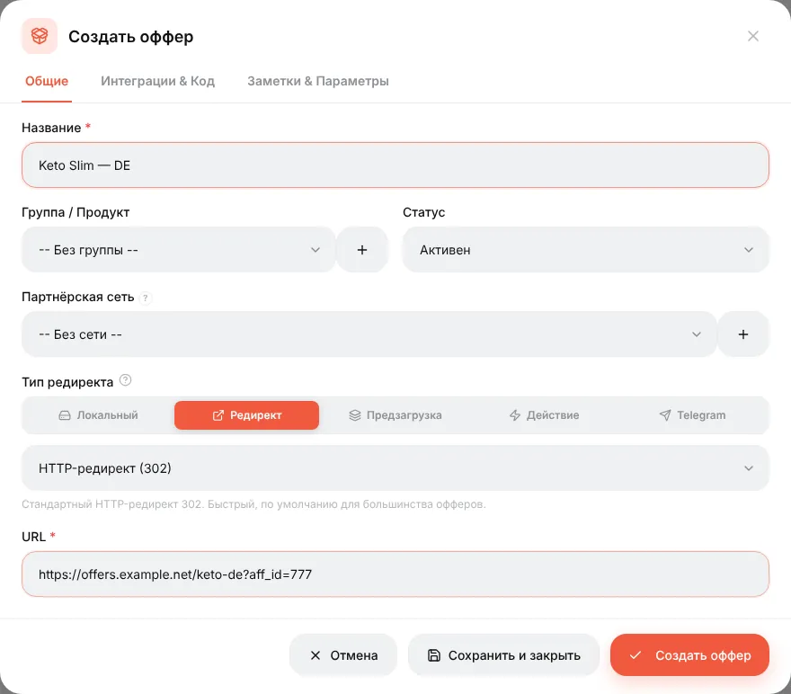

На вкладке **Заметки & Параметры** укажите страну и выплату (например, CPA, 30). Выплата здесь — только значение по умолчанию; реальная сумма приходит в постбеке.

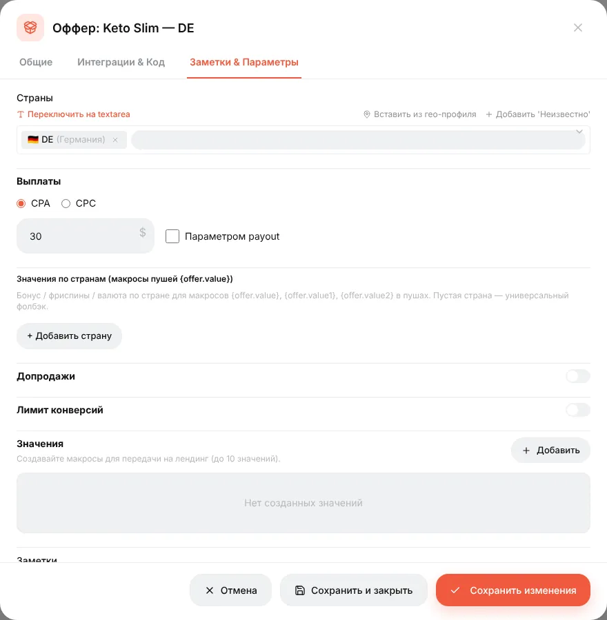

Если хотите делить трафик между двумя офферами — создайте второй так же. Подробнее: [Офферы и партнёрки](guide-offers-networks.md).

## Шаг 7. Добавьте источник трафика

**Источники → Создать**, в **Шаблоне источника** выберите **Facebook Ads**, назовите по своему рекламному кабинету.

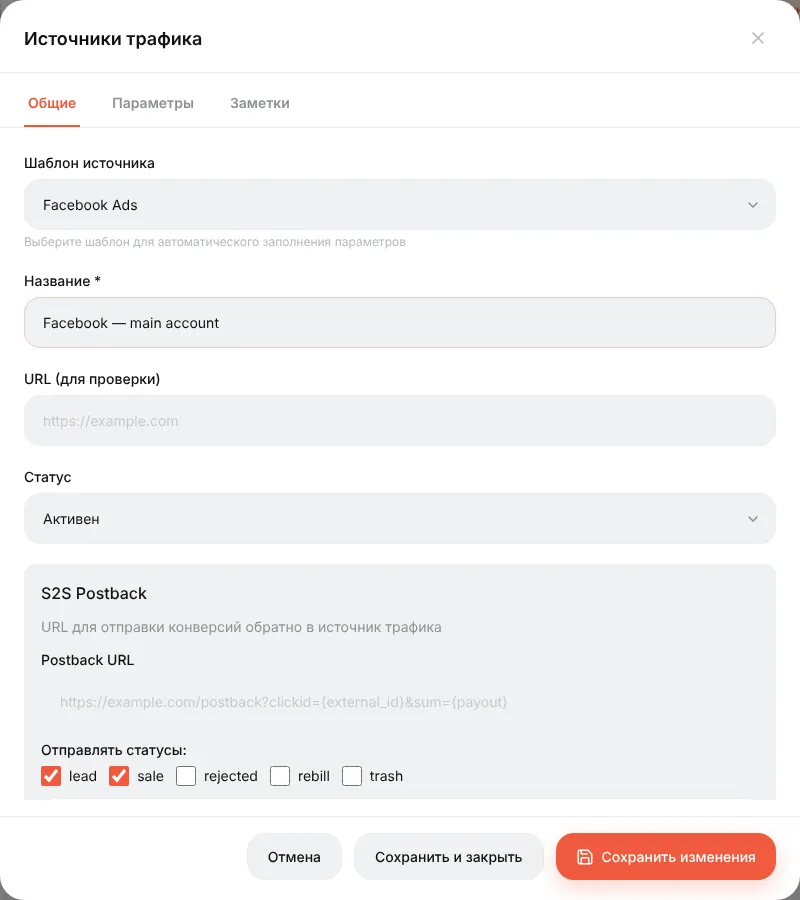

На вкладке **Параметры** теперь макросы Facebook вроде `{{ad.id}}` и `{{ad.name}}`. Они автоматически добавятся в ссылку кампании, а Facebook на каждом клике подставит вместо них реальные ID. Благодаря этому отчёты потом покажут результат по кампаниям, адсетам и объявлениям.

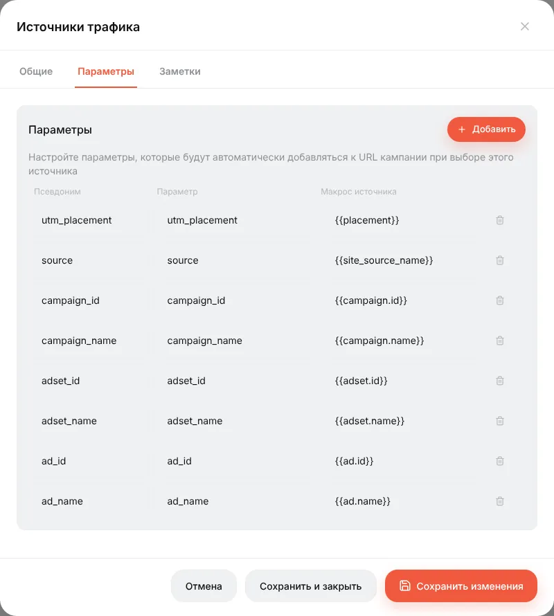

## Шаг 8. Создайте кампанию

**Кампании → Создать**. В редакторе слева настройки, справа потоки.

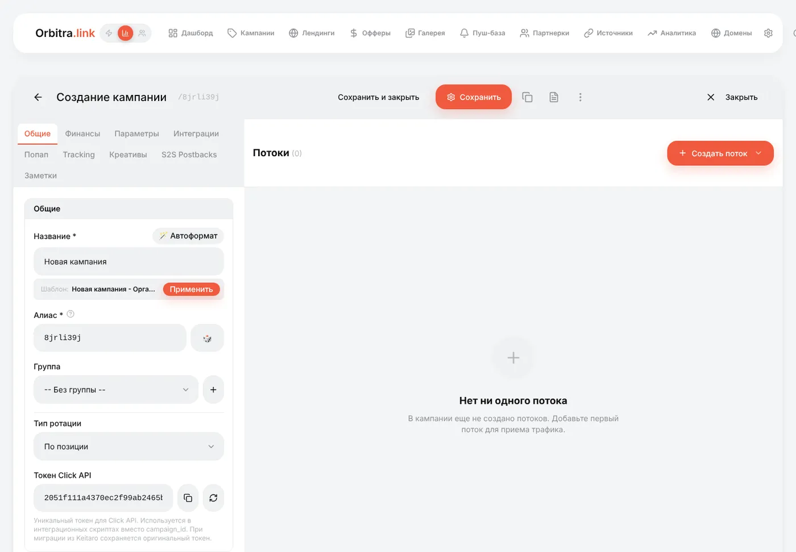

На вкладке **Общие**:

- **Название** — `Keto DE — Facebook`;
- **Домен** — `go.example.com`;
- **Источник трафика** — источник Facebook из шага 7.

Теперь основной поток: **Создать поток → Обычный**. Схему оставьте **Прямой переход на оффер**, нажмите **Добавить офферы** и отметьте оффер(ы).

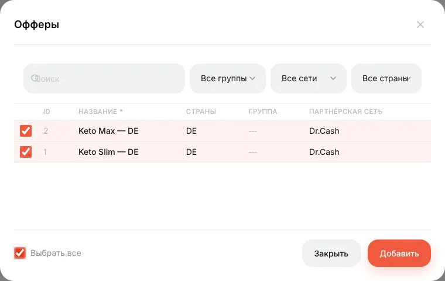

Затем **+ Добавить фильтр → Страна → Германия** и **+ Добавить фильтр → Устройство → Телефон** — чтобы поток брал только немецких мобильных посетителей.

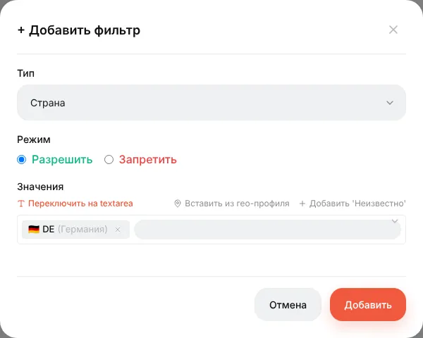

Нажмите **Сохранить**. В карточке потока видны офферы с распределением (50% / 50%) и фильтры.

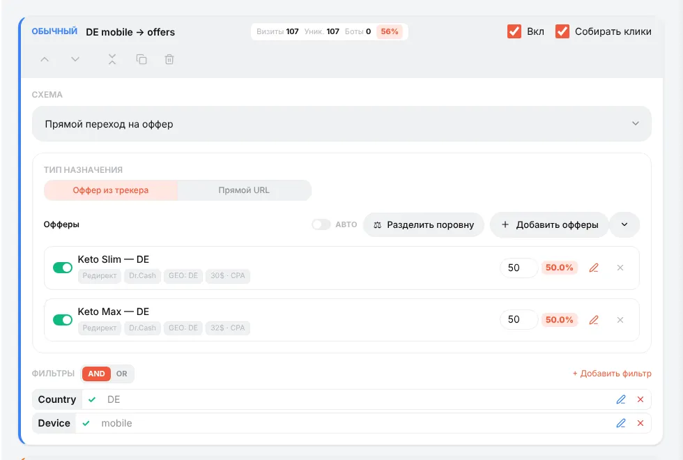

> **А что с остальными?** Посетитель, который не подошёл ни под один поток, не получит ничего. Добавьте **Замыкающий** поток (без фильтров), который отправит их на лендинг или другой оффер, и при желании **Перехватывающий** поток с фильтром **Бот** и действием **Показать 404**. Как потоки упорядочиваются и выбираются — в гайде [Потоки](guide-streams.md).

## Шаг 9. Проверьте ссылку, прежде чем тратить деньги

Прокрутите вкладку **Общие** вниз. Там:

- **URL кампании** — ссылка для объявления. Если выбран источник, в ней уже есть его макросы (`?utm_placement={{placement}}&ad_id={{ad.id}}…`);
- **Тестовая ссылка** — та же ссылка с подписью. Маршрутизация как у настоящего клика, но в статистику ничего не пишется.

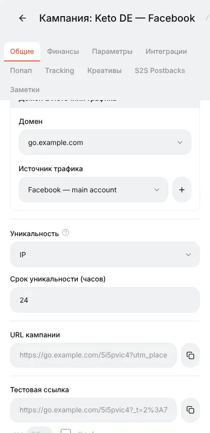

Добавьте к тестовой ссылке `&_dbg=1` и откройте: вместо редиректа будет трассировка — каждый поток, вердикт каждого фильтра, выбранный поток и итоговый URL с ID клика внутри. Добавьте `&_geo=DE`, чтобы «оказаться» в Германии без VPN.

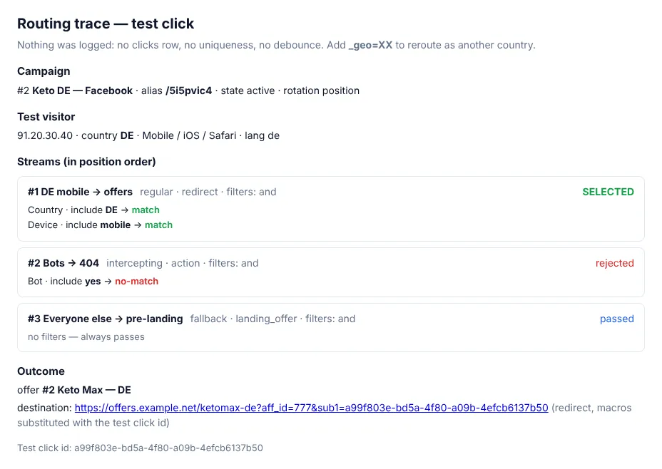

## Шаг 10. Отдайте постбек-URL партнёрке

Скопируйте **Postback URL** из раздела **Партнерки** (тот, что шаблон собрал под вашу сеть) и вставьте его в кабинете партнёрки как **глобальный постбек**. Не знаете, где это и что написать менеджеру? См. [Постбеки](guide-postbacks.md#что-написать-менеджеру-партнёрки).

Проверить цепочку без реальных продаж: **⚙ → Postback URL → Тестирование Postback** — вставьте ID клика из лога кликов, выберите статус и нажмите **Тест**.

## Шаг 11. Запускайте и следите

Вставьте **URL кампании** в объявление Facebook (целиком, с макросами). Когда пойдут посетители:

- **⚙ → Логи → Трафик** показывает каждый клик: время, страну, устройство, поток, куда ушёл;
- **⚙ → Конверсии** показывает каждый пришедший постбек;
- **Дашборд** и список **Кампании** показывают клики, конверсии, расход, доход, прибыль и ROI.

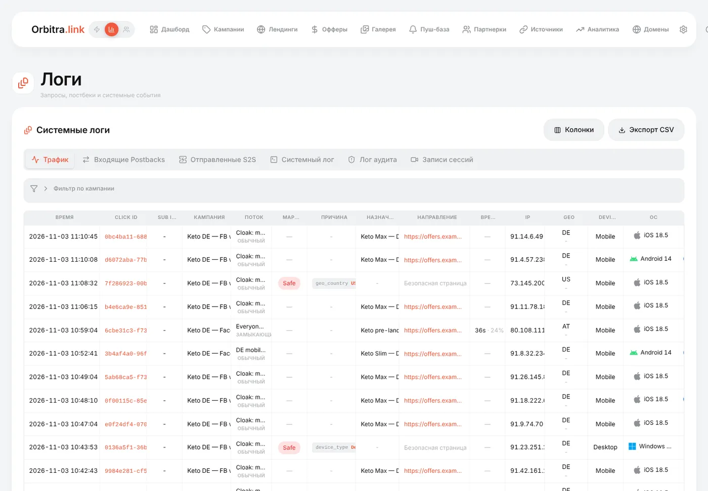

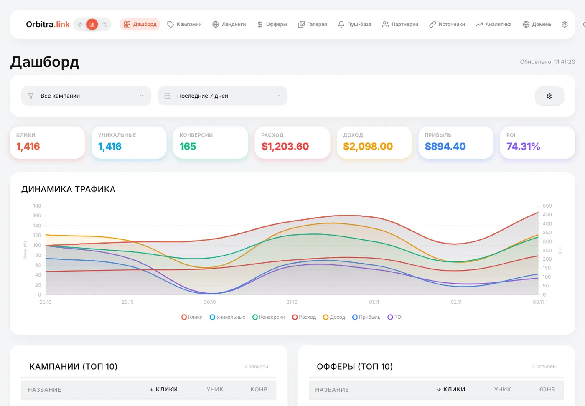

Нажмите на ID клика где угодно — откроется карточка клика: все параметры, которые принёс посетитель, поток, точный URL редиректа.

## Что дальше

- Задайте **расход** кампании на вкладке **Финансы** (или подключите импорт расходов из Facebook в **⚙ → Интеграции**) — без расхода нет прибыли и ROI. → [Расходы](costs.md)
- Разберитесь, что значат цифры: [Шпаргалка по метрикам](guide-metrics.md).
- Узнайте, какое объявление работает лучше: [Тест креативов в одной кампании](guide-creatives.md).
- Скройте оффер от модераторов: [Клоакинг для новичков](guide-cloaking.md).
