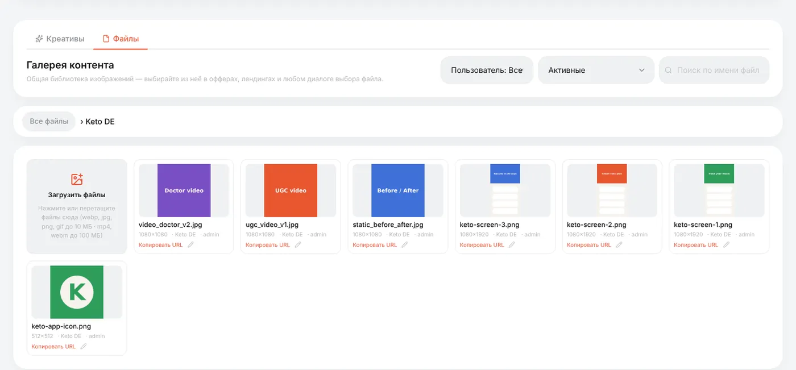
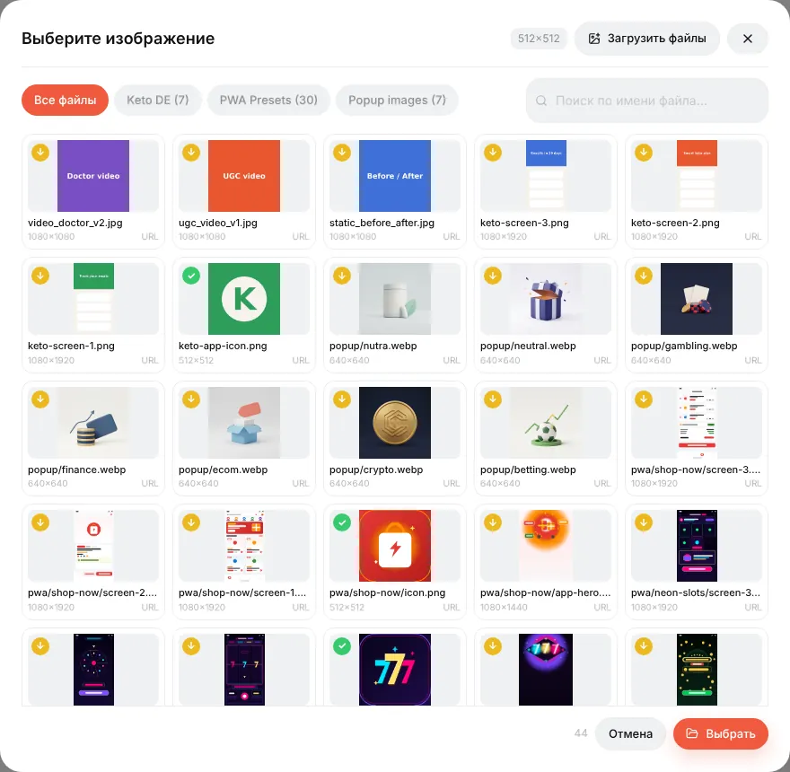

# Галерея контента

## Что это

**Галерея** — собственная медиатека трекера: одно место для всех картинок и видео, которые вы используете в панели:

- иконки и скриншоты для [PWA](guide-pwa.md);
- картинки для лендингов, офферов, попапов и пуш-уведомлений;
- ваши рекламные креативы (а при подключённом импорте расходов из Facebook/TikTok — и креативы, подтянутые из рекламных кабинетов; см. [Креативы](guide-creatives.md)).

Файлы хранятся на вашем сервере. Каждый выбор картинки в панели (иконка PWA, скриншоты, картинки попапа…) открывает эту медиатеку — загрузили один раз, используете везде.

У галереи две вкладки: **Файлы** (медиатека) и **Креативы** (эффективность рекламных креативов).

## Загрузка

**Галерея → Файлы**:

1. При желании создайте папку: **Новая папка** — например, под каждый оффер или ГЕО.
2. Откройте папку и перетащите файлы на **Загрузить файлы** (или нажмите на неё).

| Что | Ограничение |
|---|---|
| Картинки | webp, jpg, png, gif — до 10 МБ |
| Видео | mp4, webm — до 100 МБ |
| SVG | нельзя (может содержать скрипты) |

Трекер проверяет настоящий тип файла, а не расширение — переименованный файл не пройдёт.

На каждой плитке — размер в пикселях; **Скопировать URL** копирует прямую ссылку (удобно для иконки пуша или `` в лендинге); карандаш переименовывает или переносит файл.

Готовые папки **PWA Presets** и **Popup images** идут вместе с трекером и используются пресетами PWA и шаблонами попапов.

## Выбор файлов в редакторах

Везде, где панели нужна картинка, кнопка выбора из галереи открывает пикер: те же папки, поиск и вкладка загрузки.

Если у слота есть требуемый размер (иконка PWA — 512×512), плитки помечены: *точное совпадение*, *можно обрезать* или *слишком мала*. Выбор картинки побольше открывает обрезку; результат сохраняется как новый файл, оригинал не трогается.

## Удаление

Удаление «мягкое»: файл пропадает из пикера, но страницы, которые его уже используют, продолжают его показывать. Чтобы увидеть такие файлы, переключите фильтр на неактивные (удалённые). Удаление папки переносит её файлы в корень.

Справка: [Галерея контента](content-gallery.md), [Библиотека креативов](creatives-library.md).
