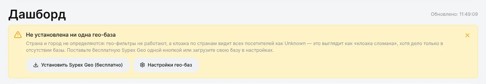
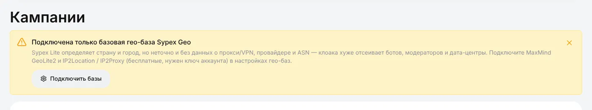
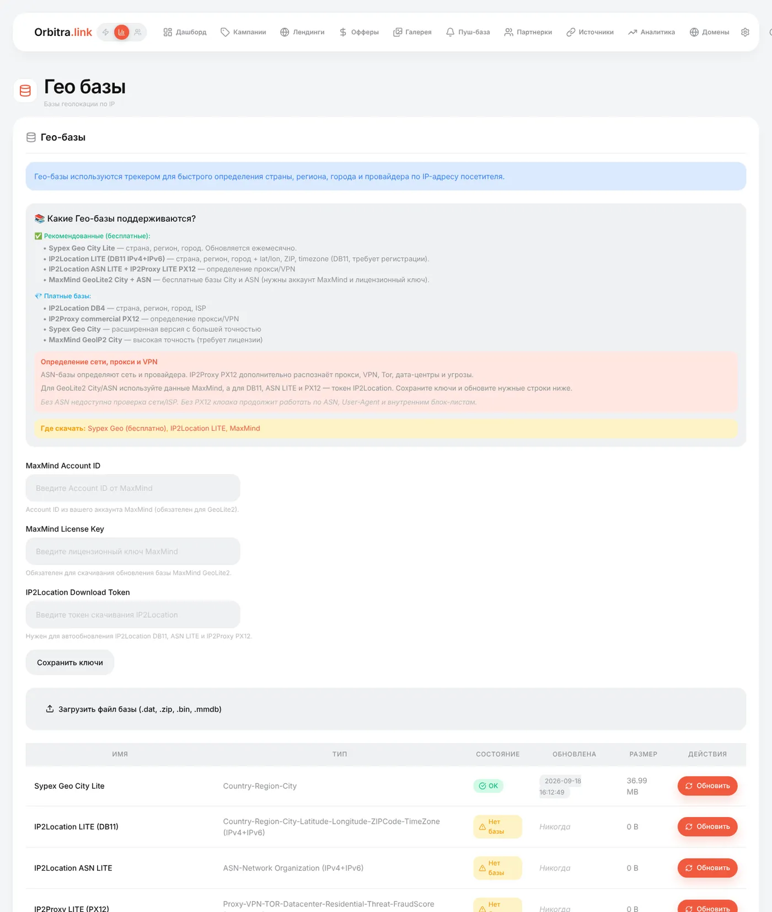

# Гео-базы

## Что это и зачем

Когда приходит посетитель, трекер видит только IP-адрес. **Гео-база** превращает IP в факты: страну, регион и город, провайдера (ISP) и сеть (ASN), принадлежит ли IP дата-центру, VPN или прокси.

Без неё:

- в отчётах нет стран;
- **фильтры по стране** в потоках не могут решить и просто не голосуют;
- **клоакинг** видит всех посетителей как *Unknown* — и с фильтром по стране отправляет **весь трафик на safe page**;
- детект дата-центров, провайдеров и VPN в клоаке выключен.

Поэтому поставьте базу до первой кампании. Это минута.

## Какие бывают базы

| База | Даёт | Цена | Что нужно |
|---|---|---|---|
| **Sypex Geo City Lite** | Страна, регион, город | Бесплатно | Ничего — один клик |
| **MaxMind GeoLite2 City + ASN** | Город, провайдер и ASN | Бесплатно | Бесплатный аккаунт MaxMind: Account ID + License key |
| **IP2Location LITE DB11** | Страна, город, координаты, индекс, **часовой пояс** | Бесплатно | Бесплатный аккаунт IP2Location: download token |
| **IP2Location ASN LITE** | Провайдер / сеть | Бесплатно | Тот же токен |
| **IP2Proxy LITE PX12** | **VPN, прокси, Tor, дата-центр, резидентные, fraud score** | Бесплатно | Тот же токен |
| Платные версии (IP2Location DB4, IP2Proxy PX12 коммерческая, MaxMind GeoIP2…) | Выше точность | Платно | Загрузите файл вручную |

**Рекомендуемый набор:** Sypex (страна) + MaxMind GeoLite2 ASN (провайдеры) + IP2Proxy PX12 (VPN/прокси). С ним работают все слои клоаки.

## Баннер на дашборде

| Баннер | Что значит |
|---|---|
| Гео-база не установлена | Ничего не стоит — поставьте Sypex сейчас |
| Подключена только базовая Sypex Geo | Страны работают, но у клоаки нет данных о провайдерах, дата-центрах и VPN. Добавьте MaxMind и IP2Location |

## Как установить

### Sypex (один клик)

Нажмите **Установить Sypex Geo (бесплатно)** на баннере или **⚙ → Гео базы → Обновить** в строке Sypex. На свежем сервере это делает и установщик.

### MaxMind GeoLite2

1. Зарегистрируйтесь на [maxmind.com](https://www.maxmind.com/en/geolite2/signup) (бесплатно).
2. В аккаунте MaxMind: **Manage License Keys → Generate new license key**. Запишите **Account ID** и ключ.
3. **⚙ → Гео базы**: вставьте **MaxMind Account ID** и **MaxMind License Key**, нажмите **Сохранить ключи**.
4. Нажмите **Обновить** в строках GeoLite2 City и GeoLite2 ASN.

### IP2Location / IP2Proxy

1. Зарегистрируйтесь на [lite.ip2location.com](https://lite.ip2location.com/) (бесплатно).
2. Скопируйте **download token** из аккаунта.
3. Вставьте его в поле токена IP2Location, **Сохранить ключи**, затем **Обновить** в строках DB11, ASN LITE и PX12.

В каждой строке — статус, дата последнего обновления и размер. Если база не скачалась, там будет ошибка.

### Свой файл

**Загрузить файл базы** принимает `.dat`, `.bin`, `.mmdb` или `.zip` с одним из них — для платных баз или сервера без интернета.

## Обновления

Базы обновляются раз в месяц фоновой задачей (`cli/geo_update.php`, ставится автоматически). MaxMind и IP2Location обновляются, только если сохранены их ключи. **Обновить** в строке обновляет базу сразу.

## Проверка

- Откройте тестовую ссылку кампании с `&_dbg=1` — трассировка покажет страну, определённую для вас.
- `&_geo=DE` подменяет страну для теста даже без базы.
- Клики в **⚙ → Логи → Трафик** показывают страну; карточка клика показывает ISP и ASN, когда эти базы стоят.

## Гео-профили

**⚙ → Гео-профили** — именованные списки стран: *EU*, *СНГ*, *Tier 1* или свои. Вставляются в фильтры по стране одним кликом вместо ввода 27 стран.

Справка: [Администрирование → Гео-базы](administration.md), [Клоакинг](cloaking.md).
