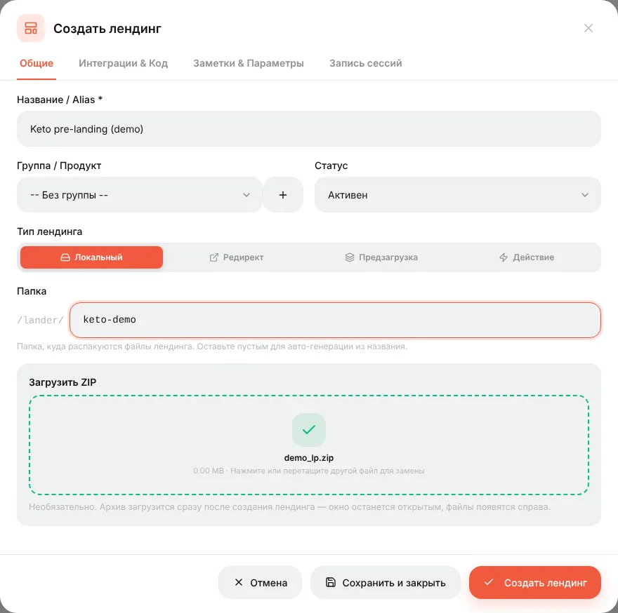
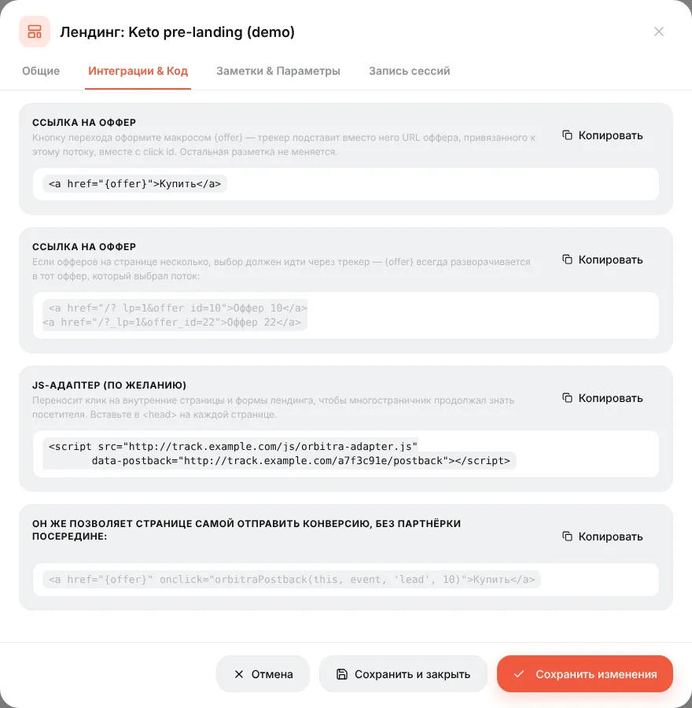
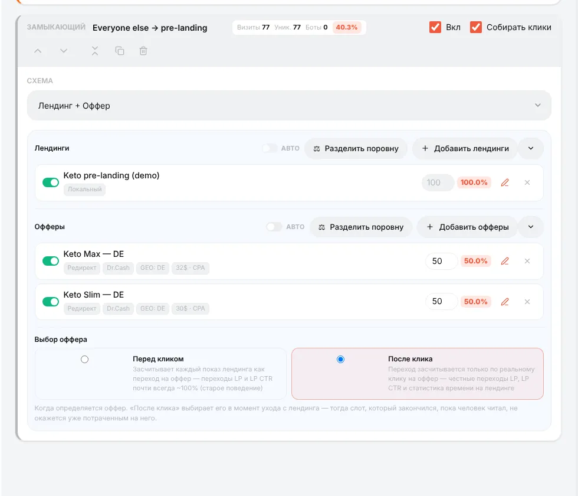
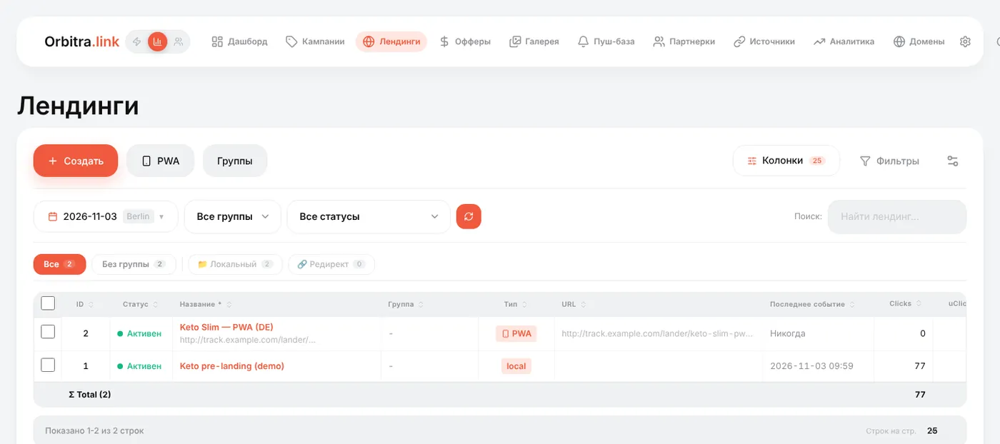

# Лендинги

## Что такое лендинг

**Лендинг** (прелендинг, прокладка) — ваша страница, которую посетитель видит **перед** оффером: история, квиз, отзыв, страница «специальная цена». Она прогревает посетителя, а прогретый лучше конвертится. Кнопка на ней ведёт на оффер через трекер, поэтому Orbitra знает, кто нажал.

Нужен ли он? Для многих офферов прямая ссылка работает отлично. Лендинг стоит тестировать, когда страница оффера «холодная», когда в объявлении не всё скажешь или когда хочется заранее отсеять нецелевых.

## Типы лендингов

| Тип | Где живёт страница | Когда использовать |
|---|---|---|
| **Локальный** | Вы загружаете ZIP, Orbitra отдаёт его с вашего домена | Обычный выбор — быстрее всего, ссылка кнопки подставляется сама |
| **Редирект** | На вашем хостинге или другом домене | Страница уже размещена где-то ещё |
| **Предзагрузка** | Чужой URL, который Orbitra подгружает и показывает под вашим доменом | Быстро переиспользовать готовую страницу |
| **Действие** | Ничего не показывается; трекер что-то делает | Особые случаи |
| **PWA** | Устанавливаемое «приложение», собранное в панели | См. [PWA-приложения](guide-pwa.md) |

## Как добавить локальный лендинг

1. Подготовьте страницу: папка с `index.html` (и её картинками, CSS, JS), упакованная в один архив. Пути относительные (`img/photo.jpg`).
2. Сделайте так, чтобы кнопка вела на оффер, макросом `{offer}`:

```html
<a href="{offer}">Получить предложение</a>
```

Orbitra заменит `{offer}` на трекинговую ссылку на оффер, выбранный в потоке. Вставлять URL оффера в страницу не нужно.

3. **Лендинги → Создать** → тип **Локальный** → название, папка (необязательно) → перетащите ZIP → **Создать лендинг**.



Файлы появятся во встроенном файловом менеджере — их можно править без повторной загрузки.

**Несколько офферов на одной странице** (например, три продукта): привяжите каждую кнопку к своему офферу — `<a href="{offer}&offer_id=10">`. Чтобы передать выбор, сделанный на странице (продукт, ответ квиза), в оффер, добавьте к ссылке `sub_id_5=…`; URL оффера сможет использовать его как `{sub_id_5}`. Подробности: [Landing pages](../landing-pages.md#linking-to-the-offer) (EN).

## Лендинг на другом сайте (Редирект)

Лендинг лежит на вашем хостинге, поэтому `{offer}` на странице не сработает. Поставьте трекинг-скрипт с вкладки **Интеграции & Код** лендинга в `<head>` страницы и ведите кнопку на `/?_lp=1`, как там показано. Скрипт позволяет трекеру узнать посетителя, который возвращается с вашего сайта.



## Лендинг в кампании

В потоке выберите схему **Лендинг + Оффер**, нажмите **Добавить лендинги** и **Добавить офферы**. Несколько лендингов делят трафик по весам — самый простой способ A/B-теста лендингов.



Оставьте **Выбор оффера: После клика** — оффер выбирается, когда посетитель действительно нажимает кнопку, и статистика лендинга честная.

## Статистика лендингов

В списке **Лендинги** и в отчёте кампании есть колонки для лендингов:

| Колонка | Значение |
|---|---|
| **LP Views** | Сколько раз показан лендинг |
| **LP Clicks** | Сколько посетителей нажали кнопку и ушли на оффер |
| **LP CTR** | LP Clicks ÷ LP Views — насколько хорошо лендинг толкает на оффер |
| **Время на LP**, **LP bounce**, **LP scroll** | Сколько времени люди проводят на странице (только видимое время), доля ушедших быстрее 5 секунд, как далеко прокручивают. На локальных лендингах меряется автоматически |
| **CR**, **EPV** | Конверсии на клик и заработок на визит — итоговый вердикт |



Хотите увидеть, что посетители делают на самом деле? Включите **Запись сессии** в редакторе лендинга — записи в стиле Clarity и карта кликов, хранятся на вашем сервере. → [Записи сессий](session-recordings.md)

Справка: [Landing pages](../landing-pages.md) (EN), [Tracking Client (PHP)](../tracking-client-php.md) (EN).
