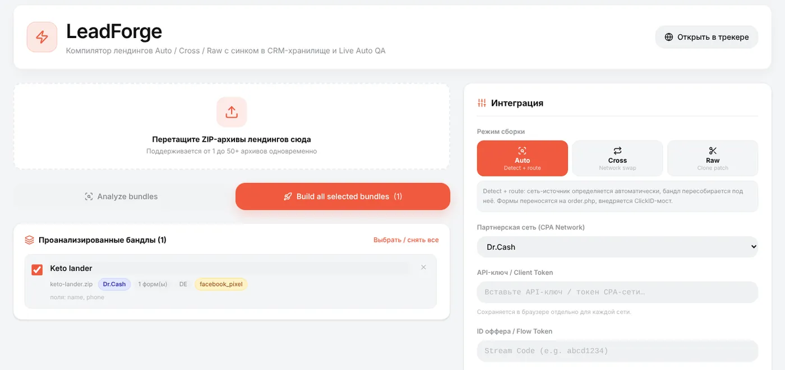
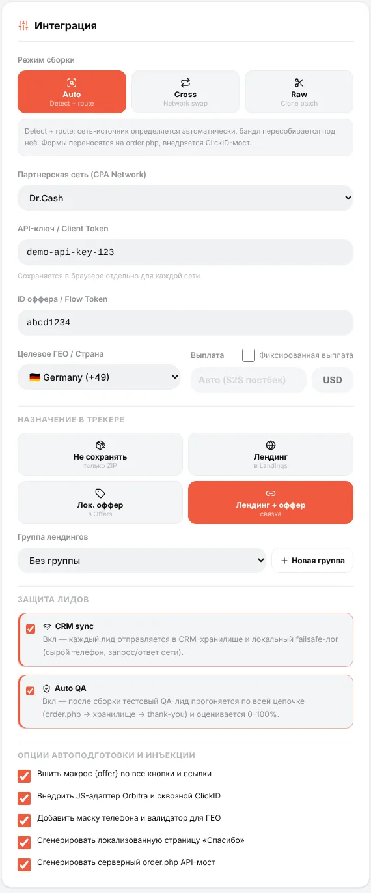
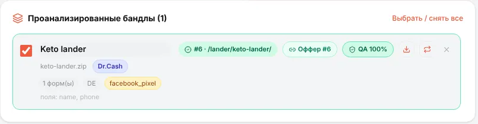
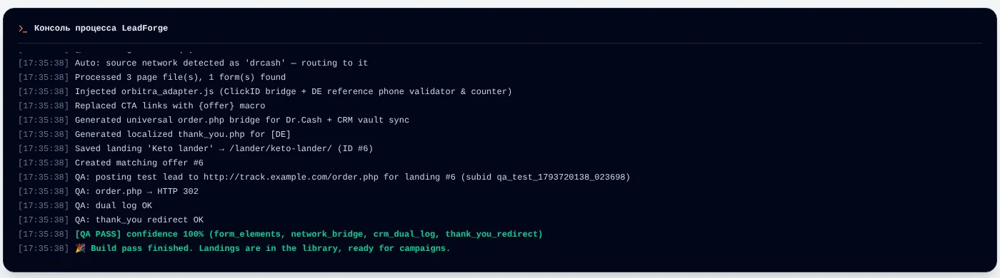
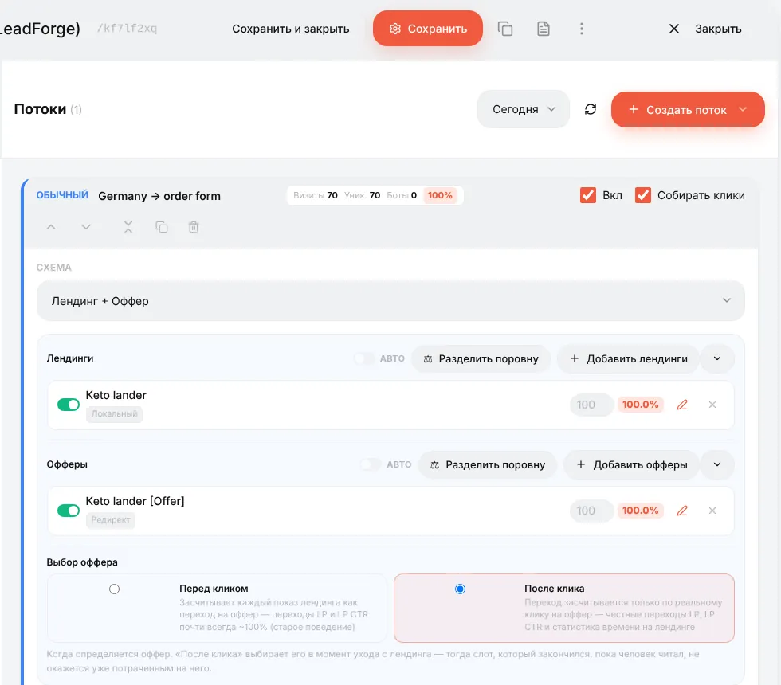

# LeadForge: лендинг с формой заказа на вашем трекере

## Что это

Многие офферы — прежде всего нутра и товарка с оплатой при получении (COD) — продаются через **форму**: имя, телефон, «Заказать». Обычно форма живёт на лендинге партнёрки, а вы просто льёте трафик на её ссылку.

**LeadForge** позволяет хостить такой лендинг у себя и отправлять лиды в партнёрку **по API**:

1. Вы берёте ZIP лендинга (из промо-материалов партнёрки, из спай-сервиса или свой).
2. LeadForge анализирует его, вырезает обработчик заказа старой сети и чужие пиксели и собирает новый **`order.php`**, который отправляет каждый лид прямо в API вашей партнёрки вместе с вашим click ID.
3. Добавляет маску телефона и валидацию под страну, локализованную страницу «Спасибо» и мост для click ID.
4. Результат сохраняется в трекер как лендинг (и при желании как связанный оффер) — сразу для кампании.
5. Каждый лид дополнительно сохраняется в [CRM](guide-crm.md) с точным телефоном, отправленным в сеть, и ответом сети — ваше доказательство, если лиды «теряются».

Зачем: страница под вашим контролем (скорость, клоакинг, A/B-тесты, свой домен), вы видите каждый лид в момент отправки и можете доказать партнёрке «шейв».

LeadForge открывается **иконкой молнии ⚡** в переключателе слева вверху (*LeadForge · Трекер · CRM*).

> LeadForge нужны включённые **PHP-лендинги** (сгенерированный `order.php` — это PHP). Если они выключены, LeadForge покажет баннер с кнопкой включения в один клик; тот же переключатель есть в **⚙ → Настройки → Общие**.

## Шаг 1. Загрузите ZIP-архивы и проанализируйте

Перетащите один или сразу много ZIP лендингов (до 50+ за раз) в зону загрузки и нажмите **Анализировать бандлы**.

По каждому архиву LeadForge показывает, что нашёл: исходную партнёрку (по сигнатурам кода — здесь *Dr.Cash*), количество форм и их поля, ГЕО и чужие скрипты, которые будут удалены (`facebook_pixel`, TikTok, Google Analytics, Яндекс Метрика, блокировщики devtools, редиректы по кнопке «Назад»). Консоль внизу записывает каждый шаг.

## Шаг 2. Выберите, как собирать

**Режим сборки**

| Режим | Что делает | Когда |
|---|---|---|
| **Auto** | Определяет исходную партнёрку и пересобирает лендинг под неё: формы переподключаются к новому `order.php`, внедряется мост click ID | Лендинг из той же партнёрки, с которой вы работаете |
| **Cross** | Смена сети: обработчики старой партнёрки (`order.php`, `send.php`, `api.php`…) и зашитые в них ключи вырезаются, лендинг пересаживается на выбранную вами сеть | Лендинг одной партнёрки, оффер другой |
| **Raw** | Клон-патч: только чистит чужие счётчики и скрипты и внедряет мост click ID и макросы `{offer}`. Без `order.php` | Лендинг, кнопка которого должна вести на обычную ссылку оффера, а не на форму |

**Настройки сети**

- **CPA-партнёрка** — сеть, которая получит лиды. Встроенные адаптеры: Dr.Cash, LemonAD, Webvork, Leadbit, Everad, KMA.biz, TerraLeads, Lucky.online, Ezaff, AdCombo, а также **Custom API / Webhook** для любой сети с POST API. Ваши партнёрки из трекера тоже есть в списке и используют custom-адаптер.
- **API-ключ / токен** — из настроек API в кабинете партнёрки. Запоминается для каждой сети в вашем браузере.
- **ID оффера / потока** — как сеть называет оффер или поток (Dr.Cash — stream code, Leadbit — flow hash…). Подсказка в поле говорит, что именно.
- **Целевое ГЕО** — страна: от неё зависят маска телефона, правила валидации, язык страницы «Спасибо» и формат номера, отправляемого в сеть.
- **Выплата** — оставьте *Auto (S2S postback)*, чтобы брать реальную сумму из постбека сети, или отметьте фиксированную выплату.

**Куда сохранить в трекере**

| Вариант | Результат |
|---|---|
| **Не сохранять** | Только ZIP для скачивания |
| **Лендинг** | Лендинг в разделе **Лендинги**, готовый для потока *Лендинг + Оффер* |
| **Локальный оффер** | Оффер в разделе **Офферы**, который сам отдаёт страницу |
| **Лендинг + Оффер** | Оба, связанные между собой — удобнее всего для кампании |

**Защита лидов**

- **Синхронизация с CRM** (вкл.) — каждый лид дополнительно уходит в хранилище CRM с сырым телефоном и полным запросом/ответом сети, плюс локальный резервный лог. Не выключайте.
- **Auto QA** (вкл.) — после сборки тестовый лид проходит всю цепочку (`order.php` → хранилище CRM → страница «Спасибо»), и бандл получает оценку от 0 до 100%. QA-лиды помечены *QA-Test* и никогда не попадают в статистику.

**Опции автоматизации** — по умолчанию включены все: вставить `{offer}` в CTA-ссылки, внедрить JS-адаптер и мост click ID, добавить маску телефона под ГЕО с живой валидацией, сгенерировать локализованную страницу «Спасибо», сгенерировать `order.php`.

## Шаг 3. Соберите

Нажмите **Собрать все выбранные бандлы**. Карточка бандла показывает, куда он сохранён, и оценку QA:

Консоль показывает, что именно сделано: какие скрипты удалены, какие файлы созданы, шаги QA:

Иконки на карточке скачивают готовый ZIP или пересобирают бандл; повторный Live QA запускает тест заново. **Открыть в трекере** переходит к сохранённому лендингу.

Если QA не прошёл, консоль назовёт шаг с ошибкой (например, `order_php_http_0` — трекер не смог обратиться к собственному `order.php`; обычно это проблема домена или SSL на сервере).

## Шаг 4. Используйте в кампании

Создайте кампанию (см. [Первая кампания](guide-first-campaign.md)) с потоком **Лендинг + Оффер**: добавьте лендинг LeadForge и связанный оффер.

Путь посетителя: реклама → ссылка кампании → ваш лендинг с формой заказа → `order.php` отправляет лид в API партнёрки с click ID → страница «Спасибо». В тот же момент в трекере появляется конверсия со статусом **lead**, а лид — в [CRM](guide-crm.md).

## Шаг 5. Получайте статусы обратно

Апрув, отклон или треш партнёрка решает позже. Чтобы это было видно в Orbitra, партнёрка должна присылать **постбеки**, как по любому другому офферу — см. [Постбеки](guide-postbacks.md). Постбек обновляет и конверсию в трекере, и лид в CRM.

## Как проверить бандл вручную

Откройте **ссылку кампании** и отправьте форму с тестовым именем и телефоном. Набрать `/order.php` в браузере — *не* проверка: это запрос без формы и без клика, и трекер ответит «Campaign not found».

Справка: [Landing pages → LeadForge](../landing-pages.md#leadforge-20-landing-analyzer-js-validation--multi-network-bridge) (EN), [LeadForge subid validation](../leadforge-subid-validation.md) (EN).
