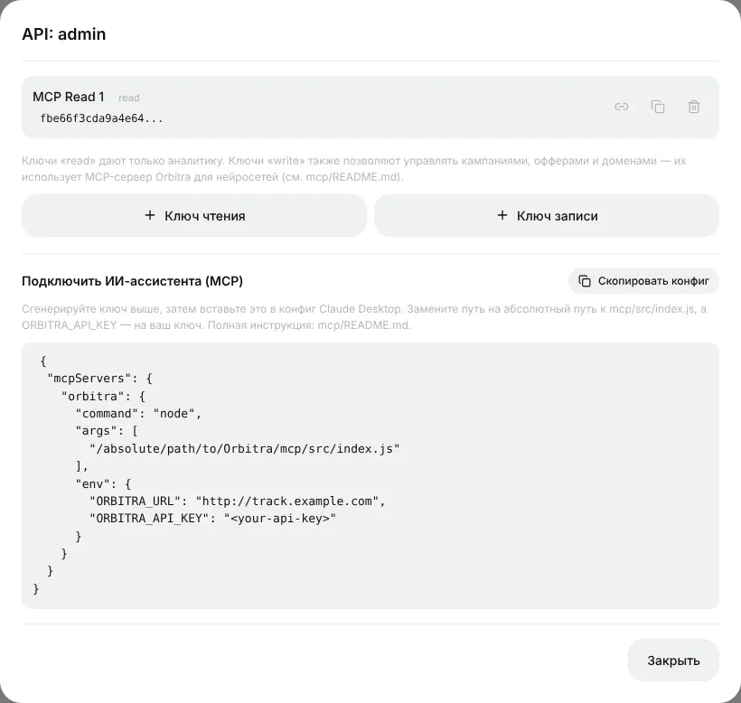
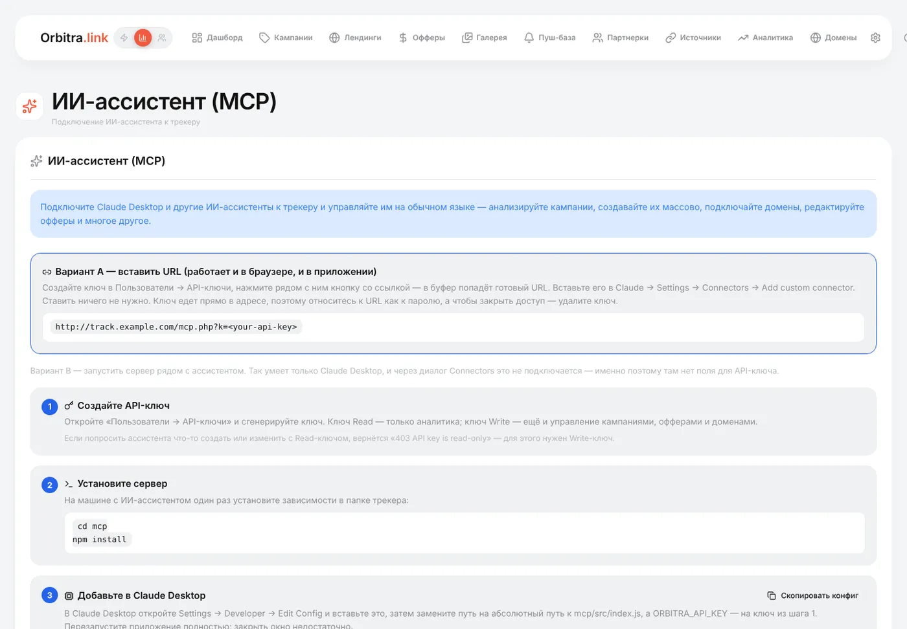

# ИИ-ассистент (MCP): управляйте трекером обычными словами

## Что это

**MCP** (Model Context Protocol) — стандартный способ дать ИИ-ассистенту (Claude и другим MCP-клиентам) инструменты для работы с вашей программой. В Orbitra есть MCP-сервер, поэтому после разового подключения ассистенту можно просто писать:

> «Как отработали мои кампании за последние 7 дней? Какая ушла в минус?»
>
> «Покажи вчерашние конверсии кампании Keto DE по странам».
>
> «Создай 5 кампаний под оффер №4 — по одной на ГЕО: DE, AT, CH, FR, IT — на домене go.example.com».
>
> «Добавь домен promo.example.com и поставь на его корень кампанию 12».
>
> «У каких креативов ROI на этой неделе ниже нуля?»

Ассистент сам вызывает API трекера: читает статистику, строит отчёты, создаёт и редактирует кампании, офферы, домены, источники трафика и лендинги (всего 41 инструмент). Он видит только то, что разрешает ваш API-ключ.

## Ключ чтения или ключ записи?

Ключи создаются в **⚙ → Пользователи и профиль** → число в колонке API-ключей у пользователя → **Ключ чтения** или **Ключ записи**.



| Ключ | Может |
|---|---|
| **Чтения** | Только смотреть: метрики, списки, отчёты, конверсии. Физически ничего не может изменить — безопасно для начала |
| **Записи** | Всё, что ключ чтения, плюс создание, изменение и удаление кампаний, офферов, доменов, источников, лендингов |

Начните с ключа чтения. Если попросить такого ассистента что-то изменить, он ответит *403 API key is read-only* — тогда создайте ключ записи.

## Подключение — вариант A: ссылка (проще всего)

Работает в приложениях Claude (веб, десктоп, мобильное), ничего ставить не нужно.

1. Создайте ключ (см. выше) и нажмите иконку **ссылки** рядом с ним — скопируется готовый URL вида `https://track.example.com/mcp.php?k=ВАШ_КЛЮЧ`.
2. В Claude: **Settings → Connectors → Add custom connector**, вставьте URL, задайте имя (*Orbitra*), **Add**.
3. В новом чате попросите «Проверь связь с моим трекером Orbitra» — ассистент должен ответить версией вашего трекера.

> 🔑 Ключ — внутри ссылки, поэтому обращайтесь с ней как с паролем: нигде не публикуйте. Чтобы отключить доступ, удалите ключ — ссылка сразу перестанет работать.

Страница **⚙ → ИИ / MCP** показывает те же инструкции с уже подставленным адресом вашего трекера.



## Подключение — вариант B: локальный сервер для Claude Desktop

Для тех, кто предпочитает запускать сервер на своём компьютере. Нужны Node.js и копия репозитория Orbitra.

1. В репозитории: `cd mcp && npm install`.
2. В Claude Desktop: **Settings → Developer → Edit Config** и добавьте:

```json
{
  "mcpServers": {
    "orbitra": {
      "command": "/usr/local/bin/node",
      "args": ["/absolute/path/to/Orbitra/mcp/src/index.js"],
      "env": {
        "ORBITRA_URL": "https://track.example.com",
        "ORBITRA_API_KEY": "ваш-api-ключ"
      }
    }
  }
}
```

3. Полностью закройте Claude Desktop (⌘Q на Mac) и запустите снова.

Кнопка **Скопировать конфиг** в окне API-ключей даёт этот блок с вашим адресом. Если сервер не появился: укажите абсолютный путь к `node` (его покажет `which node`), проверьте, что выполнен `npm install`, и проверьте ключ командой `ORBITRA_URL=… ORBITRA_API_KEY=… npm run smoke -- --ping`.

## Хорошие запросы

- Конкретизируйте период и сущность: «кампания 12, последние 7 дней, по странам».
- Для изменений сначала просите план: «Покажи, что создашь, и дождись моего ОК».
- Сильнее всего ассистент в массовой работе: «Склонируй кампанию 12 под AT и CH, потоки те же, оффер №7 вместо №4».

## Безопасность

- Ключ уходит только на адрес вашего трекера.
- Удалите ключ в **⚙ → Пользователи и профиль** — и все ассистенты с этим ключом сразу теряют доступ.
- Давайте ассистенту ключ чтения, если ему действительно не нужно ничего менять.

Справка: [MCP](mcp.md), [REST API](api.md).
