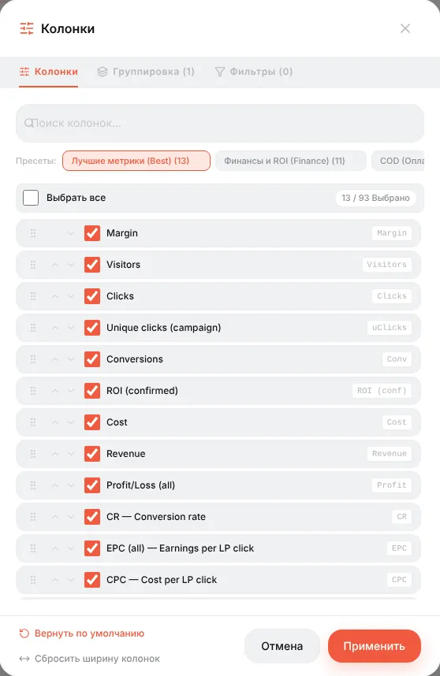

# Шпаргалка по метрикам

Каждая колонка, которую можно добавить на дашборд, в списки кампаний / офферов / лендингов и в конструктор отчётов, с формулой, по которой её считает Orbitra. Колонки выбираются в **Колонки** (или **⚙** на дашборде); при наведении на заголовок колонки в таблице тоже есть короткая подсказка.

Сокращения и сленг (CPA, RevShare, FTD, COD…) объяснены в [Словаре](glossary.md).

**Готовые наборы колонок** (пресеты вверху окна «Колонки»):

| Пресет | Для чего |
|---|---|
| **Best** | Общая картина: визиты, клики, конверсии, расход, доход, прибыль, ROI, CR, EPC, CPC, CPA |
| **Finance** | Деньги: доход по статусам, прибыль, ROI подтверждённый и общий |
| **COD** | Офферы с оплатой при получении: лиды, продажи, апрув, отклонённые, треш, CPL, CPS |
| **Lander to Offer** | Эффективность лендинга: показы, клики, LP CTR, время на странице, отказы, скролл, установки PWA |
| **Traffic** | Качество трафика: уники, боты, возможные боты, прокси, пустые рефереры |

## Трафик

| Метрика | Что считает |
|---|---|
| **Clicks (Клики)** | Каждый заход на ссылку кампании, каким бы потоком он ни был обслужен — как в Keitaro. Переходы на оффер считаются отдельно (*LP clicks*, *Real offer clicks*) |
| **Visitors (Визиты)** | Все заходы на URL кампании — равно кликам; знаменатель CPV и EPV |
| **Unique clicks (campaign)** / uClicks | Посетители, посчитанные один раз на кампанию (по IP, IP + User-Agent или cookie — настройка уникальности кампании) в пределах периода уникальности |
| **Unique clicks (flow)** | Один раз на поток — посетитель, попавший в два потока, считается в каждом |
| **Unique clicks (global)** | Один раз на весь трекер |
| **Unique clicks %** | Уники ÷ Клики |
| **Bots (Боты)** | Заходы, чей User-Agent похож на краулер или утилиту (те же сигнатуры, что у клоаки). Входят в Визиты |
| **Bot %** | Боты ÷ Клики |
| **Possible bots** | Визиты, где таймер лендинга работал, но не было ни одного движения мыши или касания — подсказка, а не вердикт |
| **Proxies** | Заходы с IP прокси / VPN / Tor. Нужна база IP2Proxy |
| **Empty referrers** | Заходы без реферера: ввели вручную, встроенный браузер или источник его обрезает |

## Конверсии

| Метрика | Что считает |
|---|---|
| **Conversions (Конверсии)** | Все конверсии, пришедшие постбеком, любого статуса |
| **Leads (Лиды)** | Конверсии в статусе *lead* (холд, ожидание) |
| **Sales (Продажи)** | Подтверждённые конверсии (*sale*) |
| **Rejected** | Отклонённые рекламодателем |
| **Trash** | Невалидные лиды (фейковый телефон, дубль…) |
| **Registrations**, **Deposits** | Конверсии типов *registration* / *deposit* (гемблинг, беттинг, финансы) |
| **Approve %** | Продажи ÷ (лиды + продажи + отклонённые + треш) — доля лидов, за которые рекламодатель заплатил |
| **CR** | Конверсии ÷ Клики × 100% |
| **CR (sales / deposits / hold / registrations)** | То же, но только по этому статусу |
| **CR (regs to deps)** | Депозиты ÷ Регистрации |
| **uCR** | Регистрации ÷ Уникальные клики |

Какие статусы считаются «конверсией», «продажей» или «прибылью», задаётся в **⚙ → Настройки → Типы конверсий**.

## Деньги

| Метрика | Формула |
|---|---|
| **Cost (Расход)** | Сколько стоил трафик: по модели стоимости кампании (CPC, CPM…) или из импорта расходов (Facebook, TikTok, Google, пуш-сети) |
| **Spend (cabinet)** | Расход без агентской комиссии |
| **Agency fee** | Комиссия, добавленная к расходу платформы, если настроено агентство |
| **Revenue (Доход)** | Сумма выплат всех конверсий |
| **Revenue (confirmed / hold / rejected / trash / registration / deposit)** | Доход конверсий в этом статусе |
| **Profit/Loss (all)** | Доход − Расход |
| **Profit/Loss (confirmed)** | Подтверждённый доход − Расход |
| **ROI (all)** | Прибыль ÷ Расход × 100%. +50% — каждый потраченный $1 вернулся как $1,50 |
| **ROI (confirmed)** | То же, только по подтверждённым деньгам — честная цифра для офферов с холдом |
| **Margin (Маржа)** | Прибыль ÷ Доход × 100% — какую долю дохода вы оставляете себе |

## Юнит-экономика

| Метрика | Формула | Отвечает на вопрос |
|---|---|---|
| **EPC** — доход на клик | Доход ÷ Клики | Сколько стоит один клик. Сравнивайте с CPC: EPC > CPC — значит, в плюсе |
| **uEPC** | Доход ÷ Уникальные клики | То же на уникального посетителя |
| **EPC (hold / registration / confirmed)** | Этот доход ÷ Клики | — |
| **EPV** — доход на визит | Доход ÷ Визиты | Равен EPC, раз каждый визит теперь клик |
| **CPC** — цена клика | Расход ÷ Клики | — |
| **uCPC** | Расход ÷ Уникальные клики | — |
| **CPV** — цена визита | Расход ÷ Визиты | Равна CPC |
| **eCPC** | Расход ÷ Клики | То же, что CPC, оставлено по привычке Keitaro |
| **CPA** — цена действия | Расход ÷ Конверсии | Во сколько вам обходится одна конверсия |
| **CPL / CPS / CPR / CPD** | Расход ÷ Лиды / Продажи / Регистрации / Депозиты | — |
| **EC** — доход на конверсию | Доход ÷ Конверсии | Средняя выплата |
| **EC (confirmed)** | Подтверждённый доход ÷ Продажи | — |
| **eCPM** | Прибыль ÷ Клики × 1000 | Прибыль на тысячу кликов |

## Цифры рекламной платформы

Заполняются, только если подключён импорт расходов из рекламной платформы:

| Метрика | Формула |
|---|---|
| **Impressions** | Показы объявлений по данным платформы |
| **Clicks (platform)** | Клики по ссылке по данным платформы |
| **CPM (platform)** | Расход ÷ Показы × 1000 |
| **CTR (platform)** | Клики платформы ÷ Показы |
| **Click loss** | 1 − Визиты ÷ Клики платформы — клики, за которые платформа взяла деньги, но до трекера они не дошли (медленная страница, встроенный браузер, боты) |

## Лендинги

| Метрика | Формула |
|---|---|
| **LP Views** | Показы лендинга |
| **LP Clicks** | Посетители, которые нажали кнопку и действительно ушли на оффер |
| **LP CTR** | LP Clicks ÷ LP Views × 100% |
| **Real LP clicks**, **Real LP CTR**, **Real offer clicks** | Та же честная воронка под именами, которые использовали старые наборы колонок; *Real offer clicks* = прямые клики на оффер + переходы с лендинга |
| **Time since LP click** (LP time) | Среднее время от открытия лендинга до нажатия кнопки |
| **Time on LP** | Среднее время на лендинге **всех** посетителей, включая тех, кто не кликнул. Считается только видимое время |
| **LP bounce rate** | Доля измеренных визитов короче 5 секунд |
| **LP scroll depth** | Средняя максимальная прокрутка, 0–100% |
| **LP measured visits** | Сколько визитов прислали время — выборка для трёх метрик выше |

## PWA, пуши и попапы

| Метрика | Формула |
|---|---|
| **PWA install intents** | Нажатия кнопки «Установить» в PWA |
| **PWA installs** / **Real PWA installs** | События установки; *real* — без ботов |
| **PWA opens** | Повторные открытия установленного приложения с главного экрана |
| **PWA install rate** | Реальные установки ÷ Клики |
| **PWA screen views** | Просмотры экранов воронки PWA |
| **Push subscribers** | Клики, чей посетитель разрешил уведомления |
| **Popup shown / clicks / closed / conversions**, **Popup CTR** | Воронка попапа конверсии; CTR = клики по попапу ÷ показы попапа. См. [Попапы конверсии](conversion-popups.md) |

## Как читать вместе

- **Кампания в плюсе?** ROI (confirmed). Положительный — да.
- **Проблема в трафике или в оффере?** CR низкий при нормальном CPC — оффер или лендинг; CR нормальный, но CPC высокий — трафик слишком дорогой.
- **Помогает ли лендинг?** Сравните LP CTR и CR потоков *Лендинг + Оффер* с *Прямым* потоком.
- **Режет ли партнёрка лиды?** Approve % падает при том же количестве лидов.
- **Платите ли вы за ботов?** Bot %, Possible bots, Click loss.

Свои формулы: **⚙ → Настройки → Пользовательские метрики**. Справка: [Отчёты, логи и метрики](reports.md).
