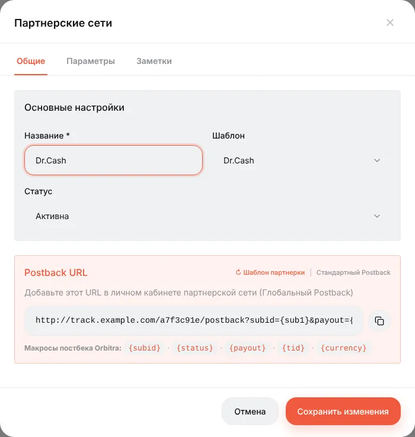
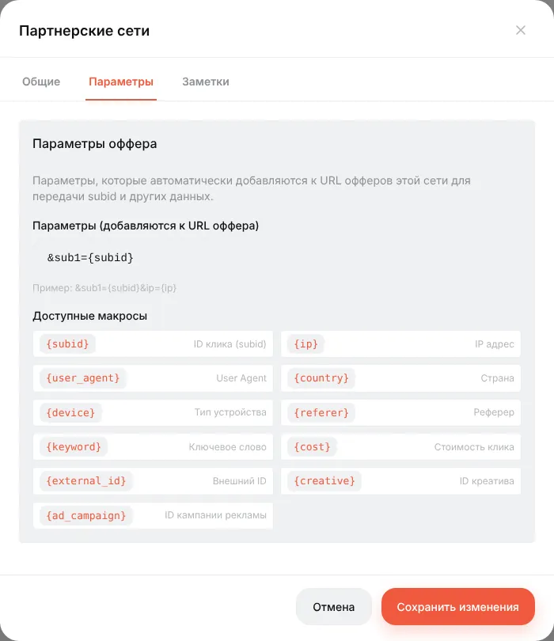
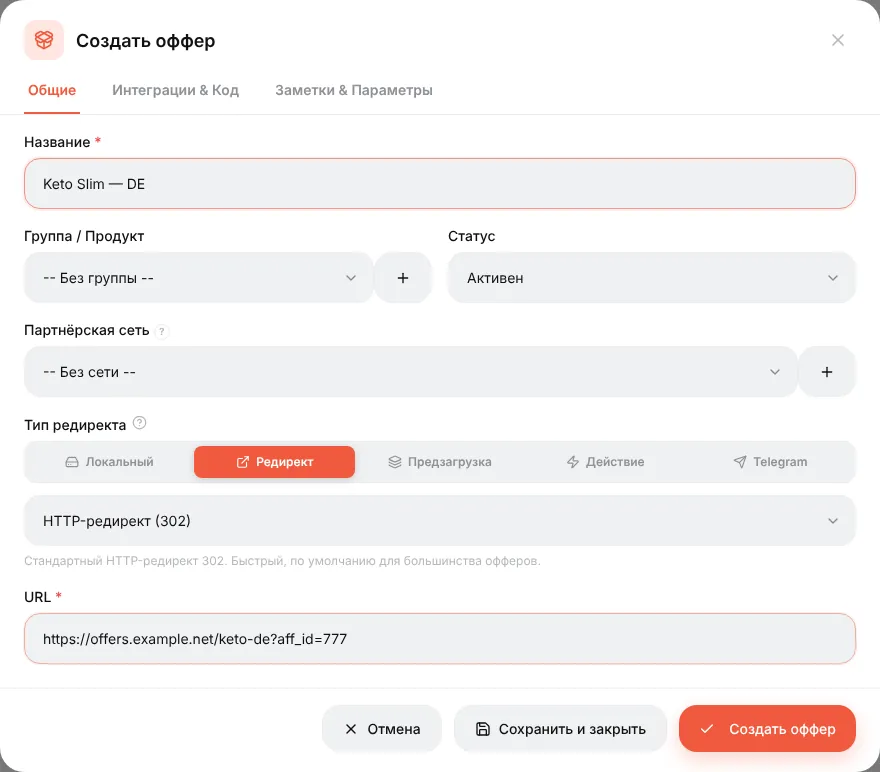
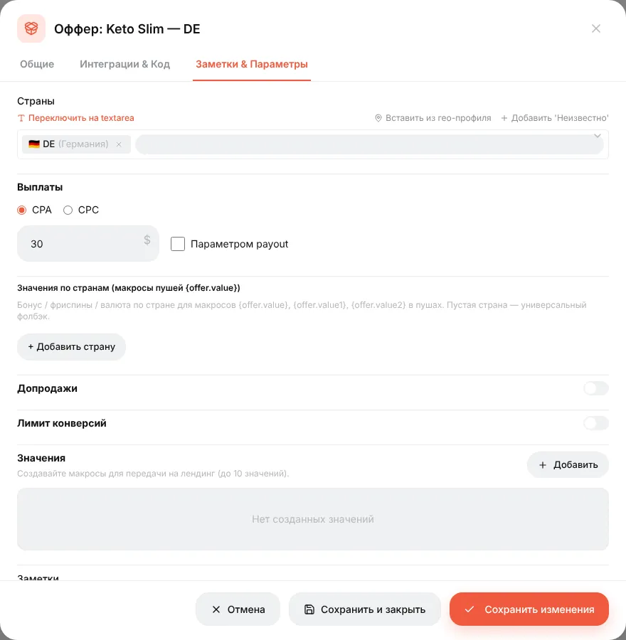
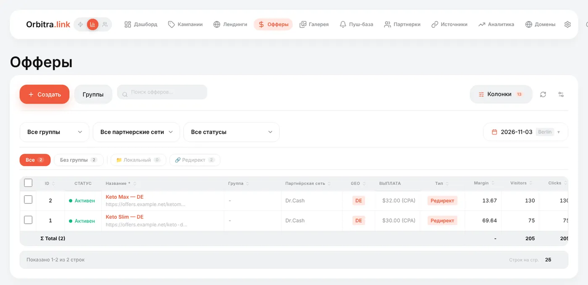

# Офферы и партнёрки

## Что это

- **Партнёрка** (партнёрская сеть: Dr.Cash, Leadbit, Everad…) — партнёр, у которого есть офферы и который платит вам за результат. В Orbitra запись партнёрки хранит две вещи: какие параметры добавлять к ссылкам её офферов и какой постбек-URL она должна вызывать.
- **Оффер** — конкретная страница продукта этой партнёрки: «Keto Slim, Германия, $30 за подтверждённую продажу». Ссылку на него берёте в кабинете партнёрки.

Партнёрку создаёте один раз, а потом добавляете сколько угодно её офферов. Изменение параметров партнёрки сразу действует на все её офферы.

## Как добавить партнёрку

**Партнерки → Создать**.

1. **Шаблон** — найдите свою сеть в списке (их около 440). Шаблон знает собственные названия макросов сети, поэтому он всегда лучше, чем писать параметры руками. Шаблона нет? Выберите **Generic**.
2. **Название** — любое.
3. Посмотрите на блок **Postback URL**: это адрес, который нужно вставить в кабинете партнёрки. Скопируйте сейчас или позже из списка партнёрок.

4. Откройте вкладку **Параметры**. Строка в поле параметров добавляется к каждой ссылке оффера этой партнёрки в момент клика. `&sub1={subid}` означает «положи ID клика Orbitra в поле `sub1` партнёрки».

Можно добавить больше, например `&sub2={country}&sub3={ad_id}` — список макросов под полем показывает, что доступно. Значения, которых у клика нет, становятся пустыми.

> ⚠️ Обязательно должен быть ID клика (`{subid}`) в том поле, которое партнёрка вернёт в постбеке. Без него конверсию не к чему привязать, и в отчётах будет ноль конверсий.

## Как добавить оффер

**Офферы → Создать**.

| Поле | Что указать |
|---|---|
| **Название** | Хорошая привычка — продукт + страна: `Keto Slim — DE` |
| **Группа / Продукт** | Необязательно, для фильтрации списков |
| **Партнёрская сеть** | Партнёрка — её параметры добавятся автоматически |
| **Тип редиректа** | **Редирект** — обычная ссылка оффера. **Локальный** — вы загружаете страницу оффера ZIP-архивом и хостите сами. **Предзагрузка** — страница подгружается и показывается под вашим доменом. **Действие** — «оффер» это действие (текст, 404, отправка в другую кампанию). **Telegram** — канал или бот Telegram как точка назначения |
| **HTTP-редирект (302)** | Способ редиректа. Оставьте 302, если партнёрка не просит иного |
| **URL** | Ссылка оффера из кабинета партнёрки. Не добавляйте `sub1=` сами — это сделают параметры партнёрки. Если вы всё же написали `sub1={subid}` в URL, он не задублируется |

На вкладке **Заметки & Параметры**:

- **Страны** — где оффер работает. Используется для фильтров и как подсказка в потоках;
- **Выплаты** — CPA (за конверсию) или CPC (за клик) и сумма. Реальная выплата обычно приходит в постбеке, это значение — запасное;
- **Лимит конверсий** — дневной кап; когда он выбран, трафик можно отправить на альтернативный оффер;
- **Значения** — до 10 своих значений, которые передаются на лендинг макросами; удобно для цен или названий, которые отличаются у разных офферов.

## Офферы в кампаниях

Оффер ничего не делает, пока на него не указывает поток. В потоке кампании нажмите **Добавить офферы** и отметьте один или несколько. При нескольких офферах трафик делится по весам (по умолчанию 50/50); **Разделить поровну** сбрасывает веса, а **AUTO** даёт трекеру самому переводить трафик на оффер, который зарабатывает больше. См. [Потоки](guide-streams.md).

Список **Офферы** показывает клики, конверсии, доход и ROI каждого оффера по всем кампаниям.

## Частые ошибки

| Симптом | Причина |
|---|---|
| В партнёрке лиды есть, в Orbitra нет | ID клика не попадает в поле, которое партнёрка возвращает (проверьте **Параметры** партнёрки и постбек-URL в кабинете партнёрки) |
| Лиды приходят, но не на тот оффер | Проверьте, что поток указывает на нужный оффер |
| Страница оффера открывается с буквальным `{subid}` в ссылке | URL поставили туда, где трекер его не обрабатывает (например, прямо в объявление). В рекламе всегда должна быть ссылка **кампании** |

Справка: [Источники трафика и партнёрки](sources-and-networks.md), [Affiliate network offer parameters](../affiliate-network-parameters.md) (EN).
