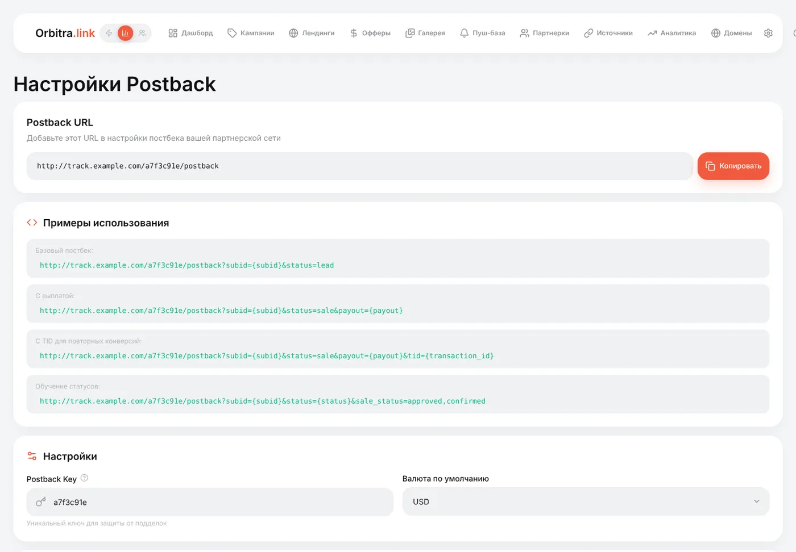
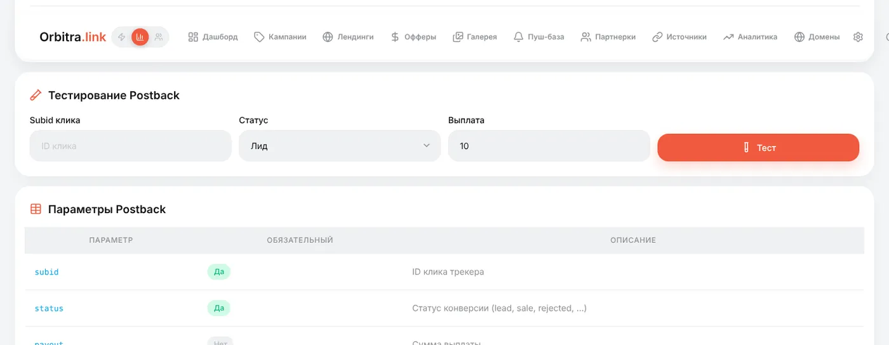
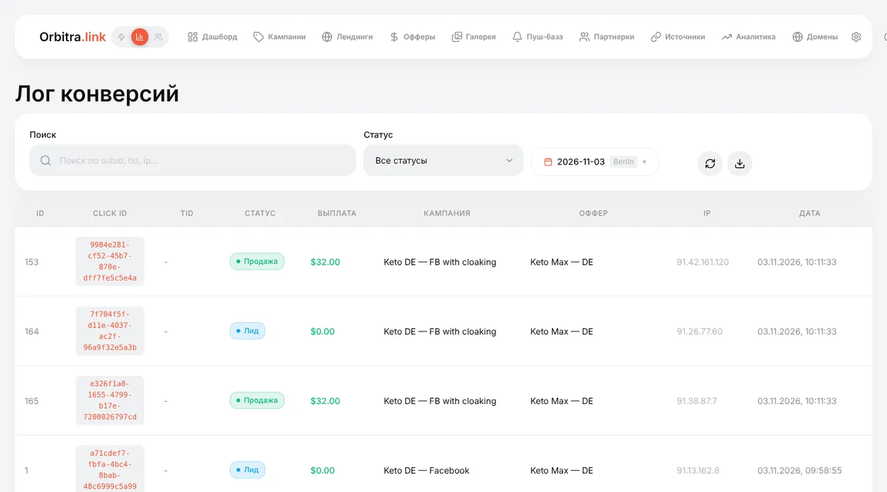
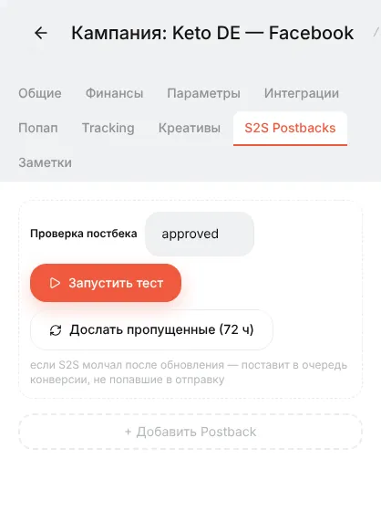

# Постбеки: что это и что написать менеджеру партнёрки

## Что такое постбек

Когда посетитель покупает на сайте рекламодателя, продажа фиксируется **в партнёрке**, а не в вашем трекере. Постбек — это партнёрка сообщает трекеру о продаже: короткий запрос «сервер → сервер» вида

```
https://track.example.com/a7f3c91e/postback?subid=0bc4ba11-688d-4de0-98b4-8b0d6e81cef&status=sale&payout=30
```

Он говорит: «клик `0bc4ba11…` сконвертился, статус *sale*, вам 30». Orbitra находит этот клик и с этого момента знает, какие кампания, поток, оффер, страна, объявление и креатив принесли деньги.

Без постбеков трекер считает клики, но не видит ни одной конверсии — доход, прибыль, ROI и CR остаются нулями.

## Как ID клика проходит круг

```
1. Посетитель кликает по рекламе → Orbitra создаёт клик 0bc4ba11…
2. Orbitra редиректит на оффер:  https://network/offer?aff=777&sub1=0bc4ba11…
                                                           ▲ добавлено «параметрами офферов» партнёрки
3. Партнёрка запоминает sub1 для этого посетителя
4. Посетитель покупает → партнёрка вызывает ваш постбек-URL и подставляет sub1 обратно:
       https://track.example.com/a7f3c91e/postback?subid=0bc4ba11…&status=sale&payout=30
5. Orbitra отмечает клик 0bc4ba11… как конверсию
```

Работает это благодаря двум настройкам:

- **параметры офферов** партнёрки в Orbitra (`&sub1={subid}`) — ID клика уходит **в** партнёрку;
- **постбек-URL** в кабинете партнёрки — ID клика возвращается **обратно**. Партнёрка подставляет вместо своего макроса (`{sub1}`, `{clickid}`, `[SUB1]` — у каждой сети по-своему) сохранённое значение.

Если партнёрка создана из шаблона, обе половины уже используют правильные названия.

## Где взять постбек-URL

- **Партнерки** → строка партнёрки (или редактор партнёрки) → **Postback URL**. Лучший вариант: в нём собственные названия макросов этой сети.
- **⚙ → Postback URL** — общий адрес и примеры для сетей, которых нет в шаблонах.



Параметры, которые понимает Orbitra:

| Параметр | Обязателен | Значение |
|---|---|---|
| `subid` | да | ID клика Orbitra — то, что партнёрка получила в `sub1` (или в выбранном вами поле) |
| `status` | нет | `lead`, `sale`, `rejected`, `trash`, `registration`, `deposit` или собственное слово сети (`approved`, `pending`, `declined`…) |
| `payout` | нет | Сколько вы получаете за эту конверсию |
| `currency` | нет | Если сеть платит в другой валюте — сумма пересчитывается в валюту трекера |
| `tid` | нет | ID транзакции; нужен, когда один клик может принести несколько конверсий (например, повторные депозиты) |

Собственные слова сетей переводятся в статусы автоматически (`approved`, `confirmed` → sale; `declined`, `cancelled` → rejected). Любое другое слово можно сопоставить прямо в URL: `&sale_status=approved,paid&lead_status=pending`. Слова, которые Orbitra не узнала, появляются в **⚙ → Настройки → Типы конверсий → Unmapped statuses** — там их можно назначить.

## Что написать менеджеру партнёрки

Большинство партнёрок настроят постбек за вас, если попросить. Отправьте примерно такое (подставьте свой URL):

> Привет! Настройте, пожалуйста, **глобальный постбек** на мой аккаунт (на все офферы):
>
> `https://track.example.com/a7f3c91e/postback?subid={sub1}&status={status}&payout={payout}`
>
> - Мой click ID передаётся в **sub1** ссылки оффера — верните его, пожалуйста, в `subid`.
> - Присылайте постбеки на **все статусы**: новый лид (hold/pending), подтверждение, отклонение и треш, с суммой выплаты для подтверждённых.
> - Метод GET подходит.
>
> И подскажите ваши макросы для click ID, статуса и выплаты, если они отличаются от `{sub1}`, `{status}`, `{payout}`. Спасибо!

Что проверить в ответе:

1. **В каком поле едет ваш click ID.** Если скажут «используйте `aff_sub`», поменяйте параметры офферов партнёрки в Orbitra на `&aff_sub={subid}`, а постбек — на `subid={aff_sub}`.
2. **Синтаксис макросов.** `{sub1}`, `[SUB1]`, `%sub1%`, `{{sub1}}` — копируйте ровно так, как у них.
3. **Слова статусов.** Если присылают `status=1/2/3` или русские слова — сопоставьте через `&sale_status=…&lead_status=…&rejected_status=…` или в **Типах конверсий**.
4. **Глобальный или на оффер.** Глобальный постбек покрывает все офферы; постбек на оффер нужно добавить в каждый оффер отдельно.

## Как проверить

1. Сделайте один настоящий клик по ссылке кампании (или возьмите клик из **⚙ → Логи → Трафик**) и скопируйте его ID.
2. **⚙ → Postback URL → Тестирование Postback**: вставьте ID клика, выберите статус, нажмите **Тест**.



3. Откройте **⚙ → Конверсии** — конверсия там, счётчики кампании изменились.

У многих партнёрок есть кнопка «тестовый постбек», которая шлёт запрос с выдуманным sub1. Orbitra ответит «клик не найден» — так и должно быть; это доказывает, что URL доступен.



**⚙ → Логи → Входящие Postbacks** — каждый пришедший запрос, включая отклонённые, с причиной. Первое место, куда смотреть, когда «партнёрка говорит, что отправила, а в трекере пусто».

## Отправка конверсий обратно в источник (S2S)

Некоторые источники трафика (пуш- и поп-сети, TikTok, часть нативных сетей) лучше оптимизируются, когда получают ваши конверсии. Это **исходящий** постбек, он настраивается на вкладке **S2S Postbacks** кампании. Если в шаблоне источника есть постбек-URL, новая кампания получит его автоматически. Кнопка **Запустить тест** там проверяет всю цепочку. Facebook и TikTok вместо этого используют Conversions API — см. [Facebook / Meta](facebook.md).



## Что делать, если не работает

| Симптом | Куда смотреть |
|---|---|
| Во **Входящих Postbacks** пусто | Партнёрка вас не вызывала: неверный URL в её кабинете или постбек настроен на другой оффер |
| «Клик не найден» | ID клика не передаётся: проверьте параметры офферов партнёрки и макрос в постбеке |
| «Неверный ключ» | В URL старый постбек-ключ. Партнёрка, созданная **до** смены ключа, хранит старый ключ в своём Postback URL — исправьте его в редакторе партнёрки и обновите в кабинете партнёрки |
| Конверсия записалась со статусом `custom` | Слово статуса не сопоставлено — исправьте в **Типах конверсий** |
| Выплата 0 | Партнёрка не подставляет `{payout}` или присылает под другим именем — добавьте алиас параметра на странице постбека |

Справка: [Постбеки и конверсии](postbacks.md).
