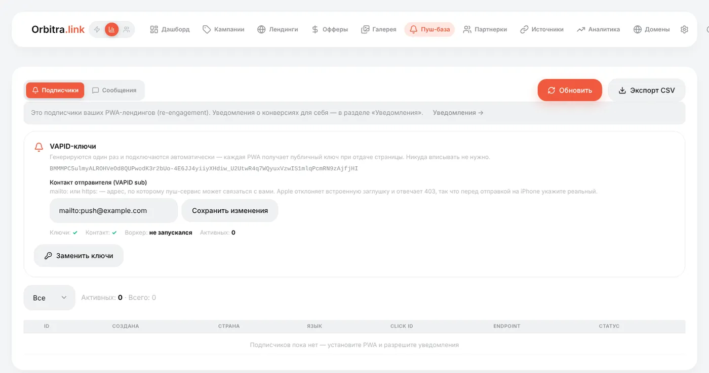
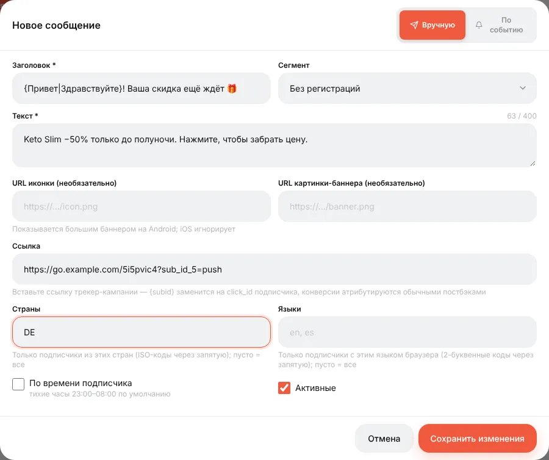
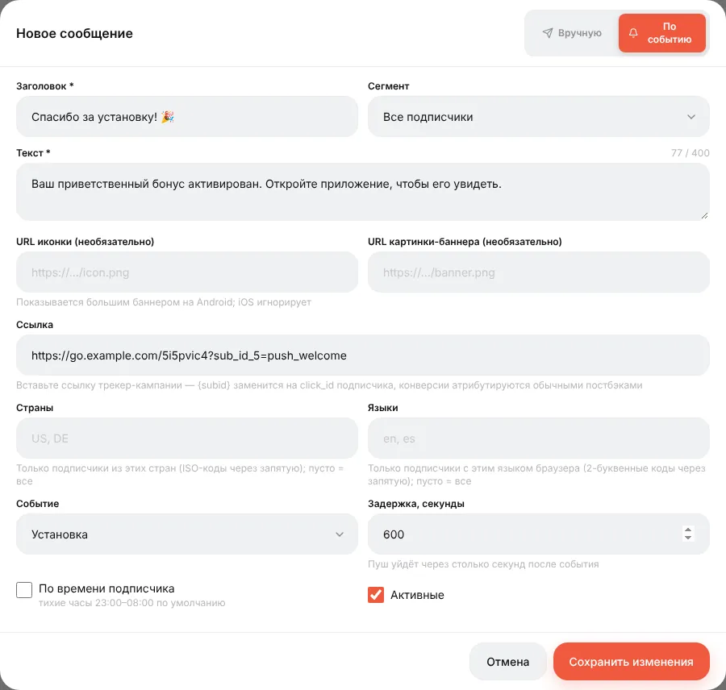
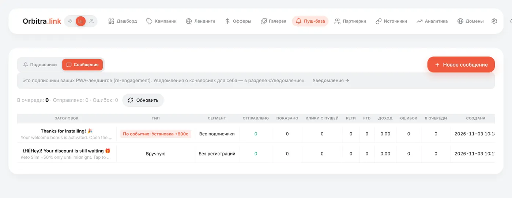

# Пуш-уведомления пользователям PWA

## Что это

Когда человек устанавливает ваше [PWA](guide-pwa.md), приложение может спросить: «Разрешить уведомления?». Каждый, кто согласился, становится **подписчиком** в вашей **Пуш-базе**. Дальше им можно бесплатно отправлять уведомления — напоминание, новый бонус, скидку, — а каждое нажатие на уведомление возвращает посетителя на оффер и привязывается к его исходному клику.

Orbitra делает всё на вашем сервере: база подписчиков, ключи шифрования, отправка. Google и Apple только доставляют сообщения на телефоны.

## Настройка

### 1. Ключи и контакт

Откройте **Пуш-база**.

1. **Контакт отправителя (VAPID sub)** — `mailto:you@yourdomain.com` (или адрес `https://`). Apple отклоняет уведомления с заглушкой вместо контакта, поэтому укажите настоящий. Нажмите **Сохранить изменения**.
2. **Сгенерировать ключи**. Всё — ключи (VAPID) автоматически передаются каждому PWA, вставлять никуда не нужно.



Полоса под ключами показывает состояние: **Ключи ✓**, **Контакт ✓**, **Воркер** (когда последний раз работала отправка) и число активных подписчиков.

> Генерируйте ключи один раз. **Заменить ключи** аннулирует все подписки; устройства переподпишутся при следующем открытии приложения, но до этого ничего не получат.

### 2. Запросите уведомления в PWA

В конструкторе PWA, шаг **Экраны**, отметьте **Пуш-уведомления** и сохраните. После установки приложение один раз предложит уведомления.

### 3. Убедитесь, что работает отправка

Уведомления рассылает фоновая задача раз в минуту (`cli/push_cron.php`). Установщик настраивает её сам. Если на боевом сервере **Воркер** пишет «никогда не запускался», проверьте cron:

```bash
crontab -u www-data -l | grep orbitra-push
```

## Подписчики

Вкладка **Подписчики** — сама база: страна, язык, ID клика, статус (активен / мёртв). Подписки отмирают сами, когда телефон удаляет приложение, — чистить не нужно.

Кнопка **Отправить** в строке подписчика мгновенно шлёт тестовый пуш на одно устройство, минуя очередь, — самый быстрый способ проверить всю цепочку на своём телефоне.

## Сообщения

**Сообщения → Новое сообщение**. Два вида:

- **Вручную** — вы нажимаете **Отправить**, и оно уходит.
- **По событию** — отправляется автоматически после события: **Установка**, **Лид** или **Продажа**, с выбранной задержкой (например, 600 секунд после установки).



| Поле | Советы |
|---|---|
| **Заголовок**, **Текст** | Коротко. `{Привет\|Здравствуйте}` выбирает случайный вариант для каждого получателя; `{subid}` и другие макросы клика подставляются при отправке |
| **Иконка**, **Картинка** | URL, удобно копировать из [Галереи](guide-gallery.md). Большая картинка показывается только на Android |
| **Ссылка** | Куда ведёт нажатие. Ставьте ссылку кампании (можно с `sub_id_5=push`, чтобы видеть пуши в отчётах) |
| **Сегмент** | Все подписчики / без регистрации / с регистрацией без депозита / с депозитом — строится по конверсиям клика каждого подписчика |
| **Страны**, **Языки** | Сузить аудиторию: `DE`, `de` |



Список сообщений показывает по каждому: отправлено, просмотрено, клики по пушу и что эти клики принесли — регистрации, FTD, доход.



## Хорошие практики

- Начните с сообщения по событию **Установка** («Спасибо за установку! Бонус ждёт») — у него лучший CTR.
- Ручные рассылки отправляйте в разумное местное время и не спамьте — каждая отписка это потерянный канал.
- «Отправлено» значит, что пуш-сервис принял сообщение; покажет ли его телефон — решает только телефон. Сначала проверьте на своём устройстве.

Справка: [PWA и Web Push](pwa-push.md).
