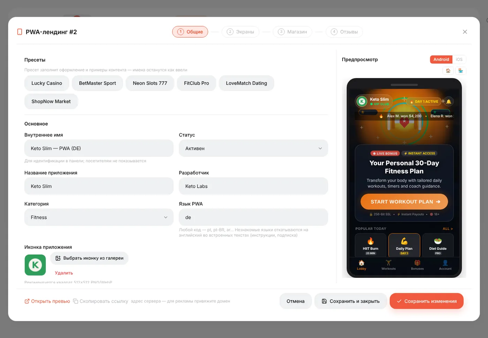
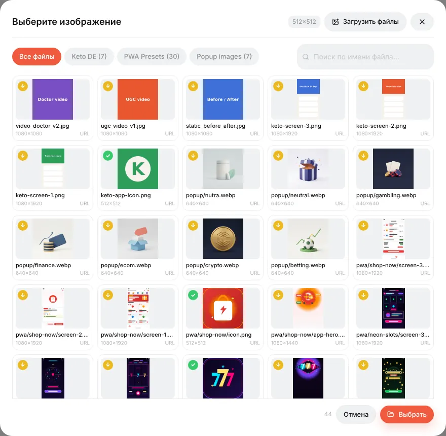
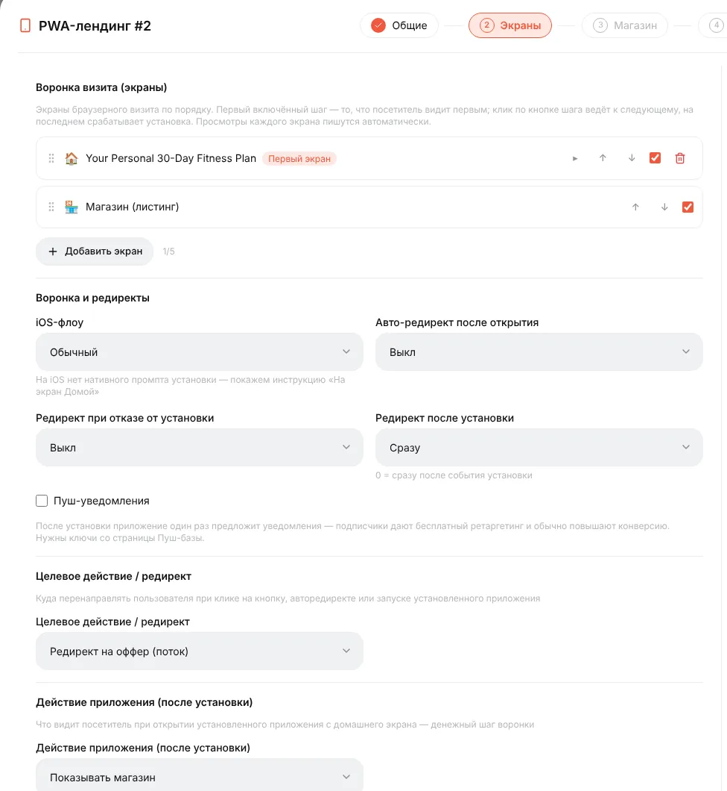
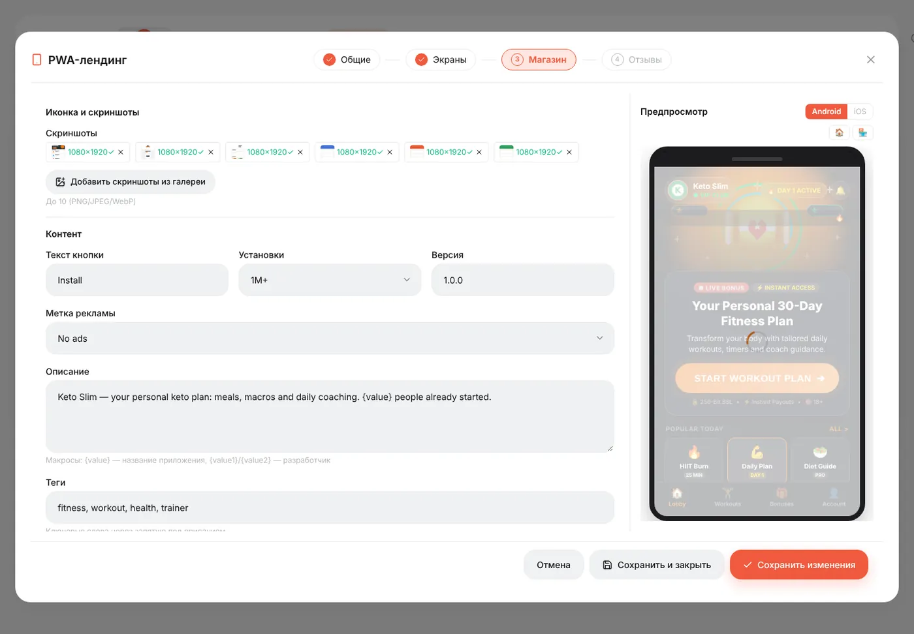
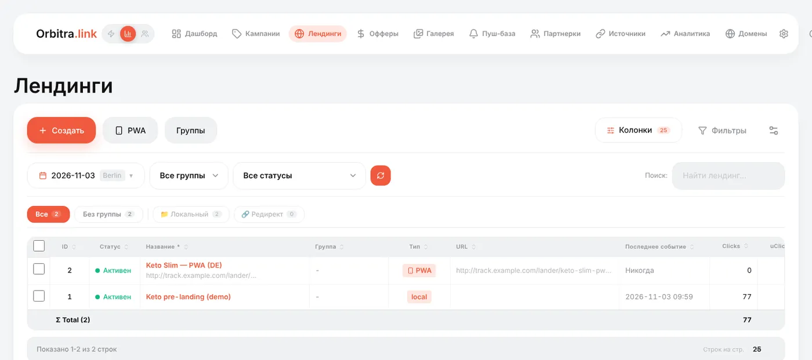

# PWA-приложения

## Что такое PWA

**PWA** (Progressive Web App) — сайт, который посетитель может **установить** на главный экран телефона. У него появляется иконка, он открывается на весь экран без строки браузера и выглядит как приложение. Orbitra собирает такое за несколько минут:

1. Посетитель кликает по рекламе и попадает на страницу, похожую на карточку в магазине приложений (Google Play на Android, App Store на iPhone): иконка, рейтинг, отзывы, скриншоты, кнопка **Установить**.
2. Нажимает **Установить** → браузер показывает своё окно установки → иконка приложения появляется на главном экране.
3. При открытии приложение показывает ваш **экран** (денежный шаг) и отправляет на оффер.
4. По желанию приложение просит разрешить **пуш-уведомления** — и у вас появляется подписчик, которому потом можно бесплатно писать. → [Пуш-уведомления](guide-push.md)

Зачем? Установленное приложение оставляет прямой канал к посетителю: он возвращается по иконке без нового платного клика, а пуши возвращают его снова. PWA популярны в гемблинге, беттинге, дейтинге и подписочных офферах.

В Orbitra PWA — особый вид **лендинга**, поэтому он используется в кампаниях, потоках, клоакинге и отчётах как любой лендинг.

## Как собрать

**Лендинги → PWA**. Конструктор из четырёх шагов с живым превью телефона справа.

### Шаг 1. Общие

- **Пресеты** одним кликом заполняют дизайн и примеры контента (казино, беттинг, фитнес, дейтинг, магазин…). Ваши названия остаются как введены.
- **Внутреннее имя** (видите только вы), **Название приложения**, **Разработчик**, **Категория**, **Язык PWA**.
- **Иконка приложения** — **Выбрать иконку из галереи**. Пикер отмечает картинки, подходящие под 512×512; большую можно тут же обрезать. → [Галерея контента](guide-gallery.md)
- **Домен** — необязательно; см. [Чистый домен для приложения](#чистый-домен-для-приложения).
- **Оформление** — стиль магазина (Auto выбирает Google Play или App Store по телефону посетителя), тема, цвета, бейджи и эффекты.

Блок **Готовность к установке** — чек-лист: иконка, описание, скриншоты правильного размера и пуш-ключи. Когда всё зелёное, Chrome показывает большое окно установки «как в магазине» вместо простого запроса.

### Шаг 2. Экраны

- **Воронка визита (экраны)** — что видит посетитель, по порядку. Первый экран — часть-лендинг; карточка магазина запускает установку. Добавьте экраны для квиза или колеса бонусов перед магазином.
- **Воронка и редиректы** — что происходит после установки или при отказе; на iOS нет нативного окна установки, поэтому можно показать инструкцию «На экран Домой».
- **Пуш-уведомления** — отметьте, чтобы просить установивших разрешить уведомления (нужны ключи на странице Пуш-база).
- **Целевое действие / редирект** — куда ведёт кнопка: оффер из потока, кампания или URL.
- **Действие приложения (после установки)** — что открывается, когда пользователь нажимает иконку на главном экране.

### Шаг 3. Магазин

Тексты карточки: текст кнопки, количество загрузок, версия, **описание** (`{value}` подставляет растущее число), теги, рейтинг и **скриншоты** из галереи.

### Шаг 4. Отзывы

Отзывы пользователей в карточке. Отредактируйте или оставьте из пресета.

Нажмите **Сохранить изменения**. **Открыть превью** внизу покажет настоящую страницу.

## PWA в кампании

PWA используется как лендинг: в потоке выберите **Лендинг + Оффер**, нажмите **Добавить лендинги**, выберите PWA, затем **Добавить офферы**. Путь посетителя: реклама → ссылка кампании → карточка PWA → установка → приложение → оффер, и каждый шаг привязан к исходному клику.

### Чистый домен для приложения

Можно привязать домен к PWA (шаг 1 → **Домен** или в настройках домена). Тогда `https://app-domain.com/` сразу открывает карточку приложения — короткая чистая ссылка, с которой удобно ставить. Визиты без кампании записываются как органические клики; выберите оффер рядом с доменом, чтобы кнопке было куда вести. Один домен — один PWA.

## Статистика

В списке **Лендинги** и отчётах кампаний есть колонки PWA:

| Колонка | Значение |
|---|---|
| **PWA Intent** | Нажатия **Установить** (до окна браузера) |
| **Real PWA Inst** | Завершённые установки реальными посетителями (боты исключены) |
| **PWA Opens** | Повторные открытия установленного приложения с главного экрана |
| **PWA CR** | Реальные установки ÷ клики |
| **Push subs** | Посетители, разрешившие уведомления |

Цифры по экранам (сколько людей увидели каждый экран воронки) — на карточке воронки PWA. → [PWA Funnel](../pwa-funnel.md) (EN)

## Полезно знать

- Для установки нужен **HTTPS** — используйте домен с сертификатом, а не голый IP.
- Встроенные браузеры (Facebook, Instagram, TikTok) не умеют ставить приложения. PWA показывает там карточку «откройте в браузере», а опция *Auto-open in browser* пытается выйти из встроенного браузера автоматически.
- На iPhone ставят через **Поделиться → На экран «Домой»**; на iOS PWA сам это объясняет.

Справка: [PWA и Web Push](pwa-push.md), [PWA Funnel](../pwa-funnel.md) (EN), [Внешние PWA и Telegram-каналы](external-pwa-telegram.md).
