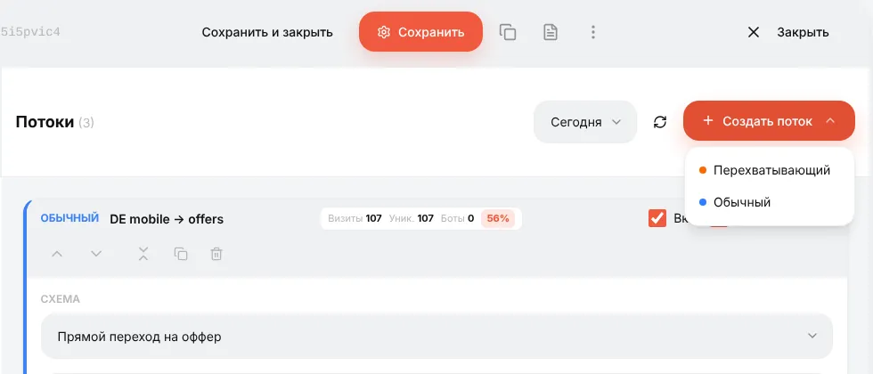
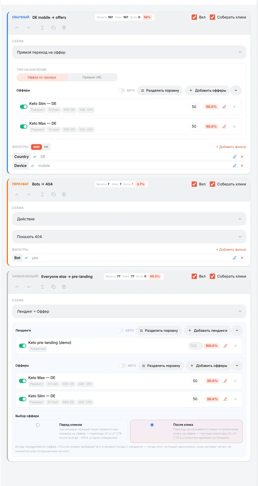
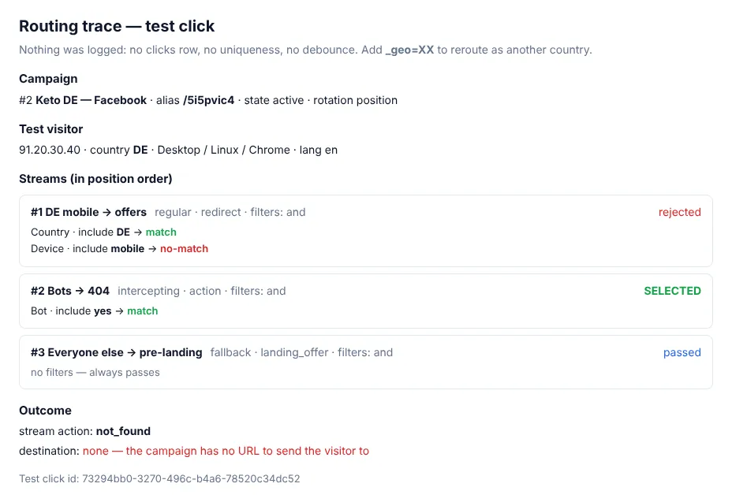

# Потоки: как распределяется трафик в кампании

## Что такое поток

У кампании одна ссылка, а посетители разные: разные страны, телефоны и компьютеры, живые люди и боты. **Потоки** — правила, которые решают, что получит каждый посетитель. У каждого потока есть:

- **фильтры** — для кого он (страна, устройство, браузер, параметр URL…);
- **схема** — что с ними делать (отправить на оффер, сначала показать лендинг, показать 404, клоачить).

Когда посетитель открывает ссылку кампании, Orbitra перебирает потоки и выбирает **один**.

## Три типа потоков

**Создать поток** предлагает три типа:

| Тип | Проверяется | Для чего |
|---|---|---|
| **Перехватывающий** | Первым, раньше всех | Исключения, которые должны победить: боты, модераторы, конкретный тестовый IP, «стоп-кран» |
| **Обычный** | Вторым | Основной трафик: «DE + телефон → оффер A», «AT → оффер B» |
| **Замыкающий** | Последним — только если ничто не подошло | «Все остальные»: запасной оффер, прелендинг, safe page |

Кампания только с обычными потоками и без замыкающего оставляет неподошедших посетителей ни с чем — всегда добавляйте замыкающий.

Вот кампания из примера со всеми тремя:

- **Bots → 404** (перехватывающий, фильтр *Бот = да*, действие *Показать 404*) — краулеры никогда не дойдут до оффера;
- **DE mobile → offers** (обычный, фильтры *Страна = DE* и *Устройство = телефон*) — денежный трафик, поделённый между двумя офферами;
- **Everyone else → pre-landing** (замыкающий, без фильтров) — лендинг с теми же офферами.

Карточки потоков идут в порядке создания; приоритет определяет **тип**, а не место на экране.

## Как выбирается обычный поток

Когда одному посетителю подходят несколько обычных потоков, решает **Тип ротации** кампании (вкладка **Общие**):

- **По позиции** — побеждает первый подходящий поток сверху. Порядок меняется стрелками на карточке. Подходит, когда потоки идут «от частного к общему»: сначала «DE + iPhone», потом «DE», потом «EU».
- **По весу** — подходящие потоки делят трафик пропорционально весам. Подходит для сплит-теста целых воронок: поток A (лендинг 1 + оффер) 50%, поток B (лендинг 2 + оффер) 50%.

## Деление внутри потока: офферы и лендинги

В один поток можно добавить несколько офферов (а в схеме *Лендинг + Оффер* — и несколько лендингов). У каждого вес; процент рядом показывает его долю.

- **Разделить поровну** ставит одинаковые веса.
- Переключатель у элемента выключает его, не удаляя.
- **AUTO** включает автооптимизацию: трекер пересчитывает веса по выбранной метрике (подтверждённые продажи, CR, EPC, EPV или ROI) за окно в днях, с минимумом продаж до участия и границами доли. Пока AUTO включён, ручные веса заблокированы. Включайте, когда у каждого элемента набралось достаточно трафика; на свежей кампании оставьте ручные веса.

## Схемы — что делает поток

| Схема | Что получает посетитель |
|---|---|
| **Прямой переход на оффер** | Редирект сразу на оффер (или на прямой URL) |
| **Лендинг + Оффер** | Сначала ваш лендинг; кнопка на нём ведёт на оффер |
| **Действие** | Ничего не делать, показать 404, показать текст или HTML, отправить в другую кампанию |
| **Cloaking** | Боты и модераторы получают safe page, люди — денежную страницу; см. [Клоакинг](guide-cloaking.md) |

**Выбор оффера** в схеме *Лендинг + Оффер*: оставьте **После клика** (по умолчанию). Тогда оффер выбирается, когда посетитель действительно нажимает кнопку, и LP clicks и LP CTR честные.

## Другие переключатели на карточке потока

- **Вкл.** — выключить поток, не удаляя.
- **Собирать клики** — если выключено, посетитель всё равно направляется, но клик не записывается. Полезно для замыкающих потоков и white page, чтобы мусорный трафик не портил CR; но к незаписанному клику не привяжется конверсия.
- Плашки **Visits / Uniq / Bots / %** показывают трафик потока за сегодня (или выбранный период) и его долю в кампании — быстрый способ увидеть, сколько ушло на safe page, а сколько на оффер.

## Проверка маршрутизации

**Тестовая ссылка** на вкладке **Общие** с `&_dbg=1` показывает решение для вашего браузера: каждый поток, голос каждого фильтра, выбранный поток и итоговый URL. В статистику ничего не пишется.

- `&_geo=AT` — «оказаться» в другой стране;
- откройте ссылку с телефона, чтобы проверить мобильные потоки;
- **⚙ → Симуляция трафика** позволяет из панели проверить любой IP, User-Agent, страну, устройство и язык.

Справка: [Кампании и потоки](campaigns.md).
